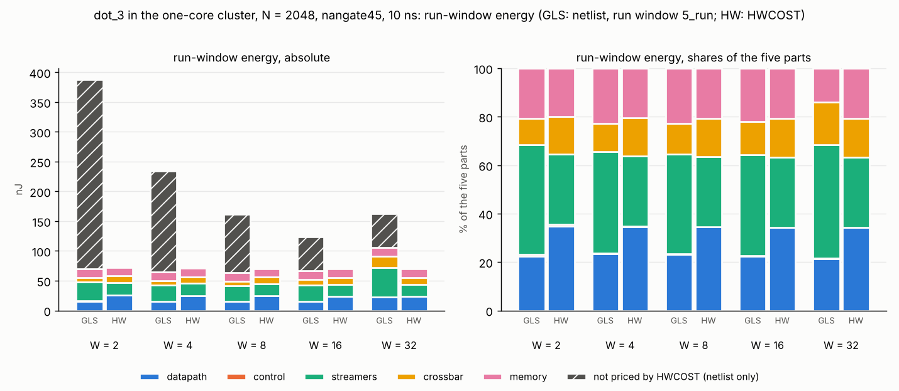
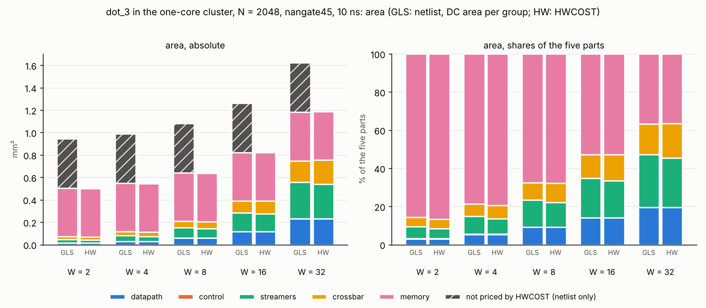
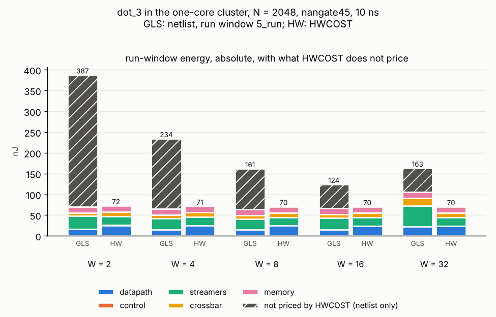
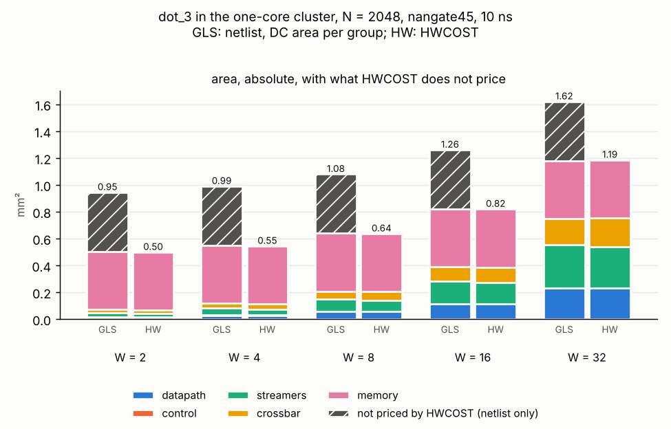

# PWR2 R2 run note (2026-11-13, Claude in the chat)

PWR2 ran dot_3 at W = 2, 4, 8 and 32 through the whole cluster flow overnight (R1, `2026-11-13_pwr2_r1.md`), beside PWR1's W = 16. This round lays the five points out side by side, the netlist beside snax-forge's HWCOST, for Ryan to read: the run window (`5_run`, the busy section, X73) and the area, each in HWCOST's five parts plus what HWCOST does not price, absolute and in %. No normalization and no check on the trend (X78).

## What ran

Claude in the chat, on R1's committed results only (no tool run): `report/cluster_sweep.py` (`pixi run cluster-sweep [--md]`, test `cluster-sweep-test`, 3 tests) on `results/cluster/nangate45/breakdown.json` and `energy.json`, writing `sweep.csv` (580 rows), `sweep_energy.png` and `sweep_area.png` beside them. Python 3.13 and matplotlib 3.11.2 in the sandbox; a second run gives the same bytes. `report/test_cluster_energy.py` still passes. HWCOST's numbers are R1's `hwcost/<point>.json` (snax-forge `b29bf0c0`; `dot3_w16`'s from PWR1 at `299ef01`, equal to a reprice at `f99d2d6` in the plan's preview).

Each side's % of the five parts is  = E_p / \sum_q E_q$ over datapath, control, streamers, crossbar and memory; the netlist's energy also as % of its whole run window and its area as % of the cluster.

## Figures

The absolute panels alone (added 13 Nov after #15, Ryan): the netlist's bar with what HWCOST does not price on top, each bar's total above it.

## Tables (`pixi run cluster-sweep --md`)

Across W (run window `5_run`; span = the first mark to the end of the last DMA out, X73):

| W | point | run cycles | run nJ | five parts nJ | HWCOST nJ | span cycles | span nJ | area µm² | five parts µm² | HWCOST µm² |
|---:|---|---:|---:|---:|---:|---:|---:|---:|---:|---:|
| 2 | `dot3_w2` | 1,085 | 387.41 | 70.40 | 72.47 | 1,801 | 663.48 | 945,145 | 504,717 | 499,344 |
| 4 | `dot3_w4` | 574 | 233.95 | 64.65 | 71.00 | 1,307 | 528.63 | 990,408 | 549,982 | 545,313 |
| 8 | `dot3_w8` | 322 | 161.43 | 64.09 | 70.41 | 1,055 | 482.75 | 1,080,530 | 640,041 | 637,305 |
| 16 | `dot3_w16` | 185 | 123.99 | 66.44 | 69.92 | 901 | 491.10 | 1,261,630 | 821,185 | 820,755 |
| 32 | `dot3_w32` | 190 | 162.76 | 105.58 | 69.93 | 923 | 643.33 | 1,621,112 | 1,180,729 | 1,186,570 |

### W = 2 (`dot3_w2`), run window 1,085 cycles

Energy:

| part | netlist nJ | % of five | % of run | HWCOST nJ | % of five |
|---|---:|---:|---:|---:|---:|
| datapath | 15.76 | 22.4 % | 4.1 % | 25.31 | 34.9 % |
| control | 0.53 | 0.8 % | 0.1 % | 0.52 | 0.7 % |
| streamers | 31.93 | 45.3 % | 8.2 % | 20.92 | 28.9 % |
| crossbar | 7.54 | 10.7 % | 1.9 % | 11.22 | 15.5 % |
| memory | 14.65 | 20.8 % | 3.8 % | 14.50 | 20.0 % |
| the five parts | 70.40 | 100 % | 18.2 % | 72.47 | 100 % |
| not priced by HWCOST (AXI, DMA, cores, I-cache, TCDM bank logic, ...) | 317.01 | | 81.8 % | | |
| run window | 387.41 | | 100 % | | |

Area:

| part | netlist µm² | % of five | % of cluster | HWCOST µm² | % of five |
|---|---:|---:|---:|---:|---:|
| datapath | 14,939 | 3.0 % | 1.6 % | 14,932 | 3.0 % |
| control | 756 | 0.1 % | 0.1 % | 713 | 0.1 % |
| streamers | 32,418 | 6.4 % | 3.4 % | 25,796 | 5.2 % |
| crossbar | 23,878 | 4.7 % | 2.5 % | 25,177 | 5.0 % |
| memory | 432,726 | 85.7 % | 45.8 % | 432,726 | 86.7 % |
| the five parts | 504,717 | 100 % | 53.4 % | 499,344 | 100 % |
| not priced by HWCOST | 440,428 | | 46.6 % | | |
| cluster | 945,145 | | 100 % | | |

The accelerator's shell (csr, control, datapath) against `done/dot/forge3_w2` alone:

| shell | cycles | pJ/cycle | nJ | µm² |
|---|---:|---:|---:|---:|
| in the cluster, run window | 1,085 | 15.98 | 17.33 | 16,755 |
| alone, busy window, rand64 seed 0 | 1,025 | 25.53 | 26.17 | 16,767 |

### W = 4 (`dot3_w4`), run window 574 cycles

Energy:

| part | netlist nJ | % of five | % of run | HWCOST nJ | % of five |
|---|---:|---:|---:|---:|---:|
| datapath | 15.09 | 23.3 % | 6.4 % | 24.51 | 34.5 % |
| control | 0.28 | 0.4 % | 0.1 % | 0.26 | 0.4 % |
| streamers | 27.10 | 41.9 % | 11.6 % | 20.51 | 28.9 % |
| crossbar | 7.54 | 11.7 % | 3.2 % | 11.22 | 15.8 % |
| memory | 14.65 | 22.7 % | 6.3 % | 14.50 | 20.4 % |
| the five parts | 64.65 | 100 % | 27.6 % | 71.00 | 100 % |
| not priced by HWCOST (AXI, DMA, cores, I-cache, TCDM bank logic, ...) | 169.30 | | 72.4 % | | |
| run window | 233.95 | | 100 % | | |

Area:

| part | netlist µm² | % of five | % of cluster | HWCOST µm² | % of five |
|---|---:|---:|---:|---:|---:|
| datapath | 29,308 | 5.3 % | 3.0 % | 29,293 | 5.4 % |
| control | 756 | 0.1 % | 0.1 % | 713 | 0.1 % |
| streamers | 51,982 | 9.5 % | 5.2 % | 44,740 | 8.2 % |
| crossbar | 35,211 | 6.4 % | 3.6 % | 37,840 | 6.9 % |
| memory | 432,726 | 78.7 % | 43.7 % | 432,726 | 79.4 % |
| the five parts | 549,982 | 100 % | 55.5 % | 545,313 | 100 % |
| not priced by HWCOST | 440,425 | | 44.5 % | | |
| cluster | 990,408 | | 100 % | | |

The accelerator's shell (csr, control, datapath) against `done/dot/forge3_w4` alone:

| shell | cycles | pJ/cycle | nJ | µm² |
|---|---:|---:|---:|---:|
| in the cluster, run window | 574 | 27.74 | 15.92 | 31,124 |
| alone, busy window, rand64 seed 0 | 513 | 48.05 | 24.65 | 31,127 |

### W = 8 (`dot3_w8`), run window 322 cycles

Energy:

| part | netlist nJ | % of five | % of run | HWCOST nJ | % of five |
|---|---:|---:|---:|---:|---:|
| datapath | 14.91 | 23.3 % | 9.2 % | 24.25 | 34.4 % |
| control | 0.16 | 0.2 % | 0.1 % | 0.13 | 0.2 % |
| streamers | 26.28 | 41.0 % | 16.3 % | 20.31 | 28.8 % |
| crossbar | 8.10 | 12.6 % | 5.0 % | 11.22 | 15.9 % |
| memory | 14.65 | 22.9 % | 9.1 % | 14.50 | 20.6 % |
| the five parts | 64.09 | 100 % | 39.7 % | 70.41 | 100 % |
| not priced by HWCOST (AXI, DMA, cores, I-cache, TCDM bank logic, ...) | 97.34 | | 60.3 % | | |
| run window | 161.43 | | 100 % | | |

Area:

| part | netlist µm² | % of five | % of cluster | HWCOST µm² | % of five |
|---|---:|---:|---:|---:|---:|
| datapath | 58,042 | 9.1 % | 5.4 % | 58,012 | 9.1 % |
| control | 756 | 0.1 % | 0.1 % | 713 | 0.1 % |
| streamers | 91,070 | 14.2 % | 8.4 % | 82,519 | 12.9 % |
| crossbar | 57,447 | 9.0 % | 5.3 % | 63,334 | 9.9 % |
| memory | 432,726 | 67.6 % | 40.0 % | 432,726 | 67.9 % |
| the five parts | 640,041 | 100 % | 59.2 % | 637,305 | 100 % |
| not priced by HWCOST | 440,489 | | 40.8 % | | |
| cluster | 1,080,530 | | 100 % | | |

The accelerator's shell (csr, control, datapath) against `done/dot/forge3_w8` alone:

| shell | cycles | pJ/cycle | nJ | µm² |
|---|---:|---:|---:|---:|
| in the cluster, run window | 322 | 47.74 | 15.37 | 59,858 |
| alone, busy window, rand64 seed 0 | 257 | 92.72 | 23.83 | 59,845 |

### W = 16 (`dot3_w16`), run window 185 cycles

Energy:

| part | netlist nJ | % of five | % of run | HWCOST nJ | % of five |
|---|---:|---:|---:|---:|---:|
| datapath | 14.88 | 22.4 % | 12.0 % | 23.92 | 34.2 % |
| control | 0.09 | 0.1 % | 0.1 % | 0.07 | 0.1 % |
| streamers | 27.71 | 41.7 % | 22.3 % | 20.21 | 28.9 % |
| crossbar | 9.11 | 13.7 % | 7.3 % | 11.22 | 16.1 % |
| memory | 14.65 | 22.0 % | 11.8 % | 14.50 | 20.7 % |
| the five parts | 66.44 | 100 % | 53.6 % | 69.92 | 100 % |
| not priced by HWCOST (AXI, DMA, cores, I-cache, TCDM bank logic, ...) | 57.55 | | 46.4 % | | |
| run window | 123.99 | | 100 % | | |

Area:

| part | netlist µm² | % of five | % of cluster | HWCOST µm² | % of five |
|---|---:|---:|---:|---:|---:|
| datapath | 115,506 | 14.1 % | 9.2 % | 115,450 | 14.1 % |
| control | 756 | 0.1 % | 0.1 % | 713 | 0.1 % |
| streamers | 169,312 | 20.6 % | 13.4 % | 158,090 | 19.3 % |
| crossbar | 102,884 | 12.5 % | 8.2 % | 113,776 | 13.9 % |
| memory | 432,726 | 52.7 % | 34.3 % | 432,726 | 52.7 % |
| the five parts | 821,185 | 100 % | 65.1 % | 820,755 | 100 % |
| not priced by HWCOST | 440,445 | | 34.9 % | | |
| cluster | 1,261,630 | | 100 % | | |

The accelerator's shell (csr, control, datapath) against `done/dot/forge3_w16` alone:

| shell | cycles | pJ/cycle | nJ | µm² |
|---|---:|---:|---:|---:|
| in the cluster, run window | 185 | 81.87 | 15.15 | 117,322 |
| alone, busy window, rand64 seed 0 | 129 | 181.61 | 23.43 | 117,278 |

### W = 32 (`dot3_w32`), run window 190 cycles

Energy:

| part | netlist nJ | % of five | % of run | HWCOST nJ | % of five |
|---|---:|---:|---:|---:|---:|
| datapath | 22.63 | 21.4 % | 13.9 % | 24.01 | 34.3 % |
| control | 0.10 | 0.1 % | 0.1 % | 0.03 | 0.0 % |
| streamers | 49.61 | 47.0 % | 30.5 % | 20.17 | 28.8 % |
| crossbar | 18.59 | 17.6 % | 11.4 % | 11.22 | 16.1 % |
| memory | 14.65 | 13.9 % | 9.0 % | 14.50 | 20.7 % |
| the five parts | 105.58 | 100 % | 64.9 % | 69.93 | 100 % |
| not priced by HWCOST (AXI, DMA, cores, I-cache, TCDM bank logic, ...) | 57.19 | | 35.1 % | | |
| run window | 162.76 | | 100 % | | |

Area:

| part | netlist µm² | % of five | % of cluster | HWCOST µm² | % of five |
|---|---:|---:|---:|---:|---:|
| datapath | 230,437 | 19.5 % | 14.2 % | 230,322 | 19.4 % |
| control | 756 | 0.1 % | 0.0 % | 713 | 0.1 % |
| streamers | 325,740 | 27.6 % | 20.1 % | 309,231 | 26.1 % |
| crossbar | 191,070 | 16.2 % | 11.8 % | 213,577 | 18.0 % |
| memory | 432,726 | 36.6 % | 26.7 % | 432,726 | 36.5 % |
| the five parts | 1,180,729 | 100 % | 72.8 % | 1,186,570 | 100 % |
| not priced by HWCOST | 440,383 | | 27.2 % | | |
| cluster | 1,621,112 | | 100 % | | |

The accelerator's shell (csr, control, datapath) against `done/dot/forge3_w32` alone:

| shell | cycles | pJ/cycle | nJ | µm² |
|---|---:|---:|---:|---:|
| in the cluster, run window | 190 | 120.60 | 22.91 | 232,253 |
| alone, busy window, rand64 seed 0 | 65 | 357.36 | 23.23 | 232,142 |

## From R1, for Ryan (not traced here)

R1's "looks off" list stands as written in `2026-11-13_pwr2_r1.md`: `dot3_w32`'s busy counter (118) below the two-operand bank floor of 128; longer configuration and DMA-out windows at W = 4 and 8; max-capacitance nets at W = 32 (123) and W = 4 (2); HWCOST's extrapolation at W = 32. R1's two fixes are in `cluster/check.py` (`1f886966`, `0a01d347`).

## Decisions and docs

X78 in `docs/DECISIONS.md` (and its index row); `pixi.toml` gains `cluster-sweep` and `cluster-sweep-test`; `cluster/README.md` names the points so far, the command and the new files; `README.md`'s round table and `report/` row.
