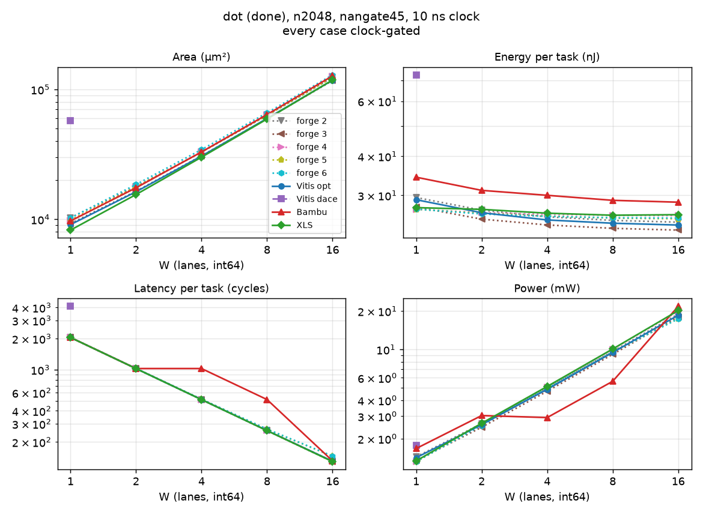

# dot (tier done)

forge's figures exclude `<tag>_peripherals` (BUSY_COUNTER, snax-forge D168): it is in neither the csr nor the total without csr.

Part of [the comparison](../README.md): setup, summary across kernels and the parts' basis are there.

<!-- gen:main -->

n2048, nangate45, int64, 10 ns, every case clock-gated.

[forge's ctrl + datapath against the HLS totals](dot_ctrl_dp.png): forge without its csr, its `<tag>_peripherals` and its glue; the HLS cases as above.

| W | Case | Area (µm²) | Energy (nJ) | Latency (cycles) | Power (mW) |
|---|---|---|---|---|---|
| 1 | forge 2 | 10,307 | 29.53 | 2050 | 1.44 |
| 1 | forge 3 | 9,262 | 27.56 | 2049 | 1.345 |
| 1 | forge 4 | 9,864 | 27.09 | 2050 | 1.321 |
| 1 | forge 5 | 9,866 | 27.09 | 2050 | 1.321 |
| 1 | forge 6 | 10,244 | 27.12 | 2051 | 1.322 |
| 1 | Vitis opt | 9,100 | 29.06 | 2050 | 1.418 |
| 1 | Vitis dace | 57,610 | 72.79 | 4101 | 1.775 |
| 1 | Bambu | 9,708 | 34.29 | 2050 | 1.673 |
| 1 | XLS | 8,257 | 27.42 | 2049 | 1.338 |
| 2 | forge 2 | 17,860 | 26.91 | 1026 | 2.623 |
| 2 | forge 3 | 16,441 | 25.19 | 1025 | 2.457 |
| 2 | forge 4 | 17,616 | 26.42 | 1026 | 2.575 |
| 2 | forge 5 | 17,771 | 26.31 | 1027 | 2.562 |
| 2 | forge 6 | 18,530 | 26.17 | 1028 | 2.545 |
| 2 | Vitis opt | 16,292 | 26.41 | 1026 | 2.574 |
| 2 | Bambu | 17,469 | 31.13 | 1026 | 3.034 |
| 2 | XLS | 15,509 | 27.07 | 1025 | 2.641 |
| 4 | forge 2 | 32,968 | 25.62 | 514 | 4.985 |
| 4 | forge 3 | 30,799 | 24.13 | 513 | 4.704 |
| 4 | forge 4 | 33,116 | 26.11 | 514 | 5.079 |
| 4 | forge 5 | 32,893 | 25.76 | 517 | 4.983 |
| 4 | forge 6 | 34,402 | 25.71 | 518 | 4.963 |
| 4 | Vitis opt | 30,677 | 25.04 | 514 | 4.871 |
| 4 | Bambu | 32,990 | 30.01 | 1026 | 2.925 |
| 4 | XLS | 30,076 | 26.32 | 513 | 5.13 |
| 8 | forge 2 | 63,182 | 24.96 | 258 | 9.674 |
| 8 | forge 3 | 59,515 | 23.54 | 257 | 9.16 |
| 8 | forge 4 | 64,114 | 25.91 | 258 | 10.04 |
| 8 | forge 5 | 63,047 | 25.37 | 265 | 9.575 |
| 8 | forge 6 | 66,052 | 25.45 | 266 | 9.568 |
| 8 | Vitis opt | 59,733 | 24.44 | 258 | 9.474 |
| 8 | Bambu | 64,038 | 28.93 | 514 | 5.628 |
| 8 | XLS | 59,149 | 25.93 | 257 | 10.09 |
| 16 | forge 2 | 123,618 | 24.63 | 130 | 18.95 |
| 16 | forge 3 | 116,948 | 23.24 | 129 | 18.01 |
| 16 | forge 4 | 126,137 | 25.85 | 130 | 19.89 |
| 16 | forge 5 | 123,415 | 25.25 | 145 | 17.41 |
| 16 | forge 6 | 129,418 | 25.39 | 146 | 17.39 |
| 16 | Vitis opt | 117,856 | 24.12 | 130 | 18.55 |
| 16 | Bambu | 127,130 | 28.53 | 131 | 21.78 |
| 16 | XLS | 118,095 | 26.02 | 129 | 20.17 |
<!-- /gen -->

## Insights

- Bambu runs at II = 2 at W = 4 and 8: 1026 and 514 cycles, twice the others, with the same lanes, so its power there is lower than the others'.
- Vitis opt at 10 ns cuts its adder tree with 64-bit partial-sum registers at W = 8 (two) and W = 16 (four), `add_ln21_*_reg` in its Verilog; that is where its registers grow from 264 to 328 and 456.
- XLS's energy per task is 6 % below Vitis opt's at W = 1 and 5 to 8 % above it from W = 4 (W = 16: 26.0 against 24.1 nJ), with fewer registers (160). XLS gates every input bit with its idle state before the multipliers; how much of the gap that explains is not measured.
- The areas stay within 8 % (W = 16: Vitis opt 117.9k µm², XLS 118.1k, Bambu 127.1k).
- forge's dot 3 (the fused tree) is its smallest variant at every W and its lowest-energy one from W = 2 (at W = 1 dot 4 to 6 are 2 % below it). Without its csr it has the lowest energy of every case at every W, 4 to 7 % below the best HLS case (W = 16: 11.31 pJ per element against Vitis opt's 11.78 and XLS's 12.71), and the smallest area from W = 2 (116.0k µm² against Vitis opt's 117.9k at W = 16), 0.6 % above XLS's at W = 1. Its ctrl is 711 µm² against dot 2's 1,379. At W = 16, dot 2, 4, 5 and 6 cost 6, 8, 6 and 11 % more area than dot 3, and dot 5 and 6 take 145 and 146 cycles against 129 (the MAC's stall and the holding buffer's drain).
- Vitis dace_w1 (X62): 57.6k µm², 49.3k of it the 2048 x 64 macro holding DaCe's products; 4101 cycles, its two loops one after the other; 72.8 nJ per task, 45.3 of it the macro's counted 2048 writes and 2051 reads.

## Parts at n2048

<!-- gen:parts -->
| W | Case | Part | Area (µm²) | Energy (nJ) | pJ per element |
|---|---|---|---|---|---|
| 1 | forge 2 | csr | 701.2 | 0.6226 | 0.304 |
| 1 | forge 2 | ctrl | 1,379 | 1.27 | 0.6203 |
| 1 | forge 2 | datapath | 7,974 | 27.06 | 13.21 |
| 1 | forge 2 | total | 10,307 | 29.53 | 14.42 |
| 1 | forge 2 | total without csr | 9,353 | 28.33 | 13.83 |
| 1 | forge 3 | csr | 701.2 | 0.6223 | 0.3039 |
| 1 | forge 3 | ctrl | 711 | 0.6507 | 0.3177 |
| 1 | forge 3 | datapath | 7,596 | 25.71 | 12.56 |
| 1 | forge 3 | total | 9,262 | 27.56 | 13.46 |
| 1 | forge 3 | total without csr | 8,308 | 26.36 | 12.87 |
| 1 | forge 4 | csr | 701.2 | 0.6226 | 0.304 |
| 1 | forge 4 | ctrl | 1,046 | 0.6762 | 0.3302 |
| 1 | forge 4 | datapath | 7,864 | 25.21 | 12.31 |
| 1 | forge 4 | total | 9,864 | 27.09 | 13.23 |
| 1 | forge 4 | total without csr | 8,910 | 25.89 | 12.64 |
| 1 | forge 5 | csr | 701.2 | 0.6226 | 0.304 |
| 1 | forge 5 | ctrl | 1,049 | 0.6762 | 0.3302 |
| 1 | forge 5 | datapath | 7,864 | 25.22 | 12.31 |
| 1 | forge 5 | total | 9,866 | 27.09 | 13.23 |
| 1 | forge 5 | total without csr | 8,913 | 25.89 | 12.64 |
| 1 | forge 6 | csr | 701.2 | 0.6229 | 0.3042 |
| 1 | forge 6 | ctrl | 1,048 | 0.6906 | 0.3372 |
| 1 | forge 6 | datapath | 8,242 | 25.23 | 12.32 |
| 1 | forge 6 | total | 10,244 | 27.12 | 13.24 |
| 1 | forge 6 | total without csr | 9,291 | 25.92 | 12.66 |
| 1 | Vitis opt | total | 9,100 | 29.06 | 14.19 |
| 1 | Vitis dace | RAM (macro) | 49,275 | 45.26 | 22.1 |
| 1 | Vitis dace | logic without the RAM | 8,335 | 27.54 | 13.44 |
| 1 | Vitis dace | total | 57,610 | 72.79 | 35.54 |
| 1 | Bambu | ctrl | 71.29 | 0.04323 | 0.02111 |
| 1 | Bambu | datapath | 9,632 | 34.24 | 16.72 |
| 1 | Bambu | total | 9,708 | 34.29 | 16.75 |
| 1 | XLS | total | 8,257 | 27.42 | 13.39 |
| 2 | forge 2 | csr | 701.2 | 0.3117 | 0.1522 |
| 2 | forge 2 | ctrl | 1,379 | 0.644 | 0.3144 |
| 2 | forge 2 | datapath | 15,528 | 25.66 | 12.53 |
| 2 | forge 2 | total | 17,860 | 26.91 | 13.14 |
| 2 | forge 2 | total without csr | 16,907 | 26.31 | 12.84 |
| 2 | forge 3 | csr | 701.2 | 0.3114 | 0.1521 |
| 2 | forge 3 | ctrl | 711 | 0.3295 | 0.1609 |
| 2 | forge 3 | datapath | 14,775 | 24.26 | 11.84 |
| 2 | forge 3 | total | 16,441 | 25.19 | 12.3 |
| 2 | forge 3 | total without csr | 15,487 | 24.59 | 12.01 |
| 2 | forge 4 | csr | 701.2 | 0.3117 | 0.1522 |
| 2 | forge 4 | ctrl | 1,046 | 0.3428 | 0.1674 |
| 2 | forge 4 | datapath | 15,616 | 25.48 | 12.44 |
| 2 | forge 4 | total | 17,616 | 26.42 | 12.9 |
| 2 | forge 4 | total without csr | 16,662 | 25.82 | 12.61 |
| 2 | forge 5 | csr | 701.2 | 0.312 | 0.1524 |
| 2 | forge 5 | ctrl | 1,047 | 0.3501 | 0.171 |
| 2 | forge 5 | datapath | 15,770 | 25.36 | 12.38 |
| 2 | forge 5 | total | 17,771 | 26.31 | 12.85 |
| 2 | forge 5 | total without csr | 16,818 | 25.71 | 12.55 |
| 2 | forge 6 | csr | 701.2 | 0.3123 | 0.1525 |
| 2 | forge 6 | ctrl | 1,053 | 0.3575 | 0.1746 |
| 2 | forge 6 | datapath | 16,523 | 25.21 | 12.31 |
| 2 | forge 6 | total | 18,530 | 26.17 | 12.78 |
| 2 | forge 6 | total without csr | 17,576 | 25.56 | 12.48 |
| 2 | Vitis opt | total | 16,292 | 26.41 | 12.89 |
| 2 | Bambu | ctrl | 71.29 | 0.02191 | 0.0107 |
| 2 | Bambu | datapath | 17,392 | 31.1 | 15.18 |
| 2 | Bambu | total | 17,469 | 31.13 | 15.2 |
| 2 | XLS | total | 15,509 | 27.07 | 13.22 |
| 4 | forge 2 | csr | 701.2 | 0.1563 | 0.07631 |
| 4 | forge 2 | ctrl | 1,379 | 0.3269 | 0.1596 |
| 4 | forge 2 | datapath | 30,635 | 24.99 | 12.2 |
| 4 | forge 2 | total | 32,968 | 25.62 | 12.51 |
| 4 | forge 2 | total without csr | 32,014 | 25.32 | 12.36 |
| 4 | forge 3 | csr | 701.2 | 0.156 | 0.07616 |
| 4 | forge 3 | ctrl | 711 | 0.1673 | 0.08169 |
| 4 | forge 3 | datapath | 29,133 | 23.66 | 11.55 |
| 4 | forge 3 | total | 30,799 | 24.13 | 11.78 |
| 4 | forge 3 | total without csr | 29,845 | 23.83 | 11.64 |
| 4 | forge 4 | csr | 701.2 | 0.1563 | 0.07631 |
| 4 | forge 4 | ctrl | 1,046 | 0.1743 | 0.08511 |
| 4 | forge 4 | datapath | 31,116 | 25.63 | 12.51 |
| 4 | forge 4 | total | 33,116 | 26.11 | 12.75 |
| 4 | forge 4 | total without csr | 32,163 | 25.8 | 12.6 |
| 4 | forge 5 | csr | 701.2 | 0.1572 | 0.07676 |
| 4 | forge 5 | ctrl | 1,059 | 0.1773 | 0.08659 |
| 4 | forge 5 | datapath | 30,880 | 25.28 | 12.34 |
| 4 | forge 5 | total | 32,893 | 25.76 | 12.58 |
| 4 | forge 5 | total without csr | 31,940 | 25.46 | 12.43 |
| 4 | forge 6 | csr | 701.2 | 0.1575 | 0.0769 |
| 4 | forge 6 | ctrl | 1,066 | 0.1809 | 0.08833 |
| 4 | forge 6 | datapath | 32,382 | 25.22 | 12.31 |
| 4 | forge 6 | total | 34,402 | 25.71 | 12.55 |
| 4 | forge 6 | total without csr | 33,448 | 25.4 | 12.4 |
| 4 | Vitis opt | total | 30,677 | 25.04 | 12.23 |
| 4 | Bambu | ctrl | 79.53 | 0.1725 | 0.08425 |
| 4 | Bambu | datapath | 32,906 | 29.83 | 14.57 |
| 4 | Bambu | total | 32,990 | 30.01 | 14.66 |
| 4 | XLS | total | 30,076 | 26.32 | 12.85 |
| 8 | forge 2 | csr | 701.2 | 0.07856 | 0.03836 |
| 8 | forge 2 | ctrl | 1,379 | 0.1666 | 0.08134 |
| 8 | forge 2 | datapath | 60,849 | 24.64 | 12.03 |
| 8 | forge 2 | total | 63,182 | 24.96 | 12.19 |
| 8 | forge 2 | total without csr | 62,229 | 24.8 | 12.11 |
| 8 | forge 3 | csr | 701.2 | 0.07826 | 0.03821 |
| 8 | forge 3 | ctrl | 711 | 0.0851 | 0.04155 |
| 8 | forge 3 | datapath | 57,850 | 23.3 | 11.38 |
| 8 | forge 3 | total | 59,515 | 23.54 | 11.49 |
| 8 | forge 3 | total without csr | 58,562 | 23.39 | 11.42 |
| 8 | forge 4 | csr | 701.2 | 0.07856 | 0.03836 |
| 8 | forge 4 | ctrl | 1,046 | 0.08911 | 0.04351 |
| 8 | forge 4 | datapath | 62,114 | 25.66 | 12.53 |
| 8 | forge 4 | total | 64,114 | 25.91 | 12.65 |
| 8 | forge 4 | total without csr | 63,161 | 25.75 | 12.57 |
| 8 | forge 5 | csr | 701.2 | 0.08068 | 0.0394 |
| 8 | forge 5 | ctrl | 1,069 | 0.09131 | 0.04458 |
| 8 | forge 5 | datapath | 61,025 | 25.12 | 12.27 |
| 8 | forge 5 | total | 63,047 | 25.37 | 12.39 |
| 8 | forge 5 | total without csr | 62,094 | 25.22 | 12.31 |
| 8 | forge 6 | csr | 701.2 | 0.08099 | 0.03954 |
| 8 | forge 6 | ctrl | 1,074 | 0.09327 | 0.04554 |
| 8 | forge 6 | datapath | 64,024 | 25.2 | 12.3 |
| 8 | forge 6 | total | 66,052 | 25.45 | 12.43 |
| 8 | forge 6 | total without csr | 65,098 | 25.29 | 12.35 |
| 8 | Vitis opt | total | 59,733 | 24.44 | 11.94 |
| 8 | Bambu | ctrl | 79.53 | 0.08642 | 0.0422 |
| 8 | Bambu | datapath | 63,953 | 28.84 | 14.08 |
| 8 | Bambu | total | 64,038 | 28.93 | 14.12 |
| 8 | XLS | total | 59,149 | 25.93 | 12.66 |
| 16 | forge 2 | csr | 701.2 | 0.0397 | 0.01938 |
| 16 | forge 2 | ctrl | 1,379 | 0.08541 | 0.04171 |
| 16 | forge 2 | datapath | 121,286 | 24.47 | 11.95 |
| 16 | forge 2 | total | 123,618 | 24.63 | 12.03 |
| 16 | forge 2 | total without csr | 122,665 | 24.56 | 11.99 |
| 16 | forge 3 | csr | 701.2 | 0.03939 | 0.01924 |
| 16 | forge 3 | ctrl | 711 | 0.04357 | 0.02127 |
| 16 | forge 3 | datapath | 115,282 | 23.12 | 11.29 |
| 16 | forge 3 | total | 116,948 | 23.24 | 11.35 |
| 16 | forge 3 | total without csr | 115,994 | 23.16 | 11.31 |
| 16 | forge 4 | csr | 701.7 | 0.0397 | 0.01938 |
| 16 | forge 4 | ctrl | 1,047 | 0.04603 | 0.02247 |
| 16 | forge 4 | datapath | 124,136 | 25.73 | 12.56 |
| 16 | forge 4 | total | 126,137 | 25.85 | 12.62 |
| 16 | forge 4 | total without csr | 125,184 | 25.77 | 12.59 |
| 16 | forge 5 | csr | 701.7 | 0.04425 | 0.02161 |
| 16 | forge 5 | ctrl | 1,075 | 0.04865 | 0.02375 |
| 16 | forge 5 | datapath | 121,386 | 25.12 | 12.26 |
| 16 | forge 5 | total | 123,415 | 25.25 | 12.33 |
| 16 | forge 5 | total without csr | 122,462 | 25.16 | 12.29 |
| 16 | forge 6 | csr | 701.7 | 0.04455 | 0.02175 |
| 16 | forge 6 | ctrl | 1,082 | 0.04977 | 0.0243 |
| 16 | forge 6 | datapath | 127,381 | 25.25 | 12.33 |
| 16 | forge 6 | total | 129,418 | 25.39 | 12.4 |
| 16 | forge 6 | total without csr | 128,464 | 25.3 | 12.36 |
| 16 | Vitis opt | total | 117,856 | 24.12 | 11.78 |
| 16 | Bambu | ctrl | 145 | 0.005115 | 0.002498 |
| 16 | Bambu | datapath | 126,980 | 28.53 | 13.93 |
| 16 | Bambu | total | 127,130 | 28.53 | 13.93 |
| 16 | XLS | total | 118,095 | 26.02 | 12.71 |
<!-- /gen -->
