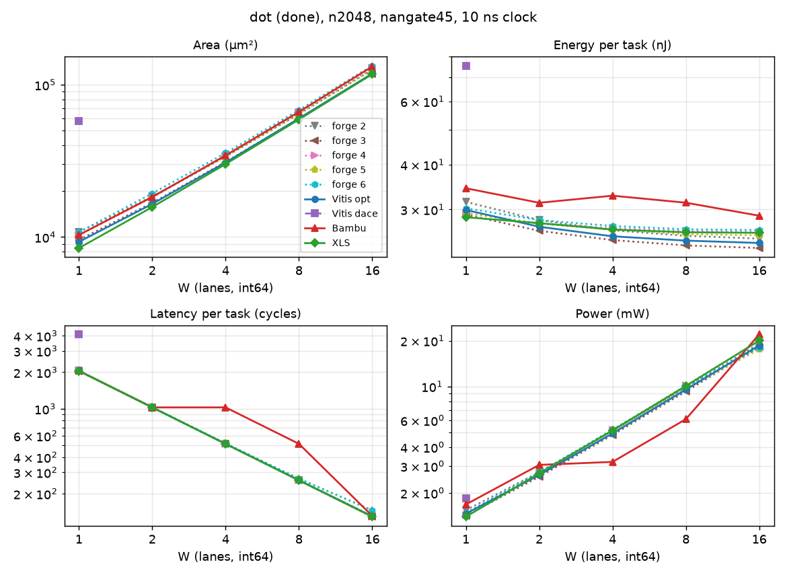

# dot (tier done)

csr excludes `<tag>_peripherals` (BUSY_COUNTER), snax-forge D168.

Part of [the comparison](../README.md): setup, summary across kernels and the parts' basis are there.

<!-- gen:main -->

n2048, nangate45, int64, 10 ns.

| W | Case | Area (µm²) | Energy (nJ) | Latency (cycles) | Power (mW) |
|---|---|---|---|---|---|
| 1 | forge 2 | 11,410 | 32.48 | 2050 | 1.584 |
| 1 | forge 3 | 10,156 | 30.02 | 2049 | 1.465 |
| 1 | forge 4 | 10,898 | 30.25 | 2050 | 1.476 |
| 1 | forge 5 | 10,870 | 30.28 | 2050 | 1.477 |
| 1 | forge 6 | 11,368 | 31.22 | 2051 | 1.522 |
| 1 | Vitis opt | 9,301 | 29.91 | 2050 | 1.459 |
| 1 | Vitis dace | 57,696 | 75.46 | 4101 | 1.84 |
| 1 | Bambu | 10,321 | 34.37 | 2050 | 1.677 |
| 1 | XLS | 8,468 | 28.54 | 2049 | 1.393 |
| 2 | forge 2 | 19,049 | 28.52 | 1026 | 2.779 |
| 2 | forge 3 | 17,334 | 26.66 | 1025 | 2.601 |
| 2 | forge 4 | 18,796 | 27.98 | 1026 | 2.727 |
| 2 | forge 5 | 18,990 | 27.89 | 1027 | 2.716 |
| 2 | forge 6 | 19,922 | 28.54 | 1028 | 2.777 |
| 2 | Vitis opt | 16,494 | 26.85 | 1026 | 2.617 |
| 2 | Bambu | 18,325 | 31.31 | 1026 | 3.052 |
| 2 | XLS | 15,732 | 27.48 | 1025 | 2.681 |
| 4 | forge 2 | 34,331 | 26.52 | 514 | 5.16 |
| 4 | forge 3 | 31,694 | 24.89 | 513 | 4.852 |
| 4 | forge 4 | 34,604 | 26.86 | 514 | 5.227 |
| 4 | forge 5 | 34,438 | 26.58 | 517 | 5.142 |
| 4 | forge 6 | 36,236 | 27.2 | 518 | 5.252 |
| 4 | Vitis opt | 30,879 | 25.26 | 514 | 4.914 |
| 4 | Bambu | 34,352 | 32.77 | 1026 | 3.194 |
| 4 | XLS | 30,141 | 26.38 | 513 | 5.142 |
| 8 | forge 2 | 64,894 | 25.48 | 258 | 9.874 |
| 8 | forge 3 | 60,411 | 23.96 | 257 | 9.323 |
| 8 | forge 4 | 66,198 | 26.25 | 258 | 10.17 |
| 8 | forge 5 | 65,186 | 25.79 | 265 | 9.734 |
| 8 | forge 6 | 68,887 | 26.55 | 266 | 9.981 |
| 8 | Vitis opt | 60,079 | 24.57 | 258 | 9.523 |
| 8 | Bambu | 66,374 | 31.33 | 514 | 6.095 |
| 8 | XLS | 59,137 | 25.92 | 257 | 10.08 |
| 16 | forge 2 | 126,017 | 24.95 | 130 | 19.2 |
| 16 | forge 3 | 117,844 | 23.49 | 129 | 18.21 |
| 16 | forge 4 | 129,403 | 26 | 130 | 20 |
| 16 | forge 5 | 126,763 | 25.5 | 145 | 17.58 |
| 16 | forge 6 | 134,136 | 26.36 | 146 | 18.05 |
| 16 | Vitis opt | 118,444 | 24.2 | 130 | 18.61 |
| 16 | Bambu | 131,737 | 28.82 | 131 | 22 |
| 16 | XLS | 117,399 | 25.83 | 129 | 20.02 |
<!-- /gen -->

## Insights

- Bambu runs at II = 2 at W = 4 and 8: 1026 and 514 cycles, twice the others, with the same lanes. Its energy per task rises at W = 4 (32.8 nJ against 31.3 at W = 2), and its power is lower than the others' there.
- Vitis opt at 10 ns cuts its adder tree with 64-bit partial-sum registers at W = 8 (two) and W = 16 (four), `add_ln21_*_reg` in its Verilog; that is where its flops grow from 264 to 328 and 456.
- XLS's combinational energy is 5 to 9 % above Vitis opt's at every W, while its flops are fewer (160). XLS gates every input bit with its idle state before the multipliers; how much of the gap that explains is not measured.
- The areas stay within 12 % (W = 16: XLS 117.4k µm², Vitis opt 118.4k, Bambu 131.7k).
- forge's dot 3 (the fused tree) is its best variant at every W, and its ctrl + datapath has the lowest energy of every case at every W (W = 16: 11.41 pJ per element against Vitis opt's 11.82 and XLS's 12.61), with an area within 1 % of the smallest (116.7k µm² against XLS's 117.4k at W = 16). At W = 16, dot 2, 4, 5 and 6 cost 7, 10, 8 and 14 % more area than dot 3, and dot 5 and 6 take 145 and 146 cycles against 129 (the MAC's stall and the holding buffer's drain).
- Vitis dace_w1 (X62): 57.7k µm², 49.3k of it the 2048 x 64 macro holding DaCe's products; 4101 cycles, its two loops one after the other; 75.5 nJ per task, 45.3 of it the macro's counted 2048 writes and 2051 reads.

## Parts at n2048

<!-- gen:parts -->
| W | Case | Part | Area (µm²) | Energy (nJ) | pJ per element |
|---|---|---|---|---|---|
| 1 | forge 2 | csr | 1,107 | 1.939 | 0.9466 |
| 1 | forge 2 | ctrl | 2,087 | 2.978 | 1.454 |
| 1 | forge 2 | datapath | 8,215 | 27.56 | 13.46 |
| 1 | forge 2 | total | 11,410 | 32.48 | 15.86 |
| 1 | forge 2 | total without csr | 10,304 | 30.54 | 14.91 |
| 1 | forge 3 | csr | 1,107 | 1.938 | 0.9461 |
| 1 | forge 3 | ctrl | 1,295 | 1.981 | 0.9672 |
| 1 | forge 3 | datapath | 7,753 | 26.1 | 12.74 |
| 1 | forge 3 | total | 10,156 | 30.02 | 14.66 |
| 1 | forge 3 | total without csr | 9,049 | 28.08 | 13.71 |
| 1 | forge 4 | csr | 1,107 | 1.939 | 0.9466 |
| 1 | forge 4 | ctrl | 1,699 | 2.472 | 1.207 |
| 1 | forge 4 | datapath | 8,091 | 25.84 | 12.62 |
| 1 | forge 4 | total | 10,898 | 30.25 | 14.77 |
| 1 | forge 4 | total without csr | 9,791 | 28.31 | 13.82 |
| 1 | forge 5 | csr | 1,107 | 1.939 | 0.9466 |
| 1 | forge 5 | ctrl | 1,672 | 2.47 | 1.206 |
| 1 | forge 5 | datapath | 8,091 | 25.87 | 12.63 |
| 1 | forge 5 | total | 10,870 | 30.28 | 14.78 |
| 1 | forge 5 | total without csr | 9,763 | 28.34 | 13.84 |
| 1 | forge 6 | csr | 1,107 | 1.94 | 0.947 |
| 1 | forge 6 | ctrl | 1,708 | 2.488 | 1.215 |
| 1 | forge 6 | datapath | 8,553 | 26.8 | 13.08 |
| 1 | forge 6 | total | 11,368 | 31.22 | 15.25 |
| 1 | forge 6 | total without csr | 10,261 | 29.28 | 14.3 |
| 1 | Vitis opt | total | 9,301 | 29.91 | 14.6 |
| 1 | Vitis dace | RAM (macro) | 49,275 | 45.26 | 22.1 |
| 1 | Vitis dace | logic without the RAM | 8,421 | 30.2 | 14.75 |
| 1 | Vitis dace | total | 57,696 | 75.46 | 36.85 |
| 1 | Bambu | ctrl | 60.12 | 0.04361 | 0.02129 |
| 1 | Bambu | datapath | 10,255 | 34.32 | 16.76 |
| 1 | Bambu | total | 10,321 | 34.37 | 16.78 |
| 1 | XLS | total | 8,468 | 28.54 | 13.94 |
| 2 | forge 2 | csr | 1,107 | 0.9741 | 0.4756 |
| 2 | forge 2 | ctrl | 2,086 | 1.5 | 0.7324 |
| 2 | forge 2 | datapath | 15,854 | 26.04 | 12.72 |
| 2 | forge 2 | total | 19,049 | 28.52 | 13.92 |
| 2 | forge 2 | total without csr | 17,942 | 27.54 | 13.45 |
| 2 | forge 3 | csr | 1,107 | 0.9732 | 0.4752 |
| 2 | forge 3 | ctrl | 1,295 | 0.9952 | 0.486 |
| 2 | forge 3 | datapath | 14,931 | 24.69 | 12.06 |
| 2 | forge 3 | total | 17,334 | 26.66 | 13.02 |
| 2 | forge 3 | total without csr | 16,227 | 25.68 | 12.54 |
| 2 | forge 4 | csr | 1,107 | 0.9741 | 0.4756 |
| 2 | forge 4 | ctrl | 1,700 | 1.242 | 0.6065 |
| 2 | forge 4 | datapath | 15,988 | 25.76 | 12.58 |
| 2 | forge 4 | total | 18,796 | 27.98 | 13.66 |
| 2 | forge 4 | total without csr | 17,689 | 27 | 13.19 |
| 2 | forge 5 | csr | 1,107 | 0.975 | 0.4761 |
| 2 | forge 5 | ctrl | 1,708 | 1.251 | 0.6108 |
| 2 | forge 5 | datapath | 16,175 | 25.66 | 12.53 |
| 2 | forge 5 | total | 18,990 | 27.89 | 13.62 |
| 2 | forge 5 | total without csr | 17,883 | 26.91 | 13.14 |
| 2 | forge 6 | csr | 1,107 | 0.9759 | 0.4765 |
| 2 | forge 6 | ctrl | 1,717 | 1.259 | 0.6149 |
| 2 | forge 6 | datapath | 17,097 | 26.31 | 12.85 |
| 2 | forge 6 | total | 19,922 | 28.54 | 13.94 |
| 2 | forge 6 | total without csr | 18,815 | 27.57 | 13.46 |
| 2 | Vitis opt | total | 16,494 | 26.85 | 13.11 |
| 2 | Bambu | ctrl | 60.12 | 0.02229 | 0.01088 |
| 2 | Bambu | datapath | 18,260 | 31.28 | 15.27 |
| 2 | Bambu | total | 18,325 | 31.31 | 15.29 |
| 2 | XLS | total | 15,732 | 27.48 | 13.42 |
| 4 | forge 2 | csr | 1,107 | 0.49 | 0.2393 |
| 4 | forge 2 | ctrl | 2,085 | 0.757 | 0.3696 |
| 4 | forge 2 | datapath | 31,137 | 25.27 | 12.34 |
| 4 | forge 2 | total | 34,331 | 26.52 | 12.95 |
| 4 | forge 2 | total without csr | 33,224 | 26.03 | 12.71 |
| 4 | forge 3 | csr | 1,107 | 0.4891 | 0.2388 |
| 4 | forge 3 | ctrl | 1,294 | 0.5007 | 0.2445 |
| 4 | forge 3 | datapath | 29,292 | 23.9 | 11.67 |
| 4 | forge 3 | total | 31,694 | 24.89 | 12.15 |
| 4 | forge 3 | total without csr | 30,587 | 24.4 | 11.91 |
| 4 | forge 4 | csr | 1,107 | 0.49 | 0.2393 |
| 4 | forge 4 | ctrl | 1,700 | 0.6252 | 0.3053 |
| 4 | forge 4 | datapath | 31,797 | 25.75 | 12.57 |
| 4 | forge 4 | total | 34,604 | 26.86 | 13.12 |
| 4 | forge 4 | total without csr | 33,497 | 26.37 | 12.88 |
| 4 | forge 5 | csr | 1,107 | 0.4928 | 0.2406 |
| 4 | forge 5 | ctrl | 1,740 | 0.6388 | 0.3119 |
| 4 | forge 5 | datapath | 31,590 | 25.45 | 12.43 |
| 4 | forge 5 | total | 34,438 | 26.58 | 12.98 |
| 4 | forge 5 | total without csr | 33,331 | 26.09 | 12.74 |
| 4 | forge 6 | csr | 1,107 | 0.4937 | 0.2411 |
| 4 | forge 6 | ctrl | 1,726 | 0.6411 | 0.313 |
| 4 | forge 6 | datapath | 33,402 | 26.07 | 12.73 |
| 4 | forge 6 | total | 36,236 | 27.2 | 13.28 |
| 4 | forge 6 | total without csr | 35,129 | 26.71 | 13.04 |
| 4 | Vitis opt | total | 30,879 | 25.26 | 12.33 |
| 4 | Bambu | ctrl | 81.4 | 0.3827 | 0.1869 |
| 4 | Bambu | datapath | 34,265 | 32.38 | 15.81 |
| 4 | Bambu | total | 34,352 | 32.77 | 16 |
| 4 | XLS | total | 30,141 | 26.38 | 12.88 |
| 8 | forge 2 | csr | 1,107 | 0.2471 | 0.1206 |
| 8 | forge 2 | ctrl | 2,086 | 0.3836 | 0.1873 |
| 8 | forge 2 | datapath | 61,699 | 24.85 | 12.13 |
| 8 | forge 2 | total | 64,894 | 25.48 | 12.44 |
| 8 | forge 2 | total without csr | 63,787 | 25.23 | 12.32 |
| 8 | forge 3 | csr | 1,107 | 0.2461 | 0.1202 |
| 8 | forge 3 | ctrl | 1,295 | 0.2525 | 0.1233 |
| 8 | forge 3 | datapath | 58,009 | 23.46 | 11.46 |
| 8 | forge 3 | total | 60,411 | 23.96 | 11.7 |
| 8 | forge 3 | total without csr | 59,304 | 23.71 | 11.58 |
| 8 | forge 4 | csr | 1,103 | 0.2471 | 0.1206 |
| 8 | forge 4 | ctrl | 1,700 | 0.3158 | 0.1542 |
| 8 | forge 4 | datapath | 63,393 | 25.69 | 12.54 |
| 8 | forge 4 | total | 66,198 | 26.25 | 12.82 |
| 8 | forge 4 | total without csr | 65,094 | 26 | 12.7 |
| 8 | forge 5 | csr | 1,103 | 0.2537 | 0.1239 |
| 8 | forge 5 | ctrl | 1,750 | 0.3314 | 0.1618 |
| 8 | forge 5 | datapath | 62,332 | 25.21 | 12.31 |
| 8 | forge 5 | total | 65,186 | 25.79 | 12.59 |
| 8 | forge 5 | total without csr | 64,083 | 25.54 | 12.47 |
| 8 | forge 6 | csr | 1,103 | 0.2546 | 0.1243 |
| 8 | forge 6 | ctrl | 1,759 | 0.3333 | 0.1627 |
| 8 | forge 6 | datapath | 66,024 | 25.96 | 12.68 |
| 8 | forge 6 | total | 68,887 | 26.55 | 12.96 |
| 8 | forge 6 | total without csr | 67,784 | 26.3 | 12.84 |
| 8 | Vitis opt | total | 60,079 | 24.57 | 12 |
| 8 | Bambu | ctrl | 81.4 | 0.1905 | 0.09302 |
| 8 | Bambu | datapath | 66,288 | 31.13 | 15.2 |
| 8 | Bambu | total | 66,374 | 31.33 | 15.3 |
| 8 | XLS | total | 59,137 | 25.92 | 12.65 |
| 16 | forge 2 | csr | 1,107 | 0.1251 | 0.06109 |
| 16 | forge 2 | ctrl | 2,086 | 0.1961 | 0.09575 |
| 16 | forge 2 | datapath | 122,823 | 24.63 | 12.03 |
| 16 | forge 2 | total | 126,017 | 24.95 | 12.18 |
| 16 | forge 2 | total without csr | 124,910 | 24.83 | 12.12 |
| 16 | forge 3 | csr | 1,107 | 0.1242 | 0.06064 |
| 16 | forge 3 | ctrl | 1,295 | 0.1279 | 0.06245 |
| 16 | forge 3 | datapath | 115,442 | 23.24 | 11.35 |
| 16 | forge 3 | total | 117,844 | 23.49 | 11.47 |
| 16 | forge 3 | total without csr | 116,737 | 23.36 | 11.41 |
| 16 | forge 4 | csr | 1,107 | 0.1251 | 0.06109 |
| 16 | forge 4 | ctrl | 1,700 | 0.1609 | 0.07856 |
| 16 | forge 4 | datapath | 126,596 | 25.71 | 12.55 |
| 16 | forge 4 | total | 129,403 | 26 | 12.69 |
| 16 | forge 4 | total without csr | 128,297 | 25.87 | 12.63 |
| 16 | forge 5 | csr | 1,107 | 0.1393 | 0.06803 |
| 16 | forge 5 | ctrl | 1,757 | 0.1826 | 0.08917 |
| 16 | forge 5 | datapath | 123,898 | 25.17 | 12.29 |
| 16 | forge 5 | total | 126,763 | 25.5 | 12.45 |
| 16 | forge 5 | total without csr | 125,656 | 25.36 | 12.38 |
| 16 | forge 6 | csr | 1,107 | 0.1402 | 0.06848 |
| 16 | forge 6 | ctrl | 1,765 | 0.1849 | 0.09029 |
| 16 | forge 6 | datapath | 131,264 | 26.03 | 12.71 |
| 16 | forge 6 | total | 134,136 | 26.36 | 12.87 |
| 16 | forge 6 | total without csr | 133,029 | 26.22 | 12.8 |
| 16 | Vitis opt | total | 118,444 | 24.2 | 11.82 |
| 16 | Bambu | ctrl | 127.7 | 0.005539 | 0.002704 |
| 16 | Bambu | datapath | 131,604 | 28.82 | 14.07 |
| 16 | Bambu | total | 131,737 | 28.82 | 14.07 |
| 16 | XLS | total | 117,399 | 25.83 | 12.61 |
<!-- /gen -->
