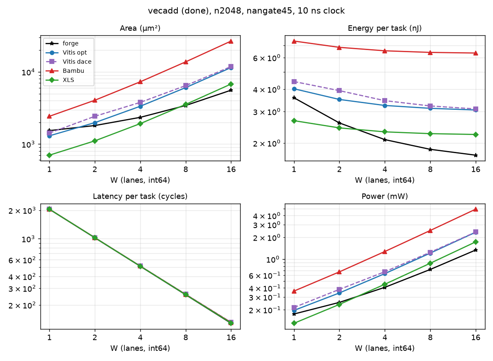

# vecadd (tier done)

forge's figures exclude `<tag>_peripherals` (BUSY_COUNTER, snax-forge D168): it is in neither the csr nor the total without csr.

Part of [the comparison](../README.md): setup, summary across kernels and the parts' basis are there.

<!-- gen:main -->

n2048, nangate45, int64, 10 ns.

[forge's ctrl + datapath against the HLS totals](vecadd_ctrl_dp.png): forge without its csr, its `<tag>_peripherals` and its glue; the HLS cases as above.

| W | Case | Area (µm²) | Energy (nJ) | Latency (cycles) | Power (mW) |
|---|---|---|---|---|---|
| 1 | forge | 1,536 | 3.579 | 2048 | 0.1748 |
| 1 | Vitis opt | 1,301 | 4.018 | 2050 | 0.196 |
| 1 | Vitis dace | 1,420 | 4.409 | 2050 | 0.2151 |
| 1 | Bambu | 2,425 | 7.421 | 2050 | 0.362 |
| 1 | XLS | 701.7 | 2.666 | 2049 | 0.1301 |
| 2 | forge | 1,806 | 2.589 | 1024 | 0.2528 |
| 2 | Vitis opt | 1,980 | 3.502 | 1026 | 0.3413 |
| 2 | Vitis dace | 2,424 | 3.922 | 1026 | 0.3822 |
| 2 | Bambu | 4,046 | 6.844 | 1026 | 0.6671 |
| 2 | XLS | 1,108 | 2.429 | 1025 | 0.237 |
| 4 | forge | 2,345 | 2.089 | 512 | 0.408 |
| 4 | Vitis opt | 3,340 | 3.241 | 514 | 0.6306 |
| 4 | Vitis dace | 3,780 | 3.448 | 515 | 0.6696 |
| 4 | Bambu | 7,288 | 6.547 | 514 | 1.274 |
| 4 | XLS | 1,920 | 2.308 | 513 | 0.4499 |
| 8 | forge | 3,424 | 1.844 | 256 | 0.7202 |
| 8 | Vitis opt | 6,057 | 3.124 | 258 | 1.211 |
| 8 | Vitis dace | 6,459 | 3.221 | 259 | 1.244 |
| 8 | Bambu | 13,777 | 6.413 | 258 | 2.486 |
| 8 | XLS | 3,545 | 2.256 | 257 | 0.8777 |
| 16 | forge | 5,582 | 1.71 | 128 | 1.336 |
| 16 | Vitis opt | 11,489 | 3.058 | 130 | 2.352 |
| 16 | Vitis dace | 11,864 | 3.099 | 131 | 2.366 |
| 16 | Bambu | 26,748 | 6.362 | 130 | 4.894 |
| 16 | XLS | 6,795 | 2.232 | 129 | 1.73 |
<!-- /gen -->

## Insights

- At W = 16: XLS 6.8k µm², Vitis opt 11.5k, Vitis dace 11.9k, Bambu 26.7k. Per lane: XLS 406, Vitis 679, Bambu 1622 µm². The gap is registers: Vitis adds 64 flops per lane (the output beat), Bambu 192 (both input beats and the output beat), XLS none.
- Energy per task barely moves from W = 4 on: XLS 2.2 to 2.7 nJ, Vitis opt 3.1 to 4.0, Bambu 6.4 to 7.4. Flops are 72 to 78 % of Vitis's energy, 60 to 64 % of Bambu's and 1 to 16 % of XLS's.
- Vitis dace is opt with 30 to 50 more flops and, from W = 4, one more cycle.
- forge: the datapath is the adders only, 270 µm² per lane and no flops; ctrl 438 µm² (34 flops, CTRL2), csr 548 µm² and its `<tag>_peripherals` (BUSY_COUNTER) 279 µm² at every W. Without its csr (its ctrl, datapath and glue; the peripherals in no figure, X65) it is 4.8k µm² at W = 16 against XLS's 6.8k, and 0.790 against 1.090 pJ per element; at W = 1 it is 1.01x XLS's area (709 against 702 µm²) and 0.80x its energy, and the smallest case from W = 2. With its CSR file it is still the smallest case at W = 16 (5.6k µm²) and the lowest-energy case from W = 4 (W = 16: 1.71 nJ). XLS's difference is its input gating (2,112 µm² of AND gates at W = 16, [the README's section 2](../README.md#2-across-all-kernels)).

## Parts at n2048

<!-- gen:parts -->
| W | Case | Part | Area (µm²) | Energy (nJ) | pJ per element |
|---|---|---|---|---|---|
| 1 | forge | csr | 547.7 | 0.9693 | 0.4733 |
| 1 | forge | ctrl | 438.4 | 0.5435 | 0.2654 |
| 1 | forge | datapath | 269.7 | 1.585 | 0.7739 |
| 1 | forge | total | 1,536 | 3.579 | 1.748 |
| 1 | forge | total without csr | 709.2 | 2.129 | 1.039 |
| 1 | Vitis opt | total | 1,301 | 4.018 | 1.962 |
| 1 | Vitis dace | total | 1,420 | 4.409 | 2.153 |
| 1 | Bambu | ctrl | 57.99 | 0.04348 | 0.02123 |
| 1 | Bambu | datapath | 2,362 | 7.363 | 3.595 |
| 1 | Bambu | total | 2,425 | 7.421 | 3.624 |
| 1 | XLS | total | 701.7 | 2.666 | 1.302 |
| 2 | forge | csr | 547.7 | 0.4847 | 0.2367 |
| 2 | forge | ctrl | 438.4 | 0.2755 | 0.1345 |
| 2 | forge | datapath | 539.4 | 1.584 | 0.7736 |
| 2 | forge | total | 1,806 | 2.589 | 1.264 |
| 2 | forge | total without csr | 978.9 | 1.86 | 0.9081 |
| 2 | Vitis opt | total | 1,980 | 3.502 | 1.71 |
| 2 | Vitis dace | total | 2,424 | 3.922 | 1.915 |
| 2 | Bambu | ctrl | 57.99 | 0.02216 | 0.01082 |
| 2 | Bambu | datapath | 3,983 | 6.815 | 3.328 |
| 2 | Bambu | total | 4,046 | 6.844 | 3.342 |
| 2 | XLS | total | 1,108 | 2.429 | 1.186 |
| 4 | forge | csr | 547.7 | 0.2424 | 0.1184 |
| 4 | forge | ctrl | 438.4 | 0.1396 | 0.06815 |
| 4 | forge | datapath | 1,079 | 1.583 | 0.773 |
| 4 | forge | total | 2,345 | 2.089 | 1.02 |
| 4 | forge | total without csr | 1,518 | 1.723 | 0.8411 |
| 4 | Vitis opt | total | 3,340 | 3.241 | 1.583 |
| 4 | Vitis dace | total | 3,780 | 3.448 | 1.684 |
| 4 | Bambu | ctrl | 57.99 | 0.01149 | 0.005609 |
| 4 | Bambu | datapath | 7,225 | 6.532 | 3.19 |
| 4 | Bambu | total | 7,288 | 6.547 | 3.197 |
| 4 | XLS | total | 1,920 | 2.308 | 1.127 |
| 8 | forge | csr | 547.7 | 0.1213 | 0.05922 |
| 8 | forge | ctrl | 438.4 | 0.07074 | 0.03454 |
| 8 | forge | datapath | 2,158 | 1.589 | 0.7758 |
| 8 | forge | total | 3,424 | 1.844 | 0.9003 |
| 8 | forge | total without csr | 2,597 | 1.66 | 0.8103 |
| 8 | Vitis opt | total | 6,057 | 3.124 | 1.525 |
| 8 | Vitis dace | total | 6,459 | 3.221 | 1.573 |
| 8 | Bambu | ctrl | 58.52 | 0.006156 | 0.003006 |
| 8 | Bambu | datapath | 13,713 | 6.405 | 3.128 |
| 8 | Bambu | total | 13,777 | 6.413 | 3.131 |
| 8 | XLS | total | 3,545 | 2.256 | 1.101 |
| 16 | forge | csr | 547.7 | 0.06071 | 0.02964 |
| 16 | forge | ctrl | 438.4 | 0.03585 | 0.01751 |
| 16 | forge | datapath | 4,316 | 1.582 | 0.7723 |
| 16 | forge | total | 5,582 | 1.71 | 0.835 |
| 16 | forge | total without csr | 4,755 | 1.618 | 0.7898 |
| 16 | Vitis opt | total | 11,489 | 3.058 | 1.493 |
| 16 | Vitis dace | total | 11,864 | 3.099 | 1.513 |
| 16 | Bambu | ctrl | 59.05 | 0.003498 | 0.001708 |
| 16 | Bambu | datapath | 26,684 | 6.357 | 3.104 |
| 16 | Bambu | total | 26,748 | 6.362 | 3.106 |
| 16 | XLS | total | 6,795 | 2.232 | 1.09 |
<!-- /gen -->
