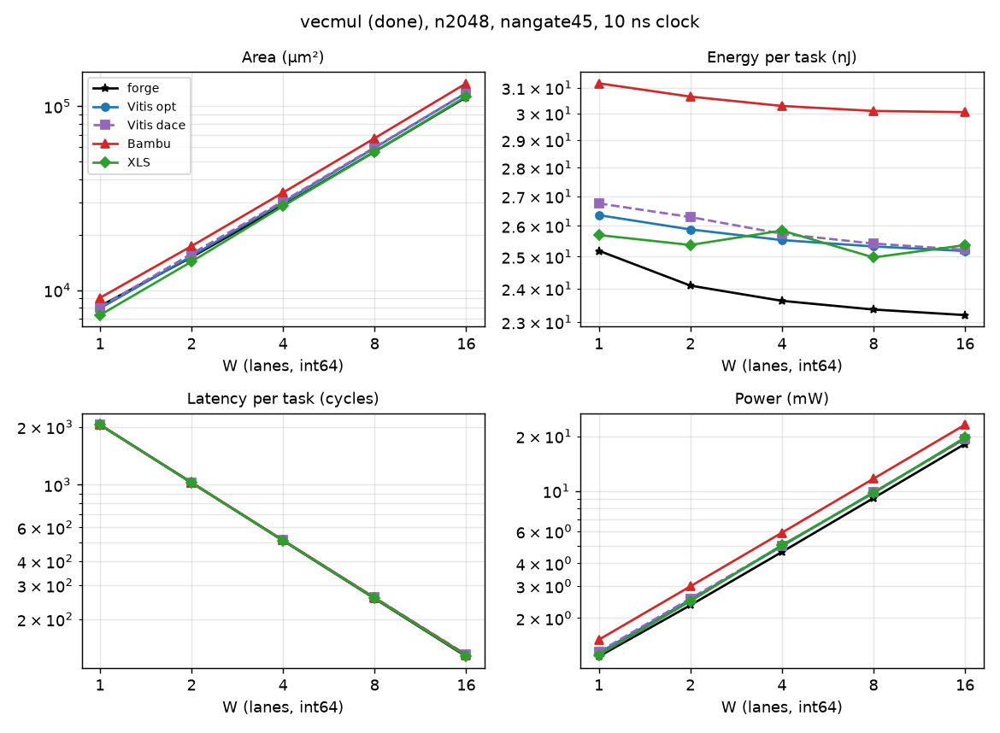

# vecmul (tier done)

csr excludes `<tag>_peripherals` (BUSY_COUNTER), snax-forge D168.

Part of [the comparison](../README.md): setup, summary across kernels and the parts' basis are there.

<!-- gen:main -->

n2048, nangate45, int64, 10 ns.

| W | Case | Area (µm²) | Energy (nJ) | Latency (cycles) | Power (mW) |
|---|---|---|---|---|---|
| 1 | forge | 8,179 | 25.19 | 2048 | 1.23 |
| 1 | Vitis opt | 7,956 | 26.36 | 2050 | 1.286 |
| 1 | Vitis dace | 8,076 | 26.75 | 2050 | 1.305 |
| 1 | Bambu | 9,073 | 31.17 | 2050 | 1.521 |
| 1 | XLS | 7,311 | 25.7 | 2049 | 1.254 |
| 2 | forge | 15,092 | 24.09 | 1024 | 2.353 |
| 2 | Vitis opt | 15,291 | 25.88 | 1026 | 2.522 |
| 2 | Vitis dace | 15,735 | 26.29 | 1026 | 2.563 |
| 2 | Bambu | 17,340 | 30.65 | 1026 | 2.987 |
| 2 | XLS | 14,276 | 25.37 | 1025 | 2.475 |
| 4 | forge | 28,917 | 23.63 | 512 | 4.615 |
| 4 | Vitis opt | 29,961 | 25.53 | 514 | 4.967 |
| 4 | Vitis dace | 30,402 | 25.74 | 515 | 4.998 |
| 4 | Bambu | 33,876 | 30.29 | 514 | 5.893 |
| 4 | XLS | 28,610 | 25.84 | 513 | 5.038 |
| 8 | forge | 56,567 | 23.37 | 256 | 9.129 |
| 8 | Vitis opt | 59,302 | 25.33 | 258 | 9.816 |
| 8 | Vitis dace | 59,710 | 25.42 | 259 | 9.814 |
| 8 | Bambu | 66,948 | 30.1 | 258 | 11.67 |
| 8 | XLS | 56,467 | 24.97 | 257 | 9.718 |
| 16 | forge | 111,867 | 23.21 | 128 | 18.13 |
| 16 | Vitis opt | 117,985 | 25.18 | 130 | 19.37 |
| 16 | Vitis dace | 118,359 | 25.22 | 131 | 19.25 |
| 16 | Bambu | 133,097 | 30.05 | 130 | 23.11 |
| 16 | XLS | 112,942 | 25.37 | 129 | 19.66 |
<!-- /gen -->

## Insights

- The 64-bit multiplier is about 7k µm² per lane for every tool, so the areas stay within 18 % (W = 16: XLS 112.9k, Vitis opt 118.0k, Bambu 133.1k).
- Bambu spends about 20 % more energy per task (30 against 25 nJ); its flops are 18 to 20 % of its energy, against 9 to 12 % for Vitis and 0 to 2 % for XLS. The registered beats are the same as in vecadd.
- forge without its csr is within 1 % of the smallest area from W = 4 and 6 to 8 % lower in energy per element than the best HLS case at every W (W = 16: 11.30 pJ against Vitis opt's 12.30 and XLS's 12.39). Its totals with the CSR file are the lowest-energy case at every W (23.2 to 25.2 nJ). CTRL2 took 274 µm² off forge's ctrl, 3.2 % of its total at W = 1 and under 1 % from W = 4; BUSY_COUNTER, now in the total without csr, gives most of it back on that basis.

## Parts at n2048

<!-- gen:parts -->
| W | Case | Part | Area (µm²) | Energy (nJ) | pJ per element |
|---|---|---|---|---|---|
| 1 | forge | csr | 547.7 | 0.9693 | 0.4733 |
| 1 | forge | ctrl | 438.4 | 0.5435 | 0.2654 |
| 1 | forge | datapath | 6,913 | 23.19 | 11.32 |
| 1 | forge | total | 8,179 | 25.19 | 12.3 |
| 1 | forge | total without csr | 7,631 | 24.22 | 11.83 |
| 1 | Vitis opt | total | 7,956 | 26.36 | 12.87 |
| 1 | Vitis dace | total | 8,076 | 26.75 | 13.06 |
| 1 | Bambu | ctrl | 57.46 | 0.04347 | 0.02123 |
| 1 | Bambu | datapath | 9,010 | 31.11 | 15.19 |
| 1 | Bambu | total | 9,073 | 31.17 | 15.22 |
| 1 | XLS | total | 7,311 | 25.7 | 12.55 |
| 2 | forge | csr | 547.7 | 0.4847 | 0.2367 |
| 2 | forge | ctrl | 438.4 | 0.2755 | 0.1345 |
| 2 | forge | datapath | 13,825 | 23.09 | 11.27 |
| 2 | forge | total | 15,092 | 24.09 | 11.76 |
| 2 | forge | total without csr | 14,544 | 23.61 | 11.53 |
| 2 | Vitis opt | total | 15,291 | 25.88 | 12.64 |
| 2 | Vitis dace | total | 15,735 | 26.29 | 12.84 |
| 2 | Bambu | ctrl | 57.72 | 0.02216 | 0.01082 |
| 2 | Bambu | datapath | 17,277 | 30.62 | 14.95 |
| 2 | Bambu | total | 17,340 | 30.65 | 14.97 |
| 2 | XLS | total | 14,276 | 25.37 | 12.39 |
| 4 | forge | csr | 547.7 | 0.2424 | 0.1184 |
| 4 | forge | ctrl | 438.4 | 0.1396 | 0.06815 |
| 4 | forge | datapath | 27,650 | 23.12 | 11.29 |
| 4 | forge | total | 28,917 | 23.63 | 11.54 |
| 4 | forge | total without csr | 28,369 | 23.39 | 11.42 |
| 4 | Vitis opt | total | 29,961 | 25.53 | 12.47 |
| 4 | Vitis dace | total | 30,402 | 25.74 | 12.57 |
| 4 | Bambu | ctrl | 58.52 | 0.0115 | 0.005613 |
| 4 | Bambu | datapath | 33,813 | 30.27 | 14.78 |
| 4 | Bambu | total | 33,876 | 30.29 | 14.79 |
| 4 | XLS | total | 28,610 | 25.84 | 12.62 |
| 8 | forge | csr | 547.7 | 0.1213 | 0.05922 |
| 8 | forge | ctrl | 438.4 | 0.07074 | 0.03454 |
| 8 | forge | datapath | 55,300 | 23.12 | 11.29 |
| 8 | forge | total | 56,567 | 23.37 | 11.41 |
| 8 | forge | total without csr | 56,019 | 23.25 | 11.35 |
| 8 | Vitis opt | total | 59,302 | 25.33 | 12.37 |
| 8 | Vitis dace | total | 59,710 | 25.42 | 12.41 |
| 8 | Bambu | ctrl | 57.99 | 0.006146 | 0.003001 |
| 8 | Bambu | datapath | 66,884 | 30.09 | 14.69 |
| 8 | Bambu | total | 66,948 | 30.1 | 14.7 |
| 8 | XLS | total | 56,467 | 24.97 | 12.19 |
| 16 | forge | csr | 547.7 | 0.06071 | 0.02964 |
| 16 | forge | ctrl | 438.4 | 0.03585 | 0.01751 |
| 16 | forge | datapath | 110,601 | 23.08 | 11.27 |
| 16 | forge | total | 111,867 | 23.21 | 11.33 |
| 16 | forge | total without csr | 111,319 | 23.15 | 11.3 |
| 16 | Vitis opt | total | 117,985 | 25.18 | 12.3 |
| 16 | Vitis dace | total | 118,359 | 25.22 | 12.31 |
| 16 | Bambu | ctrl | 59.58 | 0.003507 | 0.001712 |
| 16 | Bambu | datapath | 133,032 | 30.04 | 14.67 |
| 16 | Bambu | total | 133,097 | 30.05 | 14.67 |
| 16 | XLS | total | 112,942 | 25.37 | 12.39 |
<!-- /gen -->
