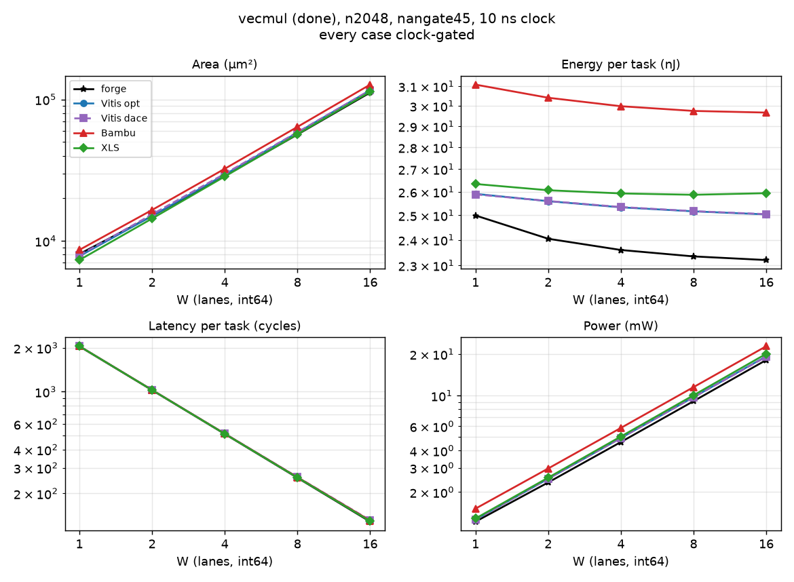

# vecmul (tier done)

forge's figures exclude `<tag>_peripherals` (BUSY_COUNTER, snax-forge D168): it is in neither the csr nor the total without csr.

Part of [the comparison](../README.md): setup, summary across kernels and the parts' basis are there.

<!-- gen:main -->

n2048, nangate45, int64, 10 ns. HLS clock-gated, forge ungated: forge's points are not yet synthesized gated, and the insights below were written when both were ungated.

[forge's ctrl + datapath against the HLS totals](vecmul_ctrl_dp.png): forge without its csr, its `<tag>_peripherals` and its glue; the HLS cases as above.

| W | Case | Area (µm²) | Energy (nJ) | Latency (cycles) | Power (mW) |
|---|---|---|---|---|---|
| 1 | forge | 8,179 | 25.19 | 2048 | 1.23 |
| 1 | Vitis opt | 7,795 | 25.91 | 2050 | 1.264 |
| 1 | Vitis dace | 7,925 | 25.89 | 2050 | 1.263 |
| 1 | Bambu | 8,641 | 31.08 | 2050 | 1.516 |
| 1 | XLS | 7,328 | 26.34 | 2049 | 1.286 |
| 2 | forge | 15,092 | 24.09 | 1024 | 2.353 |
| 2 | Vitis opt | 15,010 | 25.6 | 1026 | 2.495 |
| 2 | Vitis dace | 15,398 | 25.6 | 1026 | 2.495 |
| 2 | Bambu | 16,544 | 30.41 | 1026 | 2.964 |
| 2 | XLS | 14,389 | 26.07 | 1025 | 2.543 |
| 4 | forge | 28,917 | 23.63 | 512 | 4.615 |
| 4 | Vitis opt | 29,438 | 25.33 | 514 | 4.929 |
| 4 | Vitis dace | 29,834 | 25.35 | 515 | 4.922 |
| 4 | Bambu | 32,351 | 29.98 | 514 | 5.834 |
| 4 | XLS | 28,515 | 25.93 | 513 | 5.054 |
| 8 | forge | 56,567 | 23.37 | 256 | 9.129 |
| 8 | Vitis opt | 58,296 | 25.17 | 258 | 9.754 |
| 8 | Vitis dace | 58,662 | 25.17 | 259 | 9.72 |
| 8 | Bambu | 63,967 | 29.75 | 258 | 11.53 |
| 8 | XLS | 56,765 | 25.87 | 257 | 10.07 |
| 16 | forge | 111,867 | 23.21 | 128 | 18.13 |
| 16 | Vitis opt | 116,016 | 25.04 | 130 | 19.26 |
| 16 | Vitis dace | 116,351 | 25.05 | 131 | 19.12 |
| 16 | Bambu | 127,250 | 29.67 | 130 | 22.82 |
| 16 | XLS | 113,269 | 25.94 | 129 | 20.11 |
<!-- /gen -->

## Insights

- The 64-bit multiplier is about 7k µm² per lane for every tool, so the areas stay within 18 % (W = 16: XLS 112.9k, Vitis opt 118.0k, Bambu 133.1k).
- Bambu spends about 20 % more energy per task (30 against 25 nJ); its flops are 18 to 20 % of its energy, against 9 to 12 % for Vitis and 0 to 2 % for XLS. The registered beats are the same as in vecadd.
- forge without its csr has the smallest area from W = 2 (0.1 to 1.8 % below XLS's; 0.6 % above it at W = 1) and is 7 to 9 % lower in energy per element than the best HLS case at every W (W = 16: 11.29 pJ against Vitis opt's 12.30 and XLS's 12.39). Its totals with the CSR file are the lowest-energy case at every W (23.2 to 25.2 nJ). CTRL2 took 274 µm² off forge's ctrl, 3.2 % of its total at W = 1 and under 1 % from W = 4.

## Parts at n2048

<!-- gen:parts -->
| W | Case | Part | Area (µm²) | Energy (nJ) | pJ per element |
|---|---|---|---|---|---|
| 1 | forge | csr | 547.7 | 0.9693 | 0.4733 |
| 1 | forge | ctrl | 438.4 | 0.5435 | 0.2654 |
| 1 | forge | datapath | 6,913 | 23.19 | 11.32 |
| 1 | forge | total | 8,179 | 25.19 | 12.3 |
| 1 | forge | total without csr | 7,352 | 23.74 | 11.59 |
| 1 | Vitis opt | total | 7,795 | 25.91 | 12.65 |
| 1 | Vitis dace | total | 7,925 | 25.89 | 12.64 |
| 1 | Bambu | ctrl | 72.35 | 0.04325 | 0.02112 |
| 1 | Bambu | datapath | 8,563 | 31.03 | 15.15 |
| 1 | Bambu | total | 8,641 | 31.08 | 15.18 |
| 1 | XLS | total | 7,328 | 26.34 | 12.86 |
| 2 | forge | csr | 547.7 | 0.4847 | 0.2367 |
| 2 | forge | ctrl | 438.4 | 0.2755 | 0.1345 |
| 2 | forge | datapath | 13,825 | 23.09 | 11.27 |
| 2 | forge | total | 15,092 | 24.09 | 11.76 |
| 2 | forge | total without csr | 14,265 | 23.36 | 11.41 |
| 2 | Vitis opt | total | 15,010 | 25.6 | 12.5 |
| 2 | Vitis dace | total | 15,398 | 25.6 | 12.5 |
| 2 | Bambu | ctrl | 72.35 | 0.02193 | 0.01071 |
| 2 | Bambu | datapath | 16,466 | 30.38 | 14.83 |
| 2 | Bambu | total | 16,544 | 30.41 | 14.85 |
| 2 | XLS | total | 14,389 | 26.07 | 12.73 |
| 4 | forge | csr | 547.7 | 0.2424 | 0.1184 |
| 4 | forge | ctrl | 438.4 | 0.1396 | 0.06815 |
| 4 | forge | datapath | 27,650 | 23.12 | 11.29 |
| 4 | forge | total | 28,917 | 23.63 | 11.54 |
| 4 | forge | total without csr | 28,090 | 23.26 | 11.36 |
| 4 | Vitis opt | total | 29,438 | 25.33 | 12.37 |
| 4 | Vitis dace | total | 29,834 | 25.35 | 12.38 |
| 4 | Bambu | ctrl | 72.35 | 0.01127 | 0.005502 |
| 4 | Bambu | datapath | 32,273 | 29.97 | 14.63 |
| 4 | Bambu | total | 32,351 | 29.98 | 14.64 |
| 4 | XLS | total | 28,515 | 25.93 | 12.66 |
| 8 | forge | csr | 547.7 | 0.1213 | 0.05922 |
| 8 | forge | ctrl | 438.4 | 0.07074 | 0.03454 |
| 8 | forge | datapath | 55,300 | 23.12 | 11.29 |
| 8 | forge | total | 56,567 | 23.37 | 11.41 |
| 8 | forge | total without csr | 55,740 | 23.19 | 11.32 |
| 8 | Vitis opt | total | 58,296 | 25.17 | 12.29 |
| 8 | Vitis dace | total | 58,662 | 25.17 | 12.29 |
| 8 | Bambu | ctrl | 75.28 | 0.005961 | 0.002911 |
| 8 | Bambu | datapath | 63,886 | 29.74 | 14.52 |
| 8 | Bambu | total | 63,967 | 29.75 | 14.53 |
| 8 | XLS | total | 56,765 | 25.87 | 12.63 |
| 16 | forge | csr | 547.7 | 0.06071 | 0.02964 |
| 16 | forge | ctrl | 438.4 | 0.03585 | 0.01751 |
| 16 | forge | datapath | 110,601 | 23.08 | 11.27 |
| 16 | forge | total | 111,867 | 23.21 | 11.33 |
| 16 | forge | total without csr | 111,040 | 23.11 | 11.29 |
| 16 | Vitis opt | total | 116,016 | 25.04 | 12.23 |
| 16 | Vitis dace | total | 116,351 | 25.05 | 12.23 |
| 16 | Bambu | ctrl | 75.28 | 0.003297 | 0.00161 |
| 16 | Bambu | datapath | 127,169 | 29.66 | 14.48 |
| 16 | Bambu | total | 127,250 | 29.67 | 14.49 |
| 16 | XLS | total | 113,269 | 25.94 | 12.67 |
<!-- /gen -->
