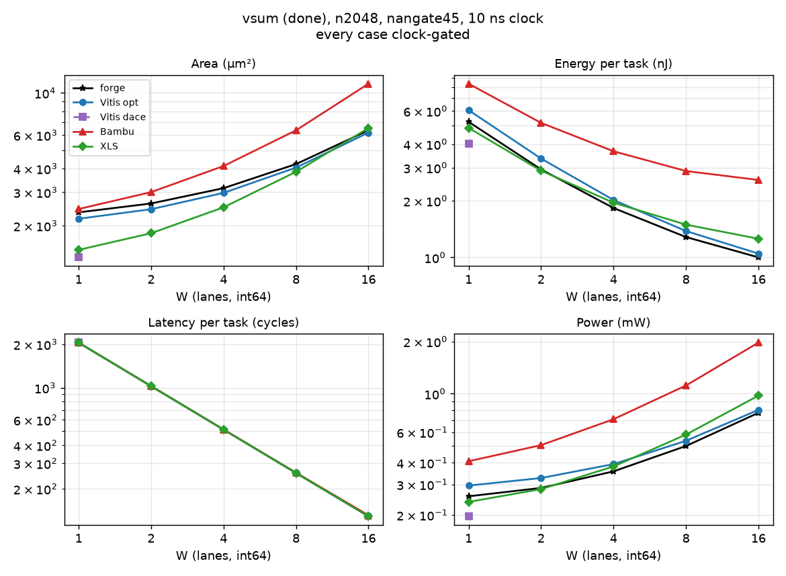

# vsum (tier done)

forge's figures exclude `<tag>_peripherals` (BUSY_COUNTER, snax-forge D168): it is in neither the csr nor the total without csr.

Part of [the comparison](../README.md): setup, summary across kernels and the parts' basis are there.

<!-- gen:main -->

n2048, nangate45, int64, 10 ns, every case clock-gated.

[forge's ctrl + datapath against the HLS totals](vsum_ctrl_dp.png): forge without its csr, its `<tag>_peripherals` and its glue; the HLS cases as above.

| W | Case | Area (µm²) | Energy (nJ) | Latency (cycles) | Power (mW) |
|---|---|---|---|---|---|
| 1 | forge | 2,349 | 5.251 | 2049 | 0.2563 |
| 1 | Vitis opt | 2,173 | 6.056 | 2050 | 0.2954 |
| 1 | Vitis dace | 1,361 | 4.032 | 2051 | 0.1966 |
| 1 | Bambu | 2,446 | 8.365 | 2050 | 0.408 |
| 1 | XLS | 1,490 | 4.874 | 2049 | 0.2379 |
| 2 | forge | 2,616 | 2.934 | 1025 | 0.2863 |
| 2 | Vitis opt | 2,440 | 3.35 | 1026 | 0.3265 |
| 2 | Bambu | 3,003 | 5.183 | 1026 | 0.5052 |
| 2 | XLS | 1,824 | 2.889 | 1025 | 0.2818 |
| 4 | forge | 3,150 | 1.83 | 513 | 0.3567 |
| 4 | Vitis opt | 2,974 | 2.019 | 514 | 0.3928 |
| 4 | Bambu | 4,121 | 3.663 | 514 | 0.7127 |
| 4 | XLS | 2,496 | 1.953 | 513 | 0.3807 |
| 8 | forge | 4,218 | 1.283 | 257 | 0.4994 |
| 8 | Vitis opt | 4,043 | 1.381 | 258 | 0.5352 |
| 8 | Bambu | 6,352 | 2.877 | 258 | 1.115 |
| 8 | XLS | 3,840 | 1.493 | 257 | 0.581 |
| 16 | forge | 6,355 | 1.001 | 129 | 0.7758 |
| 16 | Vitis opt | 6,179 | 1.048 | 130 | 0.8064 |
| 16 | Bambu | 11,178 | 2.579 | 131 | 1.969 |
| 16 | XLS | 6,528 | 1.257 | 129 | 0.9744 |
<!-- /gen -->

## Insights

- No per-lane registers in Vitis opt (264 flops at every W) or XLS (160); Bambu registers the input beat, 64 flops per lane, so its area grows 711 µm² per lane against 267 (Vitis) and 336 (XLS).
- The fixed part dominates at small W: about 2.1k µm² for Vitis and 2.2k for Bambu against 1.2k for XLS, which has 104 fewer flops than Vitis.
- Energy per task drops from W = 1 to 16 by 6x for Vitis, 4x for XLS and 3x for Bambu: the fixed per-cycle cost is spread over fewer cycles, but Bambu's input registers grow with W.
- Vitis dace exists only at W = 1 (1.5k µm², 166 flops), smaller than opt there (2.4k µm², 264 flops).
- forge (vsum_tree: TreeAccumulate) carries a fold's fixed control, 760 µm² with JOB_BEATS since CTRL2 (1,294 before: the copies of JOBS and JOB_BEATS are gone, 131 to 67 flops), against XLS's 160 flops in total. At W = 1 its total without csr (the peripherals in no figure, X65) is 1.6k µm² against 1.5k for Vitis dace and 1.55k for XLS, and 2 % more energy than Vitis dace, the best case (22 % before CTRL2), 3 % less than XLS's. From W = 2 forge has the lowest energy and the smallest area (W = 2: 1.39 pJ per element against XLS's 1.45; W = 4: 0.870 against 0.972; W = 16: 0.482 against Vitis opt's 0.540, 5.6k µm² against 6.4k).

## Parts at n2048

<!-- gen:parts -->
| W | Case | Part | Area (µm²) | Energy (nJ) | pJ per element |
|---|---|---|---|---|---|
| 1 | forge | csr | 701.2 | 0.6223 | 0.3039 |
| 1 | forge | ctrl | 710.8 | 0.6506 | 0.3177 |
| 1 | forge | datapath | 684.2 | 3.405 | 1.663 |
| 1 | forge | total | 2,349 | 5.251 | 2.564 |
| 1 | forge | total without csr | 1,395 | 4.056 | 1.98 |
| 1 | Vitis opt | total | 2,173 | 6.056 | 2.957 |
| 1 | Vitis dace | total | 1,361 | 4.032 | 1.969 |
| 1 | Bambu | ctrl | 67.3 | 0.04319 | 0.02109 |
| 1 | Bambu | datapath | 2,374 | 8.307 | 4.056 |
| 1 | Bambu | total | 2,446 | 8.365 | 4.084 |
| 1 | XLS | total | 1,490 | 4.874 | 2.38 |
| 2 | forge | csr | 701.2 | 0.3114 | 0.1521 |
| 2 | forge | ctrl | 710.8 | 0.3295 | 0.1609 |
| 2 | forge | datapath | 951.2 | 2.003 | 0.978 |
| 2 | forge | total | 2,616 | 2.934 | 1.433 |
| 2 | forge | total without csr | 1,663 | 2.332 | 1.139 |
| 2 | Vitis opt | total | 2,440 | 3.35 | 1.636 |
| 2 | Bambu | ctrl | 67.3 | 0.02188 | 0.01068 |
| 2 | Bambu | datapath | 2,930 | 5.154 | 2.517 |
| 2 | Bambu | total | 3,003 | 5.183 | 2.531 |
| 2 | XLS | total | 1,824 | 2.889 | 1.411 |
| 4 | forge | csr | 701.2 | 0.156 | 0.07616 |
| 4 | forge | ctrl | 710.8 | 0.1673 | 0.08168 |
| 4 | forge | datapath | 1,485 | 1.36 | 0.6639 |
| 4 | forge | total | 3,150 | 1.83 | 0.8935 |
| 4 | forge | total without csr | 2,197 | 1.527 | 0.7455 |
| 4 | Vitis opt | total | 2,974 | 2.019 | 0.9858 |
| 4 | Bambu | ctrl | 67.3 | 0.01122 | 0.005477 |
| 4 | Bambu | datapath | 4,048 | 3.648 | 1.781 |
| 4 | Bambu | total | 4,121 | 3.663 | 1.789 |
| 4 | XLS | total | 2,496 | 1.953 | 0.9537 |
| 8 | forge | csr | 701.2 | 0.07826 | 0.03821 |
| 8 | forge | ctrl | 710.8 | 0.08508 | 0.04154 |
| 8 | forge | datapath | 2,554 | 1.045 | 0.5105 |
| 8 | forge | total | 4,218 | 1.283 | 0.6266 |
| 8 | forge | total without csr | 3,265 | 1.131 | 0.552 |
| 8 | Vitis opt | total | 4,043 | 1.381 | 0.6743 |
| 8 | Bambu | ctrl | 67.3 | 0.005886 | 0.002874 |
| 8 | Bambu | datapath | 6,279 | 2.869 | 1.401 |
| 8 | Bambu | total | 6,352 | 2.877 | 1.405 |
| 8 | XLS | total | 3,840 | 1.493 | 0.7291 |
| 16 | forge | csr | 701.2 | 0.03939 | 0.01924 |
| 16 | forge | ctrl | 710.8 | 0.04355 | 0.02126 |
| 16 | forge | datapath | 4,690 | 0.8801 | 0.4297 |
| 16 | forge | total | 6,355 | 1.001 | 0.4887 |
| 16 | forge | total without csr | 5,401 | 0.9236 | 0.451 |
| 16 | Vitis opt | total | 6,179 | 1.048 | 0.5119 |
| 16 | Bambu | ctrl | 128.2 | 0.004935 | 0.00241 |
| 16 | Bambu | datapath | 11,045 | 2.573 | 1.257 |
| 16 | Bambu | total | 11,178 | 2.579 | 1.259 |
| 16 | XLS | total | 6,528 | 1.257 | 0.6138 |
<!-- /gen -->
