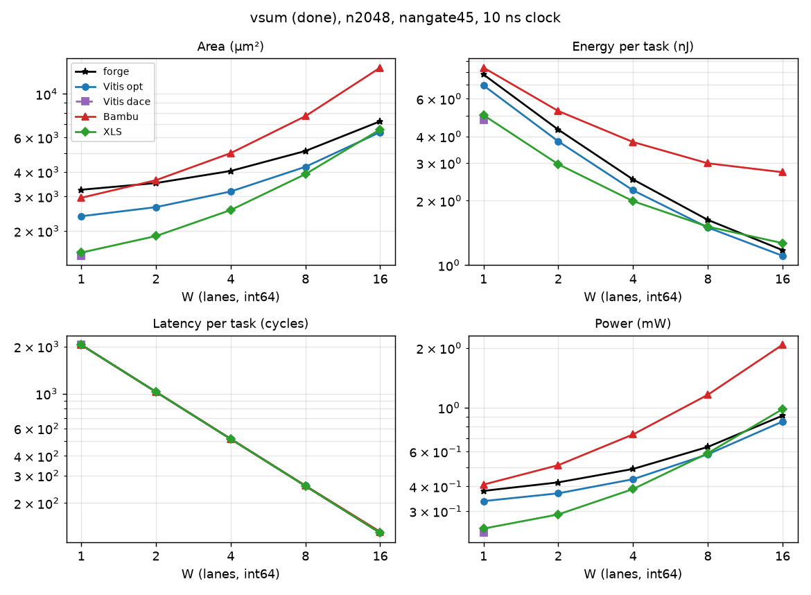

# vsum (tier done)

forge's figures exclude `<tag>_peripherals` (BUSY_COUNTER, snax-forge D168): it is in neither the csr nor the total without csr.

Part of [the comparison](../README.md): setup, summary across kernels and the parts' basis are there.

<!-- gen:main -->

n2048, nangate45, int64, 10 ns.

| W | Case | Area (µm²) | Energy (nJ) | Latency (cycles) | Power (mW) |
|---|---|---|---|---|---|
| 1 | forge | 2,677 | 6.795 | 2049 | 0.3316 |
| 1 | Vitis opt | 2,376 | 6.916 | 2050 | 0.3374 |
| 1 | Vitis dace | 1,493 | 4.785 | 2051 | 0.2333 |
| 1 | Bambu | 2,951 | 8.379 | 2050 | 0.4087 |
| 1 | XLS | 1,549 | 5.022 | 2049 | 0.2451 |
| 2 | forge | 2,942 | 3.804 | 1025 | 0.3711 |
| 2 | Vitis opt | 2,644 | 3.789 | 1026 | 0.3693 |
| 2 | Bambu | 3,629 | 5.253 | 1026 | 0.512 |
| 2 | XLS | 1,882 | 2.962 | 1025 | 0.2889 |
| 4 | forge | 3,478 | 2.266 | 513 | 0.4416 |
| 4 | Vitis opt | 3,178 | 2.236 | 514 | 0.435 |
| 4 | Bambu | 4,988 | 3.761 | 514 | 0.7316 |
| 4 | XLS | 2,555 | 1.991 | 513 | 0.388 |
| 8 | forge | 4,548 | 1.502 | 257 | 0.5844 |
| 8 | Vitis opt | 4,246 | 1.499 | 258 | 0.5808 |
| 8 | Bambu | 7,703 | 2.992 | 258 | 1.16 |
| 8 | XLS | 3,898 | 1.512 | 257 | 0.5883 |
| 16 | forge | 6,685 | 1.111 | 129 | 0.8613 |
| 16 | Vitis opt | 6,383 | 1.105 | 130 | 0.8501 |
| 16 | Bambu | 13,617 | 2.717 | 131 | 2.074 |
| 16 | XLS | 6,586 | 1.266 | 129 | 0.9817 |
<!-- /gen -->

## Insights

- No per-lane registers in Vitis opt (264 flops at every W) or XLS (160); Bambu registers the input beat, 64 flops per lane, so its area grows 711 µm² per lane against 267 (Vitis) and 336 (XLS).
- The fixed part dominates at small W: about 2.1k µm² for Vitis and 2.2k for Bambu against 1.2k for XLS, which has 104 fewer flops than Vitis.
- Energy per task drops from W = 1 to 16 by 6x for Vitis, 4x for XLS and 3x for Bambu: the fixed per-cycle cost is spread over fewer cycles, but Bambu's input registers grow with W.
- Vitis dace exists only at W = 1 (1.5k µm², 166 flops), smaller than opt there (2.4k µm², 264 flops).
- forge (vsum_tree: TreeAccumulate) carries a fold's fixed control, 760 µm² with JOB_BEATS since CTRL2 (1,294 before: the copies of JOBS and JOB_BEATS are gone, 131 to 67 flops), against XLS's 160 flops in total. At W = 1 its total without csr (the peripherals in no figure, X65) is 1.6k µm² against 1.5k for Vitis dace and 1.55k for XLS, and 2 % more energy than Vitis dace, the best case (22 % before CTRL2), 3 % less than XLS's. From W = 2 forge has the lowest energy and the smallest area (W = 2: 1.39 pJ per element against XLS's 1.45; W = 4: 0.870 against 0.972; W = 16: 0.482 against Vitis opt's 0.540, 5.6k µm² against 6.4k).

## Parts at n2048

<!-- gen:parts -->
| W | Case | Part | Area (µm²) | Energy (nJ) | pJ per element |
|---|---|---|---|---|---|
| 1 | forge | csr | 794.3 | 1.439 | 0.7029 |
| 1 | forge | ctrl | 760.8 | 1.014 | 0.4949 |
| 1 | forge | datapath | 841.4 | 3.86 | 1.885 |
| 1 | forge | total | 2,677 | 6.795 | 3.318 |
| 1 | forge | total without csr | 1,603 | 4.874 | 2.38 |
| 1 | Vitis opt | total | 2,376 | 6.916 | 3.377 |
| 1 | Vitis dace | total | 1,493 | 4.785 | 2.336 |
| 1 | Bambu | ctrl | 55.06 | 0.04351 | 0.02125 |
| 1 | Bambu | datapath | 2,891 | 8.321 | 4.063 |
| 1 | Bambu | total | 2,951 | 8.379 | 4.091 |
| 1 | XLS | total | 1,549 | 5.022 | 2.452 |
| 2 | forge | csr | 794.3 | 0.7202 | 0.3516 |
| 2 | forge | ctrl | 760.5 | 0.511 | 0.2495 |
| 2 | forge | datapath | 1,107 | 2.328 | 1.137 |
| 2 | forge | total | 2,942 | 3.804 | 1.857 |
| 2 | forge | total without csr | 1,869 | 2.839 | 1.386 |
| 2 | Vitis opt | total | 2,644 | 3.789 | 1.85 |
| 2 | Bambu | ctrl | 55.06 | 0.02219 | 0.01084 |
| 2 | Bambu | datapath | 3,568 | 5.224 | 2.551 |
| 2 | Bambu | total | 3,629 | 5.253 | 2.565 |
| 2 | XLS | total | 1,882 | 2.962 | 1.446 |
| 4 | forge | csr | 794.3 | 0.3605 | 0.176 |
| 4 | forge | ctrl | 760.5 | 0.2579 | 0.1259 |
| 4 | forge | datapath | 1,643 | 1.523 | 0.7436 |
| 4 | forge | total | 3,478 | 2.266 | 1.106 |
| 4 | forge | total without csr | 2,405 | 1.781 | 0.8695 |
| 4 | Vitis opt | total | 3,178 | 2.236 | 1.092 |
| 4 | Bambu | ctrl | 55.06 | 0.01153 | 0.005629 |
| 4 | Bambu | datapath | 4,928 | 3.745 | 1.829 |
| 4 | Bambu | total | 4,988 | 3.761 | 1.836 |
| 4 | XLS | total | 2,555 | 1.991 | 0.972 |
| 8 | forge | csr | 794.3 | 0.1807 | 0.08823 |
| 8 | forge | ctrl | 760.5 | 0.1304 | 0.06366 |
| 8 | forge | datapath | 2,713 | 1.128 | 0.5505 |
| 8 | forge | total | 4,548 | 1.502 | 0.7333 |
| 8 | forge | total without csr | 3,474 | 1.258 | 0.6142 |
| 8 | Vitis opt | total | 4,246 | 1.499 | 0.7317 |
| 8 | Bambu | ctrl | 55.06 | 0.006196 | 0.003025 |
| 8 | Bambu | datapath | 7,642 | 2.984 | 1.457 |
| 8 | Bambu | total | 7,703 | 2.992 | 1.461 |
| 8 | XLS | total | 3,898 | 1.512 | 0.7383 |
| 16 | forge | csr | 794.3 | 0.09078 | 0.04433 |
| 16 | forge | ctrl | 760.5 | 0.06617 | 0.03231 |
| 16 | forge | datapath | 4,849 | 0.9219 | 0.4501 |
| 16 | forge | total | 6,685 | 1.111 | 0.5425 |
| 16 | forge | total without csr | 5,611 | 0.9881 | 0.4825 |
| 16 | Vitis opt | total | 6,383 | 1.105 | 0.5396 |
| 16 | Bambu | ctrl | 118.6 | 0.005344 | 0.00261 |
| 16 | Bambu | datapath | 13,493 | 2.711 | 1.324 |
| 16 | Bambu | total | 13,617 | 2.717 | 1.327 |
| 16 | XLS | total | 6,586 | 1.266 | 0.6184 |
<!-- /gen -->
