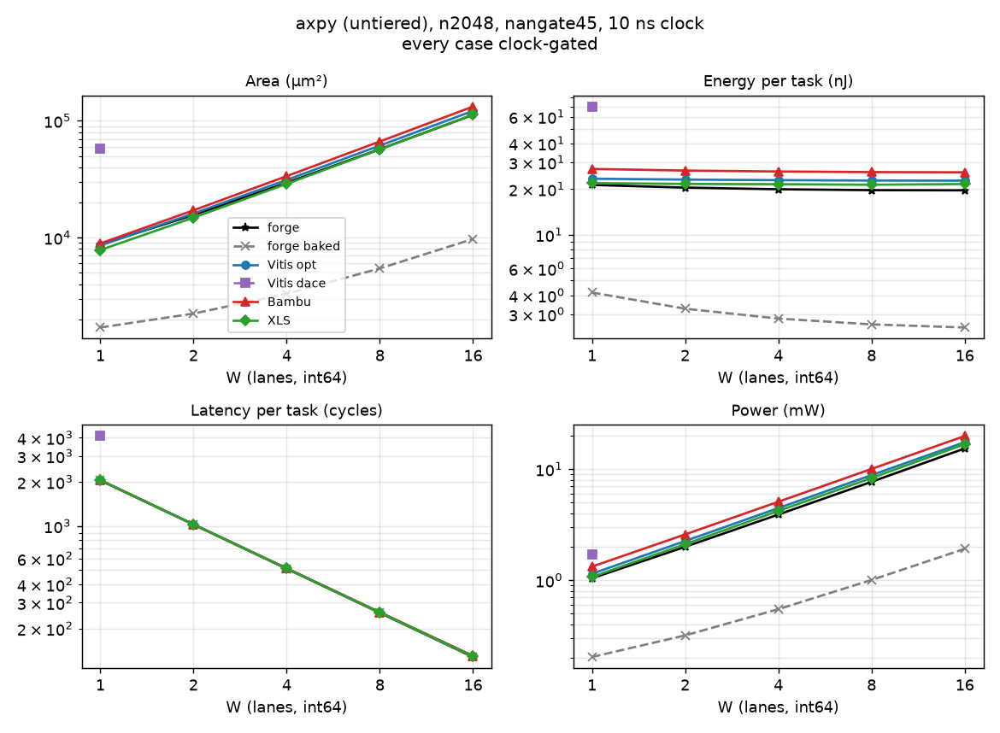

# axpy (tier untiered)

forge's figures exclude `<tag>_peripherals` (BUSY_COUNTER, snax-forge D168): it is in neither the csr nor the total without csr.

Part of [the comparison](../README.md): setup, summary across kernels and the parts' basis are there.

<!-- gen:main -->

n2048, nangate45, int64, 10 ns. HLS clock-gated, forge ungated: forge's points are not yet synthesized gated, and the insights below were written when both were ungated.

[forge's ctrl + datapath against the HLS totals](axpy_ctrl_dp.png): forge without its csr, its `<tag>_peripherals` and its glue; the HLS cases as above.

| W | Case | Area (µm²) | Energy (nJ) | Latency (cycles) | Power (mW) |
|---|---|---|---|---|---|
| 1 | forge | 8,898 | 22.39 | 2048 | 1.093 |
| 1 | forge baked | 1,802 | 4.33 | 2048 | 0.2114 |
| 1 | Vitis opt | 8,559 | 23.42 | 2050 | 1.142 |
| 1 | Vitis dace | 58,037 | 69.93 | 4101 | 1.705 |
| 1 | Bambu | 8,910 | 27.15 | 2050 | 1.325 |
| 1 | XLS | 7,829 | 21.91 | 2049 | 1.07 |
| 2 | forge | 15,812 | 20.99 | 1024 | 2.05 |
| 2 | forge baked | 2,337 | 3.341 | 1024 | 0.3263 |
| 2 | Vitis opt | 16,077 | 23.11 | 1026 | 2.252 |
| 2 | Bambu | 17,118 | 26.49 | 1026 | 2.582 |
| 2 | XLS | 14,817 | 21.63 | 1025 | 2.11 |
| 4 | forge | 29,628 | 20.23 | 512 | 3.95 |
| 4 | forge baked | 3,408 | 2.848 | 512 | 0.5562 |
| 4 | Vitis opt | 31,129 | 22.91 | 514 | 4.457 |
| 4 | Bambu | 33,551 | 26.12 | 514 | 5.081 |
| 4 | XLS | 28,829 | 21.54 | 513 | 4.2 |
| 8 | forge | 57,261 | 19.82 | 256 | 7.741 |
| 8 | forge baked | 5,550 | 2.591 | 256 | 1.012 |
| 8 | Vitis opt | 61,252 | 22.77 | 258 | 8.827 |
| 8 | Bambu | 66,432 | 25.89 | 258 | 10.03 |
| 8 | XLS | 56,791 | 21.37 | 257 | 8.314 |
| 16 | forge | 112,454 | 19.71 | 128 | 15.4 |
| 16 | forge baked | 9,834 | 2.462 | 128 | 1.923 |
| 16 | Vitis opt | 121,451 | 22.73 | 130 | 17.49 |
| 16 | Bambu | 132,178 | 25.8 | 130 | 19.85 |
| 16 | XLS | 112,758 | 21.6 | 129 | 16.75 |
<!-- /gen -->

## Insights

- Multiplier-bound, like vecmul: at W = 16, XLS 112.7k µm², Vitis opt 123.5k, Bambu 138.0k.
- XLS's 96 flops are its loop count and alpha; Vitis registers alpha as a pin and the output beat (135 fixed flops plus 64 per lane, 199 at W = 1); Bambu reads alpha as a held wire but registers x, y and the output beat (192 flops per lane).
- Energy per task: XLS 21.5 to 22.7 nJ, Vitis 22.9 to 24.8, Bambu 26.2 to 27.2, so Bambu is 20 to 22 % above XLS at every W.
- forge with α in a CSR (K1_LO and K1_HI): without its csr it is 1 to 4 % smaller than XLS at every W and 9 to 12 % lower in energy (W = 16: 9.55 against 10.58 pJ per element). Its CSR file is the largest of the kernels, 1,073 µm² without its `<tag>_peripherals` (X65), for α's two words.
- forge baked bakes α = 3 into a shift and an add per lane: 9.3k µm² and 1.17 pJ per element at W = 16, 12x less area and 9x less energy than the best run-time α case (XLS). It is not like-for-like; it shows what the design-time choice is worth.
- Vitis dace_w1 (X62): 58.2k µm², 49.3k of it the macro holding DaCe's α·x; 4101 cycles; 73.5 nJ per task, 45.3 of it the macro.

## Parts at n2048

<!-- gen:parts -->
| W | Case | Part | Area (µm²) | Energy (nJ) | pJ per element |
|---|---|---|---|---|---|
| 1 | forge | csr | 1,073 | 1.906 | 0.9306 |
| 1 | forge | ctrl | 438.4 | 0.5435 | 0.2654 |
| 1 | forge | datapath | 7,106 | 19.46 | 9.503 |
| 1 | forge | total | 8,898 | 22.39 | 10.93 |
| 1 | forge | total without csr | 7,546 | 20.01 | 9.769 |
| 1 | forge baked | csr | 547.7 | 0.9693 | 0.4733 |
| 1 | forge baked | ctrl | 438.4 | 0.5435 | 0.2654 |
| 1 | forge baked | datapath | 535.5 | 2.336 | 1.141 |
| 1 | forge baked | total | 1,802 | 4.33 | 2.114 |
| 1 | forge baked | total without csr | 974.9 | 2.88 | 1.406 |
| 1 | Vitis opt | total | 8,559 | 23.42 | 11.43 |
| 1 | Vitis dace | RAM (macro) | 49,275 | 45.25 | 22.09 |
| 1 | Vitis dace | logic without the RAM | 8,762 | 24.69 | 12.05 |
| 1 | Vitis dace | total | 58,037 | 69.93 | 34.15 |
| 1 | Bambu | ctrl | 72.35 | 0.04325 | 0.02112 |
| 1 | Bambu | datapath | 8,833 | 27.09 | 13.23 |
| 1 | Bambu | total | 8,910 | 27.15 | 13.26 |
| 1 | XLS | total | 7,829 | 21.91 | 10.7 |
| 2 | forge | csr | 1,073 | 0.9531 | 0.4654 |
| 2 | forge | ctrl | 438.4 | 0.2754 | 0.1345 |
| 2 | forge | datapath | 14,020 | 19.52 | 9.532 |
| 2 | forge | total | 15,812 | 20.99 | 10.25 |
| 2 | forge | total without csr | 14,460 | 19.8 | 9.666 |
| 2 | forge baked | csr | 547.7 | 0.4847 | 0.2367 |
| 2 | forge baked | ctrl | 438.4 | 0.2755 | 0.1345 |
| 2 | forge baked | datapath | 1,071 | 2.336 | 1.141 |
| 2 | forge baked | total | 2,337 | 3.341 | 1.631 |
| 2 | forge baked | total without csr | 1,510 | 2.612 | 1.275 |
| 2 | Vitis opt | total | 16,077 | 23.11 | 11.28 |
| 2 | Bambu | ctrl | 72.35 | 0.02193 | 0.01071 |
| 2 | Bambu | datapath | 17,040 | 26.46 | 12.92 |
| 2 | Bambu | total | 17,118 | 26.49 | 12.94 |
| 2 | XLS | total | 14,817 | 21.63 | 10.56 |
| 4 | forge | csr | 1,073 | 0.4767 | 0.2328 |
| 4 | forge | ctrl | 438.4 | 0.1395 | 0.06813 |
| 4 | forge | datapath | 27,836 | 19.49 | 9.514 |
| 4 | forge | total | 29,628 | 20.23 | 9.876 |
| 4 | forge | total without csr | 28,276 | 19.62 | 9.582 |
| 4 | forge baked | csr | 547.7 | 0.2424 | 0.1184 |
| 4 | forge baked | ctrl | 438.4 | 0.1396 | 0.06815 |
| 4 | forge baked | datapath | 2,142 | 2.342 | 1.143 |
| 4 | forge baked | total | 3,408 | 2.848 | 1.39 |
| 4 | forge baked | total without csr | 2,581 | 2.481 | 1.211 |
| 4 | Vitis opt | total | 31,129 | 22.91 | 11.19 |
| 4 | Bambu | ctrl | 72.35 | 0.01127 | 0.005502 |
| 4 | Bambu | datapath | 33,473 | 26.1 | 12.75 |
| 4 | Bambu | total | 33,551 | 26.12 | 12.75 |
| 4 | XLS | total | 28,829 | 21.54 | 10.52 |
| 8 | forge | csr | 1,073 | 0.2386 | 0.1165 |
| 8 | forge | ctrl | 438.4 | 0.0707 | 0.03452 |
| 8 | forge | datapath | 55,469 | 19.45 | 9.495 |
| 8 | forge | total | 57,261 | 19.82 | 9.676 |
| 8 | forge | total without csr | 55,908 | 19.52 | 9.529 |
| 8 | forge baked | csr | 547.7 | 0.1213 | 0.05922 |
| 8 | forge baked | ctrl | 438.4 | 0.07074 | 0.03454 |
| 8 | forge baked | datapath | 4,284 | 2.336 | 1.141 |
| 8 | forge baked | total | 5,550 | 2.591 | 1.265 |
| 8 | forge baked | total without csr | 4,723 | 2.407 | 1.175 |
| 8 | Vitis opt | total | 61,252 | 22.77 | 11.12 |
| 8 | Bambu | ctrl | 75.28 | 0.005961 | 0.002911 |
| 8 | Bambu | datapath | 66,351 | 25.88 | 12.64 |
| 8 | Bambu | total | 66,432 | 25.89 | 12.64 |
| 8 | XLS | total | 56,791 | 21.37 | 10.43 |
| 16 | forge | csr | 1,073 | 0.1195 | 0.05835 |
| 16 | forge | ctrl | 438.4 | 0.03582 | 0.01749 |
| 16 | forge | datapath | 110,662 | 19.52 | 9.534 |
| 16 | forge | total | 112,454 | 19.71 | 9.625 |
| 16 | forge | total without csr | 111,101 | 19.56 | 9.551 |
| 16 | forge baked | csr | 547.7 | 0.06071 | 0.02964 |
| 16 | forge baked | ctrl | 438.4 | 0.03585 | 0.01751 |
| 16 | forge baked | datapath | 8,567 | 2.334 | 1.139 |
| 16 | forge baked | total | 9,834 | 2.462 | 1.202 |
| 16 | forge baked | total without csr | 9,007 | 2.369 | 1.157 |
| 16 | Vitis opt | total | 121,451 | 22.73 | 11.1 |
| 16 | Bambu | ctrl | 75.28 | 0.003297 | 0.00161 |
| 16 | Bambu | datapath | 132,097 | 25.8 | 12.6 |
| 16 | Bambu | total | 132,178 | 25.8 | 12.6 |
| 16 | XLS | total | 112,758 | 21.6 | 10.55 |
<!-- /gen -->
