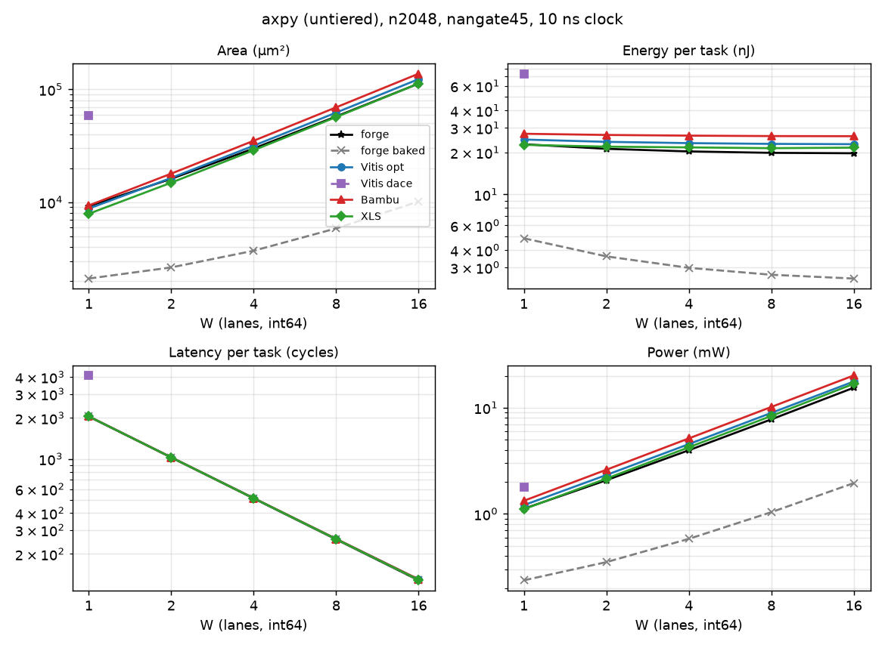

# axpy (tier untiered)

Part of [the comparison](../README.md): setup, summary across kernels and the parts' basis are there.

<!-- gen:main -->

n2048, nangate45, int64, 10 ns.

| W | Case | Area (µm²) | Energy (nJ) | Latency (cycles) | Power (mW) |
|---|---|---|---|---|---|
| 1 | forge | 9,194 | 22.91 | 2048 | 1.119 |
| 1 | forge baked | 2,099 | 4.849 | 2048 | 0.2367 |
| 1 | Vitis opt | 8,767 | 24.76 | 2050 | 1.208 |
| 1 | Vitis dace | 58,219 | 73.46 | 4101 | 1.791 |
| 1 | Bambu | 9,340 | 27.24 | 2050 | 1.329 |
| 1 | XLS | 7,883 | 22.7 | 2049 | 1.108 |
| 2 | forge | 16,108 | 21.25 | 1024 | 2.075 |
| 2 | forge baked | 2,634 | 3.598 | 1024 | 0.3514 |
| 2 | Vitis opt | 16,404 | 23.84 | 1026 | 2.324 |
| 2 | Bambu | 17,909 | 26.72 | 1026 | 2.604 |
| 2 | XLS | 14,883 | 22.02 | 1025 | 2.148 |
| 4 | forge | 29,924 | 20.36 | 512 | 3.976 |
| 4 | forge baked | 3,705 | 2.979 | 512 | 0.5818 |
| 4 | Vitis opt | 31,699 | 23.34 | 514 | 4.541 |
| 4 | Bambu | 35,066 | 26.41 | 514 | 5.139 |
| 4 | XLS | 28,904 | 21.76 | 513 | 4.241 |
| 8 | forge | 57,557 | 19.88 | 256 | 7.767 |
| 8 | forge baked | 5,847 | 2.657 | 256 | 1.038 |
| 8 | Vitis opt | 62,301 | 23.05 | 258 | 8.935 |
| 8 | Bambu | 69,396 | 26.22 | 258 | 10.16 |
| 8 | XLS | 56,854 | 21.47 | 257 | 8.354 |
| 16 | forge | 112,749 | 19.75 | 128 | 15.43 |
| 16 | forge baked | 10,131 | 2.495 | 128 | 1.949 |
| 16 | Vitis opt | 123,459 | 22.94 | 130 | 17.64 |
| 16 | Bambu | 138,011 | 26.17 | 130 | 20.13 |
| 16 | XLS | 112,732 | 21.66 | 129 | 16.79 |
<!-- /gen -->

## Insights

- Multiplier-bound, like vecmul: at W = 16, XLS 112.7k µm², Vitis opt 123.5k, Bambu 138.0k.
- XLS's 96 flops are its loop count and alpha; Vitis registers alpha as a pin and the output beat (135 fixed flops plus 64 per lane, 199 at W = 1); Bambu reads alpha as a held wire but registers x, y and the output beat (192 flops per lane).
- Energy per task: XLS 21.5 to 22.7 nJ, Vitis 22.9 to 24.8, Bambu 26.2 to 27.2, so Bambu is 20 to 22 % above XLS at every W.
- forge with α in a CSR (K1_LO and K1_HI): its ctrl + datapath is within 1 % of XLS's area at every W and 9 to 10 % lower in energy (W = 16: 9.57 against 10.58 pJ per element). Its CSR file is the largest of the kernels, 1,375 µm², for α's two words.
- forge baked bakes α = 3 into a shift and an add per lane: 9.3k µm² and 1.17 pJ per element at W = 16, 12x less area and 9x less energy than the best run-time α case (XLS). It is not like-for-like; it shows what the design-time choice is worth.
- Vitis dace_w1 (X62): 58.2k µm², 49.3k of it the macro holding DaCe's α·x; 4101 cycles; 73.5 nJ per task, 45.3 of it the macro.

## Parts at n2048

<!-- gen:parts -->
| W | Case | Part | Area (µm²) | Energy (nJ) | pJ per element |
|---|---|---|---|---|---|
| 1 | forge | csr | 1,375 | 2.404 | 1.174 |
| 1 | forge | ctrl | 712.1 | 1.042 | 0.5087 |
| 1 | forge | datapath | 7,106 | 19.46 | 9.503 |
| 1 | forge | total | 9,194 | 22.91 | 11.19 |
| 1 | forge | total without csr | 7,819 | 20.5 | 10.01 |
| 1 | forge baked | csr | 849.9 | 1.471 | 0.7182 |
| 1 | forge baked | ctrl | 712.6 | 1.042 | 0.5087 |
| 1 | forge baked | datapath | 535.5 | 2.336 | 1.141 |
| 1 | forge baked | total | 2,099 | 4.849 | 2.367 |
| 1 | forge baked | total without csr | 1,249 | 3.378 | 1.649 |
| 1 | Vitis opt | total | 8,767 | 24.76 | 12.09 |
| 1 | Vitis dace | RAM (macro) | 49,275 | 45.25 | 22.09 |
| 1 | Vitis dace | logic without the RAM | 8,944 | 28.21 | 13.77 |
| 1 | Vitis dace | total | 58,219 | 73.46 | 35.87 |
| 1 | Bambu | ctrl | 57.46 | 0.04347 | 0.02123 |
| 1 | Bambu | datapath | 9,278 | 27.18 | 13.27 |
| 1 | Bambu | total | 9,340 | 27.24 | 13.3 |
| 1 | XLS | total | 7,883 | 22.7 | 11.08 |
| 2 | forge | csr | 1,375 | 1.206 | 0.5887 |
| 2 | forge | ctrl | 712.1 | 0.5227 | 0.2552 |
| 2 | forge | datapath | 14,020 | 19.52 | 9.532 |
| 2 | forge | total | 16,108 | 21.25 | 10.38 |
| 2 | forge | total without csr | 14,733 | 20.04 | 9.788 |
| 2 | forge baked | csr | 849.9 | 0.7391 | 0.3609 |
| 2 | forge baked | ctrl | 712.6 | 0.5227 | 0.2552 |
| 2 | forge baked | datapath | 1,071 | 2.336 | 1.141 |
| 2 | forge baked | total | 2,634 | 3.598 | 1.757 |
| 2 | forge baked | total without csr | 1,785 | 2.859 | 1.396 |
| 2 | Vitis opt | total | 16,404 | 23.84 | 11.64 |
| 2 | Bambu | ctrl | 57.72 | 0.02216 | 0.01082 |
| 2 | Bambu | datapath | 17,846 | 26.69 | 13.03 |
| 2 | Bambu | total | 17,909 | 26.72 | 13.05 |
| 2 | XLS | total | 14,883 | 22.02 | 10.75 |
| 4 | forge | csr | 1,375 | 0.6049 | 0.2953 |
| 4 | forge | ctrl | 712.1 | 0.2657 | 0.1297 |
| 4 | forge | datapath | 27,836 | 19.49 | 9.514 |
| 4 | forge | total | 29,924 | 20.36 | 9.939 |
| 4 | forge | total without csr | 28,550 | 19.75 | 9.644 |
| 4 | forge baked | csr | 849.9 | 0.3715 | 0.1814 |
| 4 | forge baked | ctrl | 712.6 | 0.2657 | 0.1297 |
| 4 | forge baked | datapath | 2,142 | 2.342 | 1.143 |
| 4 | forge baked | total | 3,705 | 2.979 | 1.454 |
| 4 | forge baked | total without csr | 2,856 | 2.607 | 1.273 |
| 4 | Vitis opt | total | 31,699 | 23.34 | 11.4 |
| 4 | Bambu | ctrl | 57.99 | 0.01149 | 0.005609 |
| 4 | Bambu | datapath | 35,003 | 26.4 | 12.89 |
| 4 | Bambu | total | 35,066 | 26.41 | 12.9 |
| 4 | XLS | total | 28,904 | 21.76 | 10.62 |
| 8 | forge | csr | 1,375 | 0.3036 | 0.1482 |
| 8 | forge | ctrl | 712.1 | 0.1335 | 0.06517 |
| 8 | forge | datapath | 55,469 | 19.45 | 9.495 |
| 8 | forge | total | 57,557 | 19.88 | 9.708 |
| 8 | forge | total without csr | 56,182 | 19.58 | 9.56 |
| 8 | forge baked | csr | 849.9 | 0.1867 | 0.09118 |
| 8 | forge baked | ctrl | 712.6 | 0.1335 | 0.06517 |
| 8 | forge baked | datapath | 4,284 | 2.336 | 1.141 |
| 8 | forge baked | total | 5,847 | 2.657 | 1.297 |
| 8 | forge baked | total without csr | 4,997 | 2.47 | 1.206 |
| 8 | Vitis opt | total | 62,301 | 23.05 | 11.26 |
| 8 | Bambu | ctrl | 59.05 | 0.006157 | 0.003006 |
| 8 | Bambu | datapath | 69,332 | 26.22 | 12.8 |
| 8 | Bambu | total | 69,396 | 26.22 | 12.8 |
| 8 | XLS | total | 56,854 | 21.47 | 10.48 |
| 16 | forge | csr | 1,375 | 0.1525 | 0.07446 |
| 16 | forge | ctrl | 712.1 | 0.06781 | 0.03311 |
| 16 | forge | datapath | 110,661 | 19.53 | 9.534 |
| 16 | forge | total | 112,749 | 19.75 | 9.641 |
| 16 | forge | total without csr | 111,374 | 19.59 | 9.567 |
| 16 | forge baked | csr | 849.9 | 0.09392 | 0.04586 |
| 16 | forge baked | ctrl | 712.6 | 0.06782 | 0.03312 |
| 16 | forge baked | datapath | 8,567 | 2.334 | 1.139 |
| 16 | forge baked | total | 10,131 | 2.495 | 1.218 |
| 16 | forge baked | total without csr | 9,281 | 2.401 | 1.173 |
| 16 | Vitis opt | total | 123,459 | 22.94 | 11.2 |
| 16 | Bambu | ctrl | 58.79 | 0.003485 | 0.001702 |
| 16 | Bambu | datapath | 137,947 | 26.16 | 12.77 |
| 16 | Bambu | total | 138,011 | 26.17 | 12.78 |
| 16 | XLS | total | 112,732 | 21.66 | 10.58 |
<!-- /gen -->
