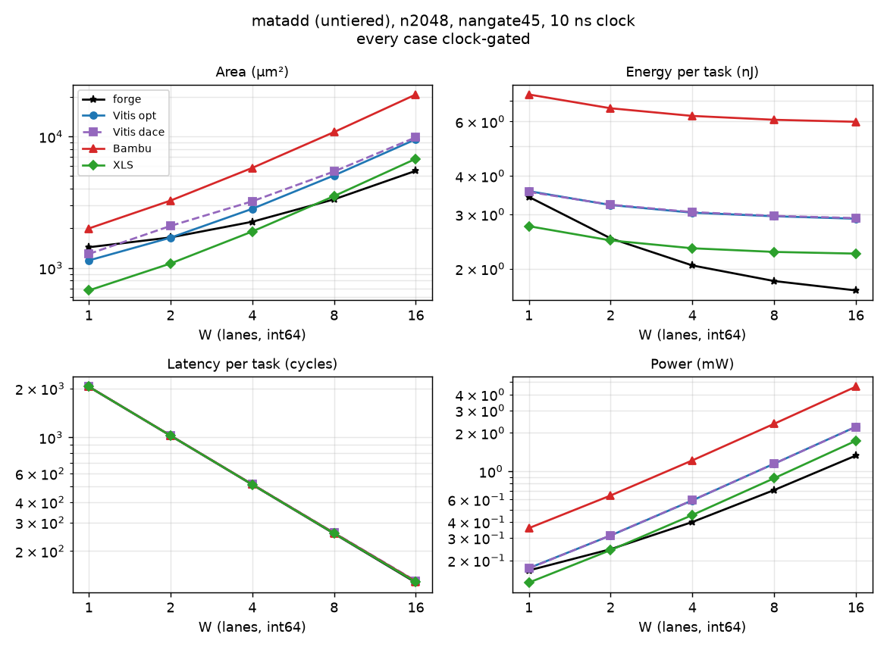

# matadd (tier untiered)

forge's figures exclude `<tag>_peripherals` (BUSY_COUNTER, snax-forge D168): it is in neither the csr nor the total without csr.

Part of [the comparison](../README.md): setup, summary across kernels and the parts' basis are there.

<!-- gen:main -->

n2048, nangate45, int64, 10 ns, every case clock-gated.

[forge's ctrl + datapath against the HLS totals](matadd_ctrl_dp.png): forge without its csr, its `<tag>_peripherals` and its glue; the HLS cases as above.

| W | Case | Area (µm²) | Energy (nJ) | Latency (cycles) | Power (mW) |
|---|---|---|---|---|---|
| 1 | forge | 1,436 | 3.417 | 2048 | 0.1669 |
| 1 | Vitis opt | 1,140 | 3.567 | 2050 | 0.174 |
| 1 | Vitis dace | 1,277 | 3.547 | 2050 | 0.173 |
| 1 | Bambu | 1,996 | 7.341 | 2050 | 0.3581 |
| 1 | XLS | 674 | 2.746 | 2049 | 0.134 |
| 2 | forge | 1,706 | 2.508 | 1024 | 0.2449 |
| 2 | Vitis opt | 1,699 | 3.216 | 1026 | 0.3135 |
| 2 | Vitis dace | 2,088 | 3.224 | 1026 | 0.3142 |
| 2 | Bambu | 3,254 | 6.623 | 1026 | 0.6456 |
| 2 | XLS | 1,080 | 2.469 | 1025 | 0.2409 |
| 4 | forge | 2,245 | 2.048 | 512 | 0.4 |
| 4 | Vitis opt | 2,817 | 3.037 | 514 | 0.5908 |
| 4 | Vitis dace | 3,213 | 3.051 | 515 | 0.5924 |
| 4 | Bambu | 5,772 | 6.255 | 514 | 1.217 |
| 4 | XLS | 1,893 | 2.328 | 513 | 0.4538 |
| 8 | forge | 3,324 | 1.823 | 256 | 0.7121 |
| 8 | Vitis opt | 5,054 | 2.957 | 258 | 1.146 |
| 8 | Vitis dace | 5,419 | 2.966 | 259 | 1.145 |
| 8 | Bambu | 10,807 | 6.078 | 258 | 2.356 |
| 8 | XLS | 3,519 | 2.266 | 257 | 0.8816 |
| 16 | forge | 5,482 | 1.7 | 128 | 1.328 |
| 16 | Vitis opt | 9,527 | 2.903 | 130 | 2.233 |
| 16 | Vitis dace | 9,863 | 2.916 | 131 | 2.226 |
| 16 | Bambu | 20,881 | 5.987 | 130 | 4.606 |
| 16 | XLS | 6,771 | 2.237 | 129 | 1.734 |
<!-- /gen -->

## Insights

- Every tool builds the same hardware as for vecadd: the 2-D loops become one flat run of M x N / W beats, and forge's streamers carry the 2-D pattern. At n2048 (m32_n64) area, flops, cycles and energy equal vecadd's at every W for every case, forge included, so vecadd's insights hold as they are.

## Parts at n2048

<!-- gen:parts -->
| W | Case | Part | Area (µm²) | Energy (nJ) | pJ per element |
|---|---|---|---|---|---|
| 1 | forge | csr | 472.9 | 0.6206 | 0.303 |
| 1 | forge | ctrl | 440.2 | 0.6423 | 0.3136 |
| 1 | forge | datapath | 269.7 | 1.585 | 0.774 |
| 1 | forge | total | 1,436 | 3.417 | 1.669 |
| 1 | forge | total without csr | 711.6 | 2.228 | 1.088 |
| 1 | Vitis opt | total | 1,140 | 3.567 | 1.742 |
| 1 | Vitis dace | total | 1,277 | 3.547 | 1.732 |
| 1 | Bambu | ctrl | 72.35 | 0.04325 | 0.02112 |
| 1 | Bambu | datapath | 1,918 | 7.283 | 3.556 |
| 1 | Bambu | total | 1,996 | 7.341 | 3.584 |
| 1 | XLS | total | 674 | 2.746 | 1.341 |
| 2 | forge | csr | 472.9 | 0.3104 | 0.1516 |
| 2 | forge | ctrl | 440.2 | 0.3247 | 0.1586 |
| 2 | forge | datapath | 539.4 | 1.584 | 0.7735 |
| 2 | forge | total | 1,706 | 2.508 | 1.224 |
| 2 | forge | total without csr | 981.3 | 1.909 | 0.9321 |
| 2 | Vitis opt | total | 1,699 | 3.216 | 1.57 |
| 2 | Vitis dace | total | 2,088 | 3.224 | 1.574 |
| 2 | Bambu | ctrl | 72.62 | 0.02193 | 0.01071 |
| 2 | Bambu | datapath | 3,176 | 6.594 | 3.22 |
| 2 | Bambu | total | 3,254 | 6.623 | 3.234 |
| 2 | XLS | total | 1,080 | 2.469 | 1.206 |
| 4 | forge | csr | 472.9 | 0.1553 | 0.07584 |
| 4 | forge | ctrl | 440.2 | 0.1641 | 0.08015 |
| 4 | forge | datapath | 1,079 | 1.583 | 0.7728 |
| 4 | forge | total | 2,245 | 2.048 | 1 |
| 4 | forge | total without csr | 1,521 | 1.747 | 0.853 |
| 4 | Vitis opt | total | 2,817 | 3.037 | 1.483 |
| 4 | Vitis dace | total | 3,213 | 3.051 | 1.49 |
| 4 | Bambu | ctrl | 72.62 | 0.01127 | 0.005505 |
| 4 | Bambu | datapath | 5,695 | 6.24 | 3.047 |
| 4 | Bambu | total | 5,772 | 6.255 | 3.054 |
| 4 | XLS | total | 1,893 | 2.328 | 1.137 |
| 8 | forge | csr | 472.9 | 0.07776 | 0.03797 |
| 8 | forge | ctrl | 440.2 | 0.08293 | 0.04049 |
| 8 | forge | datapath | 2,158 | 1.589 | 0.7757 |
| 8 | forge | total | 3,324 | 1.823 | 0.8901 |
| 8 | forge | total without csr | 2,600 | 1.672 | 0.8162 |
| 8 | Vitis opt | total | 5,054 | 2.957 | 1.444 |
| 8 | Vitis dace | total | 5,419 | 2.966 | 1.448 |
| 8 | Bambu | ctrl | 73.15 | 0.005945 | 0.002903 |
| 8 | Bambu | datapath | 10,729 | 6.07 | 2.964 |
| 8 | Bambu | total | 10,807 | 6.078 | 2.968 |
| 8 | XLS | total | 3,519 | 2.266 | 1.106 |
| 16 | forge | csr | 472.9 | 0.03898 | 0.01904 |
| 16 | forge | ctrl | 440.2 | 0.04186 | 0.02044 |
| 16 | forge | datapath | 4,316 | 1.581 | 0.7722 |
| 16 | forge | total | 5,482 | 1.7 | 0.8299 |
| 16 | forge | total without csr | 4,757 | 1.623 | 0.7927 |
| 16 | Vitis opt | total | 9,527 | 2.903 | 1.418 |
| 16 | Vitis dace | total | 9,863 | 2.916 | 1.424 |
| 16 | Bambu | ctrl | 73.15 | 0.00328 | 0.001602 |
| 16 | Bambu | datapath | 20,803 | 5.983 | 2.921 |
| 16 | Bambu | total | 20,881 | 5.987 | 2.924 |
| 16 | XLS | total | 6,771 | 2.237 | 1.092 |
<!-- /gen -->
