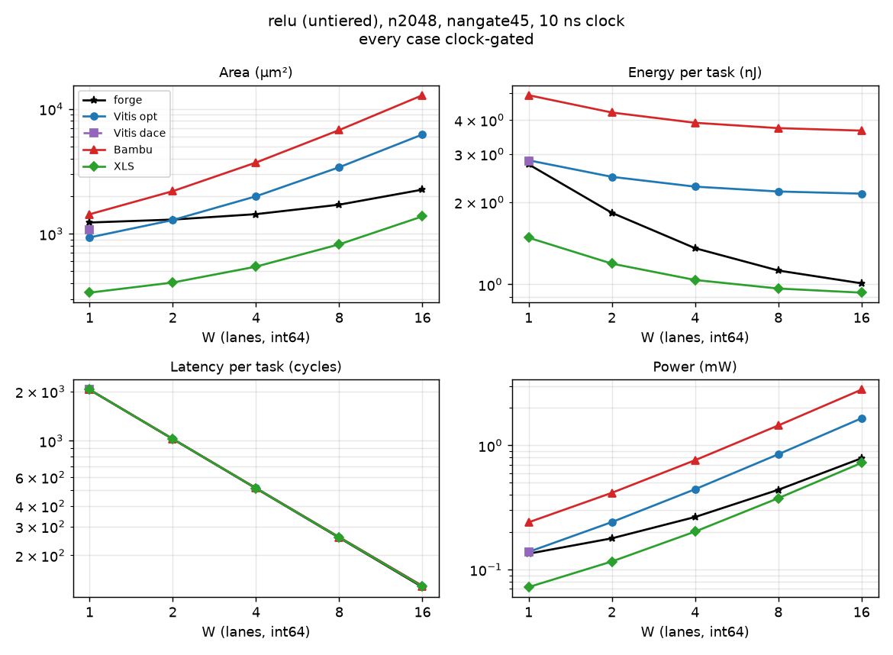

# relu (tier untiered)

forge's figures exclude `<tag>_peripherals` (BUSY_COUNTER, snax-forge D168): it is in neither the csr nor the total without csr.

Part of [the comparison](../README.md): setup, summary across kernels and the parts' basis are there.

<!-- gen:main -->

n2048, nangate45, int64, 10 ns, every case clock-gated.

[forge's ctrl + datapath against the HLS totals](relu_ctrl_dp.png): forge without its csr, its `<tag>_peripherals` and its glue; the HLS cases as above.

| W | Case | Area (µm²) | Energy (nJ) | Latency (cycles) | Power (mW) |
|---|---|---|---|---|---|
| 1 | forge | 1,229 | 2.75 | 2048 | 0.1343 |
| 1 | Vitis opt | 933.7 | 2.845 | 2050 | 0.1388 |
| 1 | Vitis dace | 1,071 | 2.824 | 2050 | 0.1378 |
| 1 | Bambu | 1,431 | 4.925 | 2050 | 0.2402 |
| 1 | XLS | 337.3 | 1.481 | 2049 | 0.07229 |
| 2 | forge | 1,298 | 1.828 | 1024 | 0.1785 |
| 2 | Vitis opt | 1,287 | 2.475 | 1026 | 0.2412 |
| 2 | Bambu | 2,192 | 4.257 | 1026 | 0.4149 |
| 2 | XLS | 406.4 | 1.191 | 1025 | 0.1162 |
| 4 | forge | 1,435 | 1.356 | 512 | 0.2649 |
| 4 | Vitis opt | 1,993 | 2.279 | 514 | 0.4433 |
| 4 | Bambu | 3,715 | 3.904 | 514 | 0.7595 |
| 4 | XLS | 544.8 | 1.037 | 513 | 0.2022 |
| 8 | forge | 1,708 | 1.123 | 256 | 0.4388 |
| 8 | Vitis opt | 3,406 | 2.187 | 258 | 0.8478 |
| 8 | Bambu | 6,763 | 3.732 | 258 | 1.446 |
| 8 | XLS | 821.9 | 0.9652 | 257 | 0.3755 |
| 16 | forge | 2,255 | 1.008 | 128 | 0.7878 |
| 16 | Vitis opt | 6,232 | 2.148 | 130 | 1.652 |
| 16 | Bambu | 12,856 | 3.654 | 130 | 2.811 |
| 16 | XLS | 1,376 | 0.9321 | 129 | 0.7226 |
<!-- /gen -->

## Insights

- The cheapest operation, so registers decide everything: XLS needs 69 µm² per lane (a sign select), Vitis opt is 66 to 78 % sequential area (the output beat, 64 registers per lane), and Bambu registers both the input and the output beat (128 per lane, 762 µm² per lane).
- Energy per task at W = 8: XLS 0.97 nJ, Vitis 2.19, Bambu 3.73. Flop energy is 91 % of Vitis's energy, 70 to 76 % of Bambu's, and 4 to 36 % of XLS's.
- Each lane's sign bit is constant 0 after relu; Vitis's synthesis warns about it (LINT-52, LINT-31). Vitis dace exists only at W = 1.
- forge: the datapath is the same sign select as XLS's (273 µm² at W = 4, against XLS's 253 AND gates, 269 µm²), so the whole gap is control: forge's ctrl reads JOBS live from the csr and keeps 34 registers (busy, the 32-bit jobs counter, done), 435 µm², against XLS's 32 registers; its `<tag>_peripherals` holds BUSY_COUNTER, 252 µm² and 0.29 pJ per cycle.
- Without its csr (X63; the peripherals in no figure, X65) forge is 11 % (W = 16) to 50 % (W = 1) above XLS's area (505 against 337 µm² at W = 1) and 5 % above its energy at W = 1, 2 % at W = 4, level at W = 16 (0.455 pJ per element for both). relu is the one kernel where XLS has the smaller area at every W.

## Parts at n2048

<!-- gen:parts -->
| W | Case | Part | Area (µm²) | Energy (nJ) | pJ per element |
|---|---|---|---|---|---|
| 1 | forge | csr | 472.9 | 0.6206 | 0.303 |
| 1 | forge | ctrl | 435.4 | 0.6417 | 0.3134 |
| 1 | forge | datapath | 68.36 | 0.9181 | 0.4483 |
| 1 | forge | total | 1,229 | 2.75 | 1.343 |
| 1 | forge | total without csr | 504.9 | 1.56 | 0.7616 |
| 1 | Vitis opt | total | 933.7 | 2.845 | 1.389 |
| 1 | Vitis dace | total | 1,071 | 2.824 | 1.379 |
| 1 | Bambu | ctrl | 58.79 | 0.04314 | 0.02107 |
| 1 | Bambu | datapath | 1,367 | 4.867 | 2.376 |
| 1 | Bambu | total | 1,431 | 4.925 | 2.405 |
| 1 | XLS | total | 337.3 | 1.481 | 0.7233 |
| 2 | forge | csr | 472.9 | 0.3104 | 0.1516 |
| 2 | forge | ctrl | 435.4 | 0.3245 | 0.1584 |
| 2 | forge | datapath | 136.7 | 0.9045 | 0.4416 |
| 2 | forge | total | 1,298 | 1.828 | 0.8924 |
| 2 | forge | total without csr | 573.2 | 1.229 | 0.6001 |
| 2 | Vitis opt | total | 1,287 | 2.475 | 1.209 |
| 2 | Bambu | ctrl | 59.05 | 0.02183 | 0.01066 |
| 2 | Bambu | datapath | 2,128 | 4.227 | 2.064 |
| 2 | Bambu | total | 2,192 | 4.257 | 2.078 |
| 2 | XLS | total | 406.4 | 1.191 | 0.5814 |
| 4 | forge | csr | 472.9 | 0.1553 | 0.07584 |
| 4 | forge | ctrl | 435.4 | 0.164 | 0.08008 |
| 4 | forge | datapath | 273.4 | 0.891 | 0.4351 |
| 4 | forge | total | 1,435 | 1.356 | 0.6622 |
| 4 | forge | total without csr | 710 | 1.055 | 0.5152 |
| 4 | Vitis opt | total | 1,993 | 2.279 | 1.113 |
| 4 | Bambu | ctrl | 59.05 | 0.01117 | 0.005455 |
| 4 | Bambu | datapath | 3,651 | 3.889 | 1.899 |
| 4 | Bambu | total | 3,715 | 3.904 | 1.906 |
| 4 | XLS | total | 544.8 | 1.037 | 0.5065 |
| 8 | forge | csr | 472.9 | 0.07776 | 0.03797 |
| 8 | forge | ctrl | 435.4 | 0.08286 | 0.04046 |
| 8 | forge | datapath | 546.9 | 0.8891 | 0.4341 |
| 8 | forge | total | 1,708 | 1.123 | 0.5485 |
| 8 | forge | total without csr | 983.4 | 0.9719 | 0.4746 |
| 8 | Vitis opt | total | 3,406 | 2.187 | 1.068 |
| 8 | Bambu | ctrl | 59.58 | 0.005843 | 0.002853 |
| 8 | Bambu | datapath | 6,698 | 3.724 | 1.818 |
| 8 | Bambu | total | 6,763 | 3.732 | 1.822 |
| 8 | XLS | total | 821.9 | 0.9652 | 0.4713 |
| 16 | forge | csr | 472.9 | 0.03898 | 0.01904 |
| 16 | forge | ctrl | 435.4 | 0.04183 | 0.02042 |
| 16 | forge | datapath | 1,094 | 0.8904 | 0.4347 |
| 16 | forge | total | 2,255 | 1.008 | 0.4924 |
| 16 | forge | total without csr | 1,530 | 0.9322 | 0.4552 |
| 16 | Vitis opt | total | 6,232 | 2.148 | 1.049 |
| 16 | Bambu | ctrl | 59.58 | 0.003178 | 0.001552 |
| 16 | Bambu | datapath | 12,791 | 3.65 | 1.782 |
| 16 | Bambu | total | 12,856 | 3.654 | 1.784 |
| 16 | XLS | total | 1,376 | 0.9321 | 0.4551 |
<!-- /gen -->
