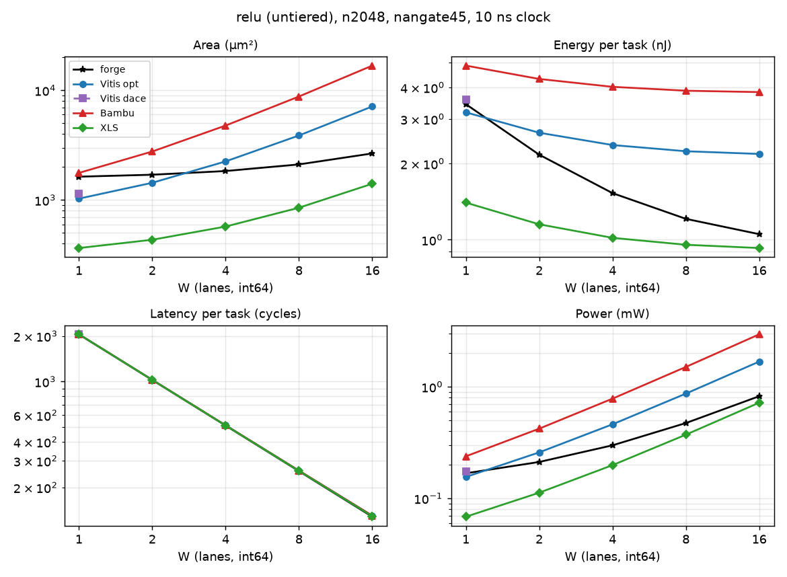

# relu (tier untiered)

forge's figures exclude `<tag>_peripherals` (BUSY_COUNTER, snax-forge D168): it is in neither the csr nor the total without csr.

Part of [the comparison](../README.md): setup, summary across kernels and the parts' basis are there.

<!-- gen:main -->

n2048, nangate45, int64, 10 ns.

| W | Case | Area (µm²) | Energy (nJ) | Latency (cycles) | Power (mW) |
|---|---|---|---|---|---|
| 1 | forge | 1,335 | 2.912 | 2048 | 0.1422 |
| 1 | Vitis opt | 1,028 | 3.186 | 2050 | 0.1554 |
| 1 | Vitis dace | 1,145 | 3.576 | 2050 | 0.1745 |
| 1 | Bambu | 1,764 | 4.875 | 2050 | 0.2378 |
| 1 | XLS | 364.4 | 1.401 | 2049 | 0.06839 |
| 2 | forge | 1,403 | 1.909 | 1024 | 0.1864 |
| 2 | Vitis opt | 1,434 | 2.647 | 1026 | 0.258 |
| 2 | Bambu | 2,765 | 4.317 | 1026 | 0.4208 |
| 2 | XLS | 433.6 | 1.151 | 1025 | 0.1123 |
| 4 | forge | 1,540 | 1.397 | 512 | 0.2729 |
| 4 | Vitis opt | 2,246 | 2.367 | 514 | 0.4604 |
| 4 | Bambu | 4,768 | 4.019 | 514 | 0.7819 |
| 4 | XLS | 571.9 | 1.017 | 513 | 0.1983 |
| 8 | forge | 1,813 | 1.144 | 256 | 0.4469 |
| 8 | Vitis opt | 3,871 | 2.237 | 258 | 0.8671 |
| 8 | Bambu | 8,776 | 3.879 | 258 | 1.504 |
| 8 | XLS | 849.3 | 0.9553 | 257 | 0.3717 |
| 16 | forge | 2,360 | 1.019 | 128 | 0.7959 |
| 16 | Vitis opt | 7,121 | 2.183 | 130 | 1.679 |
| 16 | Bambu | 16,789 | 3.831 | 130 | 2.947 |
| 16 | XLS | 1,405 | 0.9274 | 129 | 0.7189 |
<!-- /gen -->

## Insights

- The cheapest operation, so registers decide everything: XLS needs 69 µm² per lane (a sign select), Vitis opt is 59 to 68 % registers (the output beat, 64 flops per lane), and Bambu registers both the input and the output beat (128 per lane, 1002 µm² per lane).
- Energy per task at W = 8: XLS 0.96 nJ, Vitis 2.24, Bambu 3.88. Flops are 86 to 89 % of Vitis's energy, 61 to 67 % of Bambu's, and 3 to 31 % of XLS's.
- Each lane's sign bit is constant 0 after relu; Vitis's synthesis warns about it (LINT-52, LINT-31). Vitis dace exists only at W = 1.
- forge: the datapath is the same sign select as XLS's (273 µm² at W = 4, against XLS's 253 AND gates, 269 µm²), so the whole gap is control. Since CTRL2 (snax-forge D168) forge's ctrl reads JOBS live from the csr and keeps 34 flops (busy, the 32-bit jobs counter, done): 438 µm², 181 of them flops, against XLS's 32 flops (145 µm²); its `<tag>_peripherals` holds BUSY_COUNTER, 279 µm² and 0.24 pJ per cycle.
- Without its csr (X63; the peripherals in no figure, X65) forge is 9 % (W = 16) to 39 % (W = 1) above XLS's area (508 against 364 µm² at W = 1) and 4 % above its energy at W = 1, 1 % at W = 4, level from W = 8 (W = 16: 0.452 against 0.453 pJ per element). Before CTRL2 it was 29 % to 2.1x and 3 to 40 %: the JOBS copy left the ctrl (711 to 438 µm²). relu is the one kernel where XLS has the smaller area at every W.

## Parts at n2048

<!-- gen:parts -->
| W | Case | Part | Area (µm²) | Energy (nJ) | pJ per element |
|---|---|---|---|---|---|
| 1 | forge | csr | 547.7 | 0.9693 | 0.4733 |
| 1 | forge | ctrl | 438.1 | 0.5435 | 0.2654 |
| 1 | forge | datapath | 68.36 | 0.9181 | 0.4483 |
| 1 | forge | total | 1,335 | 2.912 | 1.422 |
| 1 | forge | total without csr | 507.5 | 1.462 | 0.7137 |
| 1 | Vitis opt | total | 1,028 | 3.186 | 1.556 |
| 1 | Vitis dace | total | 1,145 | 3.576 | 1.746 |
| 1 | Bambu | ctrl | 54 | 0.04337 | 0.02118 |
| 1 | Bambu | datapath | 1,705 | 4.817 | 2.352 |
| 1 | Bambu | total | 1,764 | 4.875 | 2.38 |
| 1 | XLS | total | 364.4 | 1.401 | 0.6842 |
| 2 | forge | csr | 547.7 | 0.4847 | 0.2367 |
| 2 | forge | ctrl | 438.1 | 0.2755 | 0.1345 |
| 2 | forge | datapath | 136.7 | 0.9045 | 0.4416 |
| 2 | forge | total | 1,403 | 1.909 | 0.9321 |
| 2 | forge | total without csr | 575.9 | 1.18 | 0.5761 |
| 2 | Vitis opt | total | 1,434 | 2.647 | 1.292 |
| 2 | Bambu | ctrl | 54 | 0.02204 | 0.01076 |
| 2 | Bambu | datapath | 2,706 | 4.288 | 2.094 |
| 2 | Bambu | total | 2,765 | 4.317 | 2.108 |
| 2 | XLS | total | 433.6 | 1.151 | 0.5619 |
| 4 | forge | csr | 547.7 | 0.2424 | 0.1184 |
| 4 | forge | ctrl | 438.1 | 0.1396 | 0.06815 |
| 4 | forge | datapath | 273.4 | 0.891 | 0.4351 |
| 4 | forge | total | 1,540 | 1.397 | 0.6821 |
| 4 | forge | total without csr | 712.6 | 1.031 | 0.5032 |
| 4 | Vitis opt | total | 2,246 | 2.367 | 1.156 |
| 4 | Bambu | ctrl | 54 | 0.01138 | 0.005557 |
| 4 | Bambu | datapath | 4,709 | 4.004 | 1.955 |
| 4 | Bambu | total | 4,768 | 4.019 | 1.962 |
| 4 | XLS | total | 571.9 | 1.017 | 0.4968 |
| 8 | forge | csr | 547.7 | 0.1213 | 0.05922 |
| 8 | forge | ctrl | 438.1 | 0.07074 | 0.03454 |
| 8 | forge | datapath | 546.9 | 0.8891 | 0.4341 |
| 8 | forge | total | 1,813 | 1.144 | 0.5586 |
| 8 | forge | total without csr | 986.1 | 0.9598 | 0.4687 |
| 8 | Vitis opt | total | 3,871 | 2.237 | 1.092 |
| 8 | Bambu | ctrl | 54.53 | 0.006046 | 0.002952 |
| 8 | Bambu | datapath | 8,716 | 3.872 | 1.89 |
| 8 | Bambu | total | 8,776 | 3.879 | 1.894 |
| 8 | XLS | total | 849.3 | 0.9553 | 0.4665 |
| 16 | forge | csr | 547.7 | 0.06071 | 0.02964 |
| 16 | forge | ctrl | 438.1 | 0.03585 | 0.01751 |
| 16 | forge | datapath | 1,094 | 0.8904 | 0.4347 |
| 16 | forge | total | 2,360 | 1.019 | 0.4975 |
| 16 | forge | total without csr | 1,533 | 0.9262 | 0.4523 |
| 16 | Vitis opt | total | 7,121 | 2.183 | 1.066 |
| 16 | Bambu | ctrl | 55.33 | 0.003399 | 0.00166 |
| 16 | Bambu | datapath | 16,729 | 3.826 | 1.868 |
| 16 | Bambu | total | 16,789 | 3.831 | 1.87 |
| 16 | XLS | total | 1,405 | 0.9274 | 0.4528 |
<!-- /gen -->
