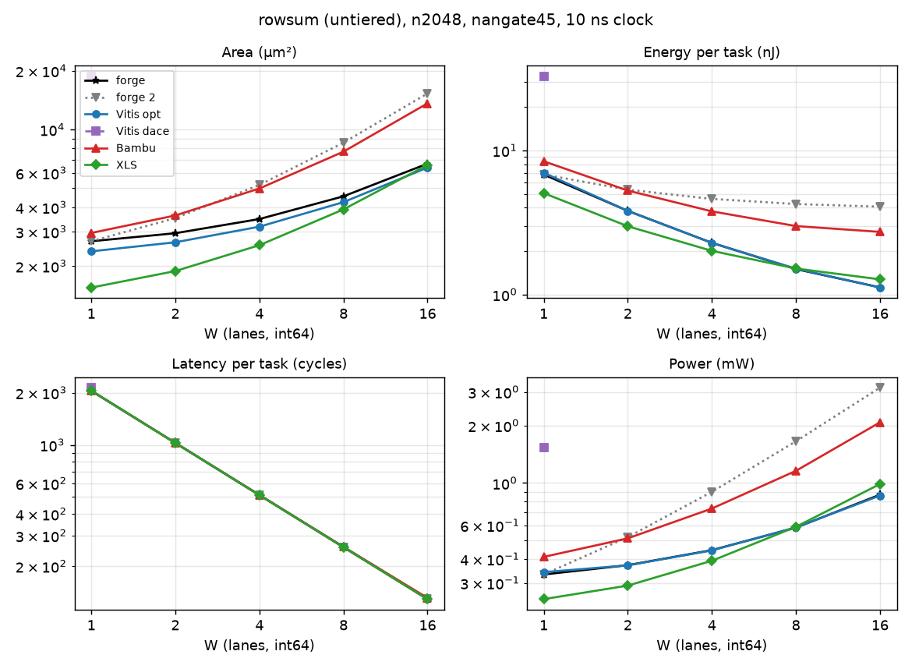

# rowsum (tier untiered)

csr excludes `<tag>_peripherals` (BUSY_COUNTER), snax-forge D168.

Part of [the comparison](../README.md): setup, summary across kernels and the parts' basis are there.

<!-- gen:main -->

n2048, nangate45, int64, 10 ns.

| W | Case | Area (µm²) | Energy (nJ) | Latency (cycles) | Power (mW) |
|---|---|---|---|---|---|
| 1 | forge | 2,677 | 6.805 | 2049 | 0.3321 |
| 1 | forge 2 | 2,677 | 6.805 | 2049 | 0.3321 |
| 1 | Vitis opt | 2,376 | 7.001 | 2050 | 0.3415 |
| 1 | Vitis dace | 18,791 | 32.85 | 2137 | 1.537 |
| 1 | Bambu | 2,951 | 8.416 | 2050 | 0.4105 |
| 1 | XLS | 1,549 | 5.056 | 2049 | 0.2468 |
| 2 | forge | 2,942 | 3.808 | 1025 | 0.3715 |
| 2 | forge 2 | 3,517 | 5.343 | 1025 | 0.5213 |
| 2 | Vitis opt | 2,644 | 3.804 | 1026 | 0.3707 |
| 2 | Bambu | 3,629 | 5.267 | 1026 | 0.5133 |
| 2 | XLS | 1,882 | 2.977 | 1025 | 0.2905 |
| 4 | forge | 3,478 | 2.284 | 513 | 0.4453 |
| 4 | forge 2 | 5,201 | 4.611 | 513 | 0.8989 |
| 4 | Vitis opt | 3,178 | 2.282 | 514 | 0.444 |
| 4 | Bambu | 4,988 | 3.779 | 514 | 0.7352 |
| 4 | XLS | 2,555 | 2.01 | 513 | 0.3918 |
| 8 | forge | 4,548 | 1.501 | 257 | 0.5841 |
| 8 | forge 2 | 8,567 | 4.248 | 257 | 1.653 |
| 8 | Vitis opt | 4,246 | 1.511 | 258 | 0.5856 |
| 8 | Bambu | 7,703 | 2.987 | 258 | 1.158 |
| 8 | XLS | 3,898 | 1.515 | 257 | 0.5897 |
| 16 | forge | 6,685 | 1.12 | 129 | 0.8685 |
| 16 | forge 2 | 15,298 | 4.072 | 129 | 3.157 |
| 16 | Vitis opt | 6,383 | 1.117 | 130 | 0.8595 |
| 16 | Bambu | 13,617 | 2.721 | 131 | 2.077 |
| 16 | XLS | 6,586 | 1.274 | 129 | 0.9876 |
<!-- /gen -->

## Insights

- Every tool builds the same hardware as for vsum (identical area, flops and cycles at n2048): restarting the sum every `len` beats costs nothing synthesis can see, and the energies differ from vsum's by at most about 2 %.
- forge's rowsum (the tree, TreeAccumulate, JOB_BEATS = N / W) follows vsum's ratios. rowsum 2 (LaneAccumulate, W lanes across rows) has the same cycles but W 64-bit sums switching every cycle: its datapath is 2.0x rowsum's at W = 4 (3.4k against 1.6k µm²) and 2.8x at W = 16 (13.5k against 4.8k), and its energy per element without csr 2.2x and 3.9x (CTRL2 took the same 534 µm² of control off both, so rowsum 2's ratios grew a little). It is measured with ideal feed, so the bank conflicts of its column walk are not in these numbers. At W = 1 both build one adder and one register and come out identical.
- Vitis dace_w1 (X62): `y_buf` (16 x 64) built from flops, 9.2k of its 18.8k µm²; 2137 cycles; 32.9 nJ per task.

## Parts at n2048

<!-- gen:parts -->
| W | Case | Part | Area (µm²) | Energy (nJ) | pJ per element |
|---|---|---|---|---|---|
| 1 | forge | csr | 794.3 | 1.439 | 0.7029 |
| 1 | forge | ctrl | 760.8 | 1.018 | 0.4973 |
| 1 | forge | datapath | 841.4 | 3.865 | 1.887 |
| 1 | forge | total | 2,677 | 6.805 | 3.323 |
| 1 | forge | total without csr | 1,882 | 5.366 | 2.62 |
| 1 | forge 2 | csr | 794.3 | 1.439 | 0.7029 |
| 1 | forge 2 | ctrl | 760.8 | 1.018 | 0.4973 |
| 1 | forge 2 | datapath | 841.4 | 3.865 | 1.887 |
| 1 | forge 2 | total | 2,677 | 6.805 | 3.323 |
| 1 | forge 2 | total without csr | 1,882 | 5.366 | 2.62 |
| 1 | Vitis opt | total | 2,376 | 7.001 | 3.418 |
| 1 | Vitis dace | RAM (flops) | 9,232 | 18.27 | 8.92 |
| 1 | Vitis dace | logic without the RAM | 9,559 | 14.58 | 7.121 |
| 1 | Vitis dace | total | 18,791 | 32.85 | 16.04 |
| 1 | Bambu | ctrl | 55.06 | 0.04351 | 0.02125 |
| 1 | Bambu | datapath | 2,891 | 8.357 | 4.081 |
| 1 | Bambu | total | 2,951 | 8.416 | 4.109 |
| 1 | XLS | total | 1,549 | 5.056 | 2.469 |
| 2 | forge | csr | 794.3 | 0.7202 | 0.3516 |
| 2 | forge | ctrl | 760.5 | 0.5161 | 0.252 |
| 2 | forge | datapath | 1,107 | 2.327 | 1.136 |
| 2 | forge | total | 2,942 | 3.808 | 1.859 |
| 2 | forge | total without csr | 2,148 | 3.088 | 1.508 |
| 2 | forge 2 | csr | 794.3 | 0.7202 | 0.3516 |
| 2 | forge 2 | ctrl | 760.5 | 0.513 | 0.2505 |
| 2 | forge 2 | datapath | 1,682 | 3.865 | 1.887 |
| 2 | forge 2 | total | 3,517 | 5.343 | 2.609 |
| 2 | forge 2 | total without csr | 2,723 | 4.623 | 2.257 |
| 2 | Vitis opt | total | 2,644 | 3.804 | 1.857 |
| 2 | Bambu | ctrl | 55.06 | 0.02219 | 0.01084 |
| 2 | Bambu | datapath | 3,568 | 5.237 | 2.557 |
| 2 | Bambu | total | 3,629 | 5.267 | 2.572 |
| 2 | XLS | total | 1,882 | 2.977 | 1.454 |
| 4 | forge | csr | 794.3 | 0.3605 | 0.176 |
| 4 | forge | ctrl | 760.5 | 0.2633 | 0.1286 |
| 4 | forge | datapath | 1,643 | 1.536 | 0.75 |
| 4 | forge | total | 3,478 | 2.284 | 1.115 |
| 4 | forge | total without csr | 2,684 | 1.924 | 0.9393 |
| 4 | forge 2 | csr | 794.3 | 0.3605 | 0.176 |
| 4 | forge 2 | ctrl | 759.7 | 0.2586 | 0.1263 |
| 4 | forge 2 | datapath | 3,367 | 3.868 | 1.888 |
| 4 | forge 2 | total | 5,201 | 4.611 | 2.252 |
| 4 | forge 2 | total without csr | 4,407 | 4.251 | 2.076 |
| 4 | Vitis opt | total | 3,178 | 2.282 | 1.114 |
| 4 | Bambu | ctrl | 55.06 | 0.01153 | 0.005629 |
| 4 | Bambu | datapath | 4,928 | 3.764 | 1.838 |
| 4 | Bambu | total | 4,988 | 3.779 | 1.845 |
| 4 | XLS | total | 2,555 | 2.01 | 0.9814 |
| 8 | forge | csr | 794.3 | 0.1807 | 0.08823 |
| 8 | forge | ctrl | 760.5 | 0.1354 | 0.06611 |
| 8 | forge | datapath | 2,713 | 1.122 | 0.5477 |
| 8 | forge | total | 4,548 | 1.501 | 0.733 |
| 8 | forge | total without csr | 3,754 | 1.32 | 0.6447 |
| 8 | forge 2 | csr | 794.3 | 0.1807 | 0.08823 |
| 8 | forge 2 | ctrl | 760.5 | 0.1307 | 0.06383 |
| 8 | forge 2 | datapath | 6,732 | 3.874 | 1.891 |
| 8 | forge 2 | total | 8,567 | 4.248 | 2.074 |
| 8 | forge 2 | total without csr | 7,773 | 4.067 | 1.986 |
| 8 | Vitis opt | total | 4,246 | 1.511 | 0.7378 |
| 8 | Bambu | ctrl | 55.06 | 0.006196 | 0.003025 |
| 8 | Bambu | datapath | 7,642 | 2.979 | 1.455 |
| 8 | Bambu | total | 7,703 | 2.987 | 1.458 |
| 8 | XLS | total | 3,898 | 1.515 | 0.7399 |
| 16 | forge | csr | 794.3 | 0.09078 | 0.04432 |
| 16 | forge | ctrl | 760.5 | 0.07144 | 0.03488 |
| 16 | forge | datapath | 4,849 | 0.926 | 0.4521 |
| 16 | forge | total | 6,685 | 1.12 | 0.5471 |
| 16 | forge | total without csr | 5,890 | 1.03 | 0.5027 |
| 16 | forge 2 | csr | 794.3 | 0.09078 | 0.04433 |
| 16 | forge 2 | ctrl | 760.5 | 0.06617 | 0.03231 |
| 16 | forge 2 | datapath | 13,463 | 3.883 | 1.896 |
| 16 | forge 2 | total | 15,298 | 4.072 | 1.988 |
| 16 | forge 2 | total without csr | 14,504 | 3.981 | 1.944 |
| 16 | Vitis opt | total | 6,383 | 1.117 | 0.5456 |
| 16 | Bambu | ctrl | 118.6 | 0.005344 | 0.00261 |
| 16 | Bambu | datapath | 13,493 | 2.715 | 1.325 |
| 16 | Bambu | total | 13,617 | 2.721 | 1.329 |
| 16 | XLS | total | 6,586 | 1.274 | 0.6221 |
<!-- /gen -->
