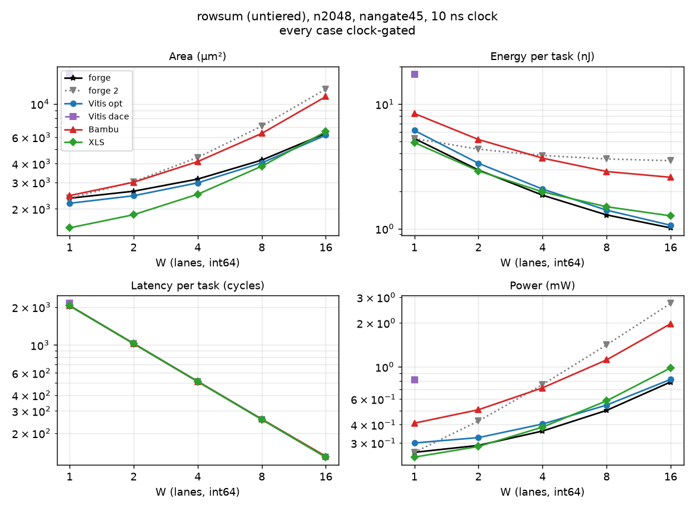

# rowsum (tier untiered)

forge's figures exclude `<tag>_peripherals` (BUSY_COUNTER, snax-forge D168): it is in neither the csr nor the total without csr.

Part of [the comparison](../README.md): setup, summary across kernels and the parts' basis are there.

<!-- gen:main -->

n2048, nangate45, int64, 10 ns, every case clock-gated.

[forge's ctrl + datapath against the HLS totals](rowsum_ctrl_dp.png): forge without its csr, its `<tag>_peripherals` and its glue; the HLS cases as above.

| W | Case | Area (µm²) | Energy (nJ) | Latency (cycles) | Power (mW) |
|---|---|---|---|---|---|
| 1 | forge | 2,349 | 5.293 | 2049 | 0.2583 |
| 1 | forge 2 | 2,349 | 5.293 | 2049 | 0.2583 |
| 1 | Vitis opt | 2,173 | 6.141 | 2050 | 0.2996 |
| 1 | Vitis dace | 15,774 | 17.4 | 2137 | 0.8141 |
| 1 | Bambu | 2,446 | 8.401 | 2050 | 0.4098 |
| 1 | XLS | 1,490 | 4.909 | 2049 | 0.2396 |
| 2 | forge | 2,616 | 2.955 | 1025 | 0.2883 |
| 2 | forge 2 | 3,028 | 4.342 | 1025 | 0.4236 |
| 2 | Vitis opt | 2,440 | 3.345 | 1026 | 0.326 |
| 2 | Bambu | 3,003 | 5.197 | 1026 | 0.5065 |
| 2 | XLS | 1,824 | 2.906 | 1025 | 0.2835 |
| 4 | forge | 3,150 | 1.856 | 513 | 0.3617 |
| 4 | forge 2 | 4,388 | 3.865 | 513 | 0.7534 |
| 4 | Vitis opt | 2,974 | 2.077 | 514 | 0.4041 |
| 4 | Bambu | 4,121 | 3.68 | 514 | 0.7159 |
| 4 | XLS | 2,496 | 1.974 | 513 | 0.3847 |
| 8 | forge | 4,218 | 1.288 | 257 | 0.5012 |
| 8 | forge 2 | 7,106 | 3.627 | 257 | 1.411 |
| 8 | Vitis opt | 4,043 | 1.407 | 258 | 0.5452 |
| 8 | Bambu | 6,352 | 2.873 | 258 | 1.114 |
| 8 | XLS | 3,840 | 1.498 | 257 | 0.5829 |
| 16 | forge | 6,355 | 1.013 | 129 | 0.7856 |
| 16 | forge 2 | 12,544 | 3.51 | 129 | 2.721 |
| 16 | Vitis opt | 6,179 | 1.064 | 130 | 0.8182 |
| 16 | Bambu | 11,178 | 2.583 | 131 | 1.971 |
| 16 | XLS | 6,528 | 1.266 | 129 | 0.9812 |
<!-- /gen -->

## Insights

- Every tool builds the same hardware as for vsum (identical area, registers and cycles at n2048): restarting the sum every `len` beats costs nothing synthesis can see, and the energies differ from vsum's by at most about 3 %.
- forge's rowsum (the tree, TreeAccumulate, JOB_BEATS = N / W) follows vsum's ratios. rowsum 2 (LaneAccumulate, W lanes across rows) has the same cycles but W 64-bit sums switching every cycle: its datapath is 1.8x rowsum's at W = 4 (2.7k against 1.5k µm²) and 2.3x at W = 16 (10.9k against 4.7k), and its energy per element without csr 2.3x and 3.7x. It is measured with ideal feed, so the bank conflicts of its column walk are not in these numbers. At W = 1 both build one adder and one register and come out identical.
- Vitis dace_w1 (X62): `y_buf` (16 x 64) built from flops, 7.2k of its 15.8k µm²; 2137 cycles; 17.4 nJ per task, 9.7 of it the buffer.

## Parts at n2048

<!-- gen:parts -->
| W | Case | Part | Area (µm²) | Energy (nJ) | pJ per element |
|---|---|---|---|---|---|
| 1 | forge | csr | 701.2 | 0.6223 | 0.3039 |
| 1 | forge | ctrl | 710.8 | 0.6879 | 0.3359 |
| 1 | forge | datapath | 684.2 | 3.409 | 1.664 |
| 1 | forge | total | 2,349 | 5.293 | 2.584 |
| 1 | forge | total without csr | 1,395 | 4.097 | 2 |
| 1 | forge 2 | csr | 701.2 | 0.6223 | 0.3039 |
| 1 | forge 2 | ctrl | 710.8 | 0.6879 | 0.3359 |
| 1 | forge 2 | datapath | 684.2 | 3.409 | 1.664 |
| 1 | forge 2 | total | 2,349 | 5.293 | 2.584 |
| 1 | forge 2 | total without csr | 1,395 | 4.097 | 2 |
| 1 | Vitis opt | total | 2,173 | 6.141 | 2.999 |
| 1 | Vitis dace | RAM (flops) | 7,199 | 9.683 | 4.728 |
| 1 | Vitis dace | logic without the RAM | 8,575 | 7.715 | 3.767 |
| 1 | Vitis dace | total | 15,774 | 17.4 | 8.495 |
| 1 | Bambu | ctrl | 67.3 | 0.04319 | 0.02109 |
| 1 | Bambu | datapath | 2,374 | 8.343 | 4.074 |
| 1 | Bambu | total | 2,446 | 8.401 | 4.102 |
| 1 | XLS | total | 1,490 | 4.909 | 2.397 |
| 2 | forge | csr | 701.2 | 0.3114 | 0.1521 |
| 2 | forge | ctrl | 710.8 | 0.3514 | 0.1716 |
| 2 | forge | datapath | 951.2 | 2.002 | 0.9774 |
| 2 | forge | total | 2,616 | 2.955 | 1.443 |
| 2 | forge | total without csr | 1,663 | 2.353 | 1.149 |
| 2 | forge 2 | csr | 701.2 | 0.3114 | 0.1521 |
| 2 | forge 2 | ctrl | 710.8 | 0.3442 | 0.1681 |
| 2 | forge 2 | datapath | 1,364 | 3.395 | 1.658 |
| 2 | forge 2 | total | 3,028 | 4.342 | 2.12 |
| 2 | forge 2 | total without csr | 2,075 | 3.74 | 1.826 |
| 2 | Vitis opt | total | 2,440 | 3.345 | 1.633 |
| 2 | Bambu | ctrl | 67.3 | 0.02188 | 0.01068 |
| 2 | Bambu | datapath | 2,930 | 5.167 | 2.523 |
| 2 | Bambu | total | 3,003 | 5.197 | 2.537 |
| 2 | XLS | total | 1,824 | 2.906 | 1.419 |
| 4 | forge | csr | 701.2 | 0.156 | 0.07616 |
| 4 | forge | ctrl | 710.8 | 0.1817 | 0.08874 |
| 4 | forge | datapath | 1,485 | 1.371 | 0.6693 |
| 4 | forge | total | 3,150 | 1.856 | 0.9061 |
| 4 | forge | total without csr | 2,197 | 1.553 | 0.7581 |
| 4 | forge 2 | csr | 701.2 | 0.156 | 0.07616 |
| 4 | forge 2 | ctrl | 710.8 | 0.1724 | 0.08419 |
| 4 | forge 2 | datapath | 2,723 | 3.389 | 1.655 |
| 4 | forge 2 | total | 4,388 | 3.865 | 1.887 |
| 4 | forge 2 | total without csr | 3,434 | 3.562 | 1.739 |
| 4 | Vitis opt | total | 2,974 | 2.077 | 1.014 |
| 4 | Bambu | ctrl | 67.3 | 0.01122 | 0.005477 |
| 4 | Bambu | datapath | 4,048 | 3.665 | 1.79 |
| 4 | Bambu | total | 4,121 | 3.68 | 1.797 |
| 4 | XLS | total | 2,496 | 1.974 | 0.9637 |
| 8 | forge | csr | 701.2 | 0.07826 | 0.03821 |
| 8 | forge | ctrl | 710.8 | 0.09564 | 0.0467 |
| 8 | forge | datapath | 2,554 | 1.04 | 0.5076 |
| 8 | forge | total | 4,218 | 1.288 | 0.6289 |
| 8 | forge | total without csr | 3,265 | 1.135 | 0.5543 |
| 8 | forge 2 | csr | 701.2 | 0.07826 | 0.03821 |
| 8 | forge 2 | ctrl | 710.8 | 0.08651 | 0.04224 |
| 8 | forge 2 | datapath | 5,442 | 3.388 | 1.654 |
| 8 | forge 2 | total | 7,106 | 3.627 | 1.771 |
| 8 | forge 2 | total without csr | 6,153 | 3.474 | 1.696 |
| 8 | Vitis opt | total | 4,043 | 1.407 | 0.6868 |
| 8 | Bambu | ctrl | 67.3 | 0.005886 | 0.002874 |
| 8 | Bambu | datapath | 6,279 | 2.865 | 1.399 |
| 8 | Bambu | total | 6,352 | 2.873 | 1.403 |
| 8 | XLS | total | 3,840 | 1.498 | 0.7315 |
| 16 | forge | csr | 701.2 | 0.03939 | 0.01924 |
| 16 | forge | ctrl | 710.8 | 0.05222 | 0.0255 |
| 16 | forge | datapath | 4,690 | 0.8841 | 0.4317 |
| 16 | forge | total | 6,355 | 1.013 | 0.4949 |
| 16 | forge | total without csr | 5,401 | 0.9363 | 0.4572 |
| 16 | forge 2 | csr | 701.7 | 0.03939 | 0.01923 |
| 16 | forge 2 | ctrl | 710.2 | 0.04355 | 0.02126 |
| 16 | forge 2 | datapath | 10,879 | 3.389 | 1.655 |
| 16 | forge 2 | total | 12,544 | 3.51 | 1.714 |
| 16 | forge 2 | total without csr | 11,590 | 3.433 | 1.676 |
| 16 | Vitis opt | total | 6,179 | 1.064 | 0.5193 |
| 16 | Bambu | ctrl | 128.2 | 0.004935 | 0.00241 |
| 16 | Bambu | datapath | 11,045 | 2.577 | 1.258 |
| 16 | Bambu | total | 11,178 | 2.583 | 1.261 |
| 16 | XLS | total | 6,528 | 1.266 | 0.618 |
<!-- /gen -->
