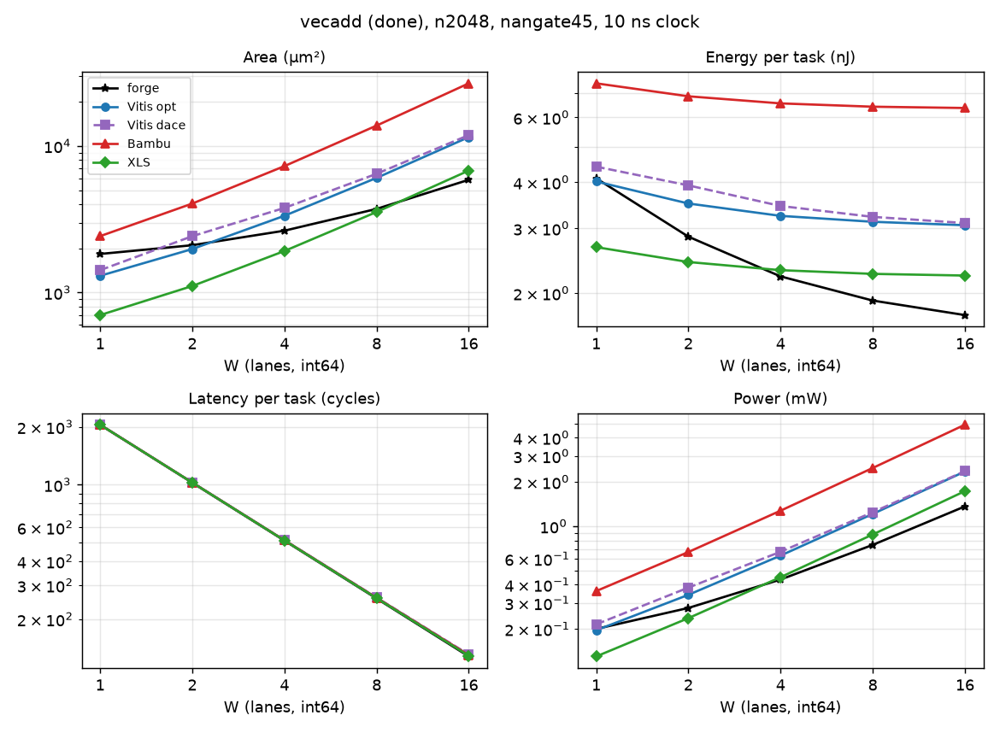
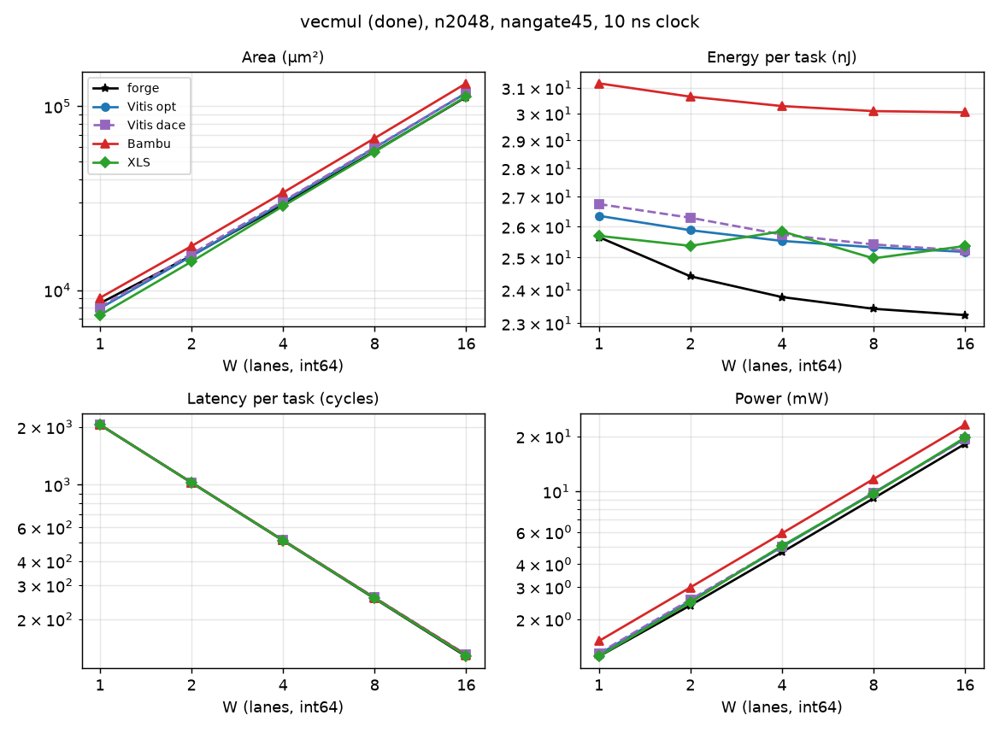
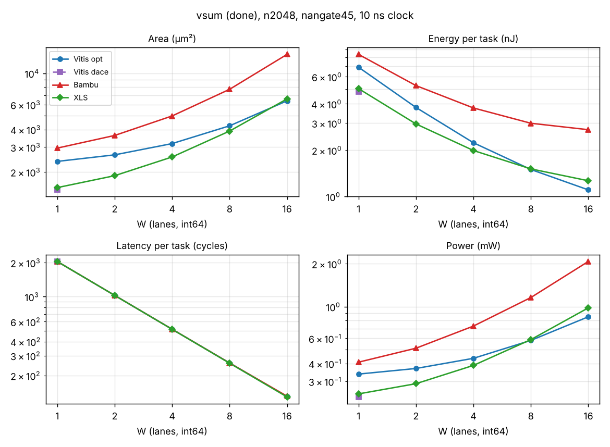
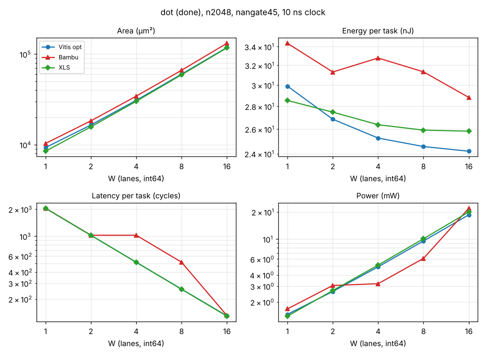
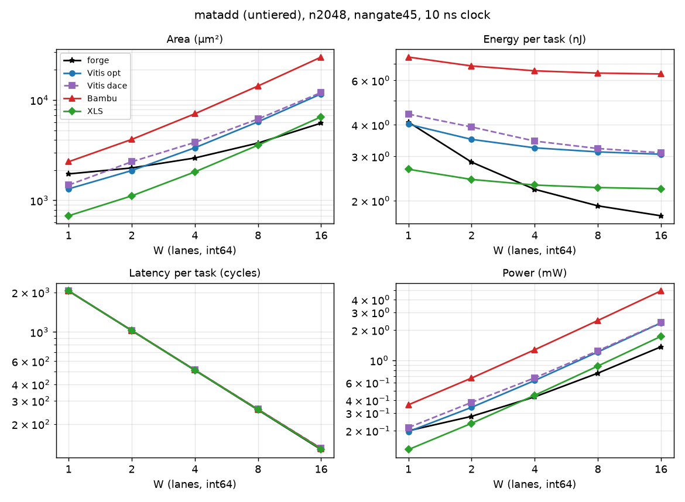
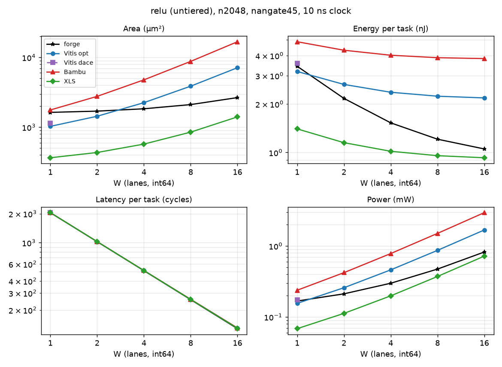
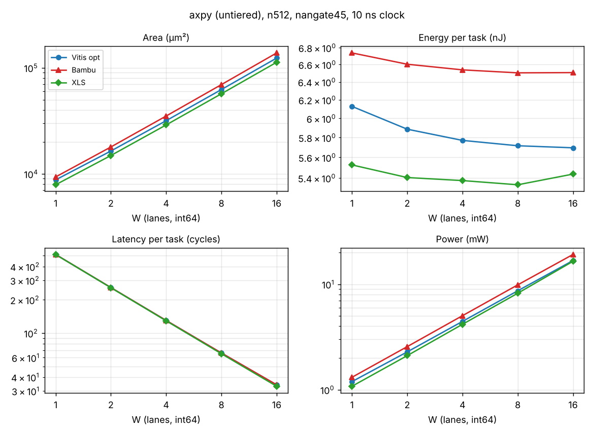
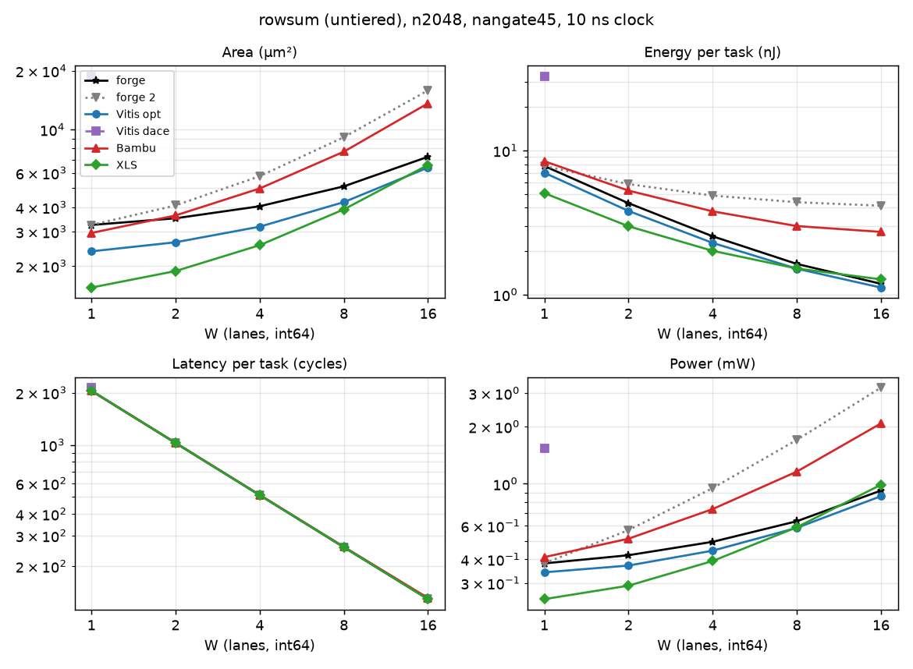

# The HLS cases side by side: Vitis opt and dace, Bambu, XLS

Generated parts come from `report/compare_hls.py` (`pixi run compare-hls`) and the two tier CSVs (X45, X46, X61); the text outside the `gen` markers is written by hand. forge's cases are in since CSYN1 R2 (X61), and every tier is shown at n2048. The insights were written in HSYN1 R9 for the HLS cases and reread against the n2048 numbers in CSYN1 R4, with forge's cases added; section 2 opens with the summary.

## 1. Setup

<!-- gen:setup -->
| Case | Tool version | RTL measured at | Latency window |
|---|---|---|---|
| forge |  | e8bb93e, f9764d5 | START to done (X13) |
| forge 2 |  | e8bb93e, f9764d5 | START to done (X13) |
| forge 3 |  | f9764d5 | START to done (X13) |
| forge 4 |  | f9764d5 | START to done (X13) |
| forge 5 |  | f9764d5 | START to done (X13) |
| forge 6 |  | f9764d5 | START to done (X13) |
| forge baked |  | e8bb93e | START to done (X13) |
| Vitis opt | v2023.2.2 | 4ef8bc8 | ap_start to ap_done (X12) |
| Vitis dace | v2023.2.2 | 4ef8bc8, f33338d | ap_start to ap_done (X12) |
| Bambu | PandA 2026.11 rev cda4db2e | 542fa32 | start_port to done_port (X44) |
| XLS | v0.0.0-10782-g5ddc35c4e | 46fa843, 9ae29ea, faf5a3d | cfg transfer to last output, last edge included (X44) |

Main view: nangate45, int64, every point synthesized at a 10 ns clock (the HLS tools scheduled at a 10 ns HLS clock), W = 1 to 16 lanes per stream. Size: n2048 everywhere, 2048 elements per input stream (X24, X55): tier done N = 2048, untiered relu and axpy n = 2048, matadd m32_n64, rowsum m16_n128. Energy is the dynamic energy of one task (PrimePower on simulated activity, X7); power is E_run / (cycles x 10 ns). The latency windows differ by a cycle or two by definition. forge's cases: dot 2 to 6 (forge2 to forge6), axpy with alpha baked to 3 (forge baked), rowsum 2 (forge2).
<!-- /gen -->

## 2. Across all kernels

### Summary: forge's ctrl + datapath against the HLS tools

forge without its CSR file, X63's like-for-like basis, against the best HLS case per metric: the lowest of Vitis opt, Vitis dace, Bambu and XLS, taken separately for energy and for area. n2048, nangate45, int64. Each cell is forge's energy per element divided by the best HLS energy per element, then forge's area divided by the smallest HLS area; below 1, forge is better. dot is forge's dot 3 and axpy is forge's α from a CSR (forge baked is not like-for-like). vecadd and matadd are the same hardware for every tool, and so are vsum and rowsum (energies within about 2 %), so they share rows.

| Kernel | W = 1 | W = 2 | W = 4 | W = 8 | W = 16 |
|---|---|---|---|---|---|
| dot (forge 3) | 0.98 / 1.07 | 0.96 / 1.03 | 0.97 / 1.01 | 0.97 / 1.00 | 0.97 / 0.99 |
| vecmul | 0.94 / 1.04 | 0.93 / 1.02 | 0.92 / 0.99 | 0.93 / 0.99 | 0.92 / 0.99 |
| axpy (α from a CSR) | 0.90 / 0.99 | 0.91 / 0.99 | 0.91 / 0.99 | 0.91 / 0.99 | 0.90 / 0.99 |
| vecadd, matadd | 0.99 / 1.40 | 0.87 / 1.13 | 0.80 / 0.93 | 0.76 / 0.81 | 0.74 / 0.74 |
| vsum, rowsum | 1.22 / 1.43 | 1.12 / 1.28 | 1.02 / 1.15 | 0.92 / 1.03 | 0.95 / 0.96 |
| relu | 1.40 / 2.14 | 1.24 / 1.96 | 1.14 / 1.72 | 1.07 / 1.48 | 1.03 / 1.28 |

- **Energy:** from W = 8, forge has the lowest energy per element on six of the eight kernels: 3 % below the best HLS case on dot, 7 to 8 % on vecmul, 9 to 10 % on axpy, 24 to 26 % on vecadd and matadd, 5 to 8 % on vsum and rowsum. relu stays above XLS at every W (3 % at W = 16).
- **Area:** within 1 % of the smallest wherever 64-bit multipliers set it (dot, vecmul and axpy, from W = 4); 19 to 26 % smaller on vecadd and matadd at W = 8 and 16; larger at small W on the reductions (15 to 43 % at W ≤ 4) and on relu (28 % to 2.1x).
- **Why the rows fall with W:** forge's control is fixed, about 711 µm² for an elementwise unit and 1,294 µm² for a fold with JOB_BEATS, at every W, against XLS's 32 to 160 flops in total. It holds the job counter, snax-forge D123's 32-bit busy-cycle COUNTER and the START, busy and done handshake with the CSR file. Where the datapath is a few hundred µm² (relu's 273 µm² at W = 4, a one-lane adder), the control decides; as W grows the datapath takes over.
- **No flops per lane and no input gating:** forge's datapath is the arithmetic only, so its slope over W is the lowest (vecadd: 270 µm² per lane, against XLS 406, Vitis 679 and Bambu 1622).
- **Latency:** forge is at par, one cycle per beat. The exceptions are dot 5 and 6 (145 and 146 cycles at W = 16 against 129), from the stall and the holding buffer.
- **With the CSR file** (the totals in sections 3 and 4), forge adds 850 µm² for an elementwise unit, 1,107 µm² for a fold and 1,375 µm² for axpy (K1_LO and K1_HI), and 0.73 to 1.19 pJ per cycle. Integrating any HLS block into the cluster would need a register interface of its own (X63).

### The HLS cases

All numbers below are nangate45, int64, at n2048 (X24, X55). Flops are DC's `seq_cells`, traced to each tool's RTL in R6 and R7.

- **Registers per lane decide the gaps wherever the arithmetic is cheap.** Flops added per lane (the slope of the flop count over W): forge 0, XLS 0; Vitis opt 64 per output stream, since it registers the output beat, and 0 for the reductions; Bambu 64 per stream, inputs and outputs alike (vecadd, vecmul and axpy 192; relu 128; dot about 141; vsum about 68).
- **Bambu's registered beats are its most costly trait.** In vecadd they are 53 % of its area and 60 % of its energy, and they are why its area grows 1622 µm² per lane against Vitis's 679 and XLS's 406.
- **XLS's flops are its proc state only, and they do not grow with W:** 32 (the loop count: vecadd, vecmul, matadd, relu), 96 (axpy: loop count and alpha), 160 (vsum, dot, rowsum). That makes XLS the smallest HLS case in every kernel, with flops at most 3 % of its energy from W = 8. forge's ctrl + datapath is smaller than XLS on vecadd and matadd from W = 4 and on vsum and rowsum at W = 16 (the summary above).
- **XLS gates every input bit with its proc state.** In vecadd that is 2 x 64 AND gates per lane: 497 AND2 cells at W = 4 (529 µm², 28 % of its area) and 1,985 at W = 16 (2,112 µm², 31 %). In relu the same gates are the operation itself (253 at W = 4); in the multiplier kernels fewer are left (vecmul W = 16: 1,097 cells, 1 % of the area). forge feeds its datapath straight from the shell's valid-ready ports, so this is where XLS's extra vecadd area goes, and likely its extra energy; the energy share is not measured.
- **64-bit multipliers set the area wherever they are in the datapath** (vecmul, dot, axpy): about 7.0k to 8.6k µm² per lane for every tool. At W = 16, Vitis opt is within 1 to 10 % of XLS and Bambu 12 to 22 % above it, the difference being registers.
- **Run-time pins:** Vitis registers its pins (`ap_vld`), XLS keeps them in its proc state, and Bambu reads them as plain wires held for the task, so Bambu pays no pin registers. In axpy, Vitis's 65 extra fixed flops against vecadd are alpha's pin register.
- **Energy per task falls with W and then levels off:** the fixed part (control, handshakes, reset logic) is paid per cycle, and wider beats need fewer cycles for the same task.
- **Latency is about one cycle per beat for all four cases.** The differences of 1 or 2 cycles are their windows and pipeline depths (Vitis opt 2 stages at 10 ns, Bambu an iteration latency of 2 or 3, XLS one stage). The one real exception is Bambu's dot at W = 4 and 8, which runs at II = 2. forge is at par (the summary above); DaCe's two loops take twice as long (next bullet).
- **Control is only visible where the RTL keeps it apart.** Bambu's controller is a module of its own and small (81 µm² in dot at W = 8, 0.1 % of the area). Vitis and XLS mix control and datapath in one flat module, so their control cost cannot be split out after synthesis (X41); their totals hold it. forge keeps its control in `<tag>_ctrl` and its CSR file in `<tag>_csr` (X22), the only case with both measured apart. The Bambu figure holds after X63's correction of Bambu's parts.
- **Vitis dace with a RAM** (dot, axpy and rowsum at W = 1, X62): DaCe keeps NPBench's intermediate array, so dot and axpy write 2048 words to a 2048 x 64 macro (49.3k µm²) and read them back in a second loop. That is 4101 cycles, twice the others; 57.7k and 58.2k µm²; 75.5 and 73.5 nJ per task, the macro 85 % of the area and 60 % of the energy. rowsum's 16-word `y_buf` is built from flops (CACTI refuses 16 words, and the buffer has a second read port): 18.8k µm², 2137 cycles, 32.9 nJ. forge's `fuse_map` removes the intermediate array altogether.
- **Timing:** every point meets 10 ns. XLS, with one combinational stage from its ports, has the least slack (dot at W = 16: 2.38 ns on nangate45, against 3.87 ns for Bambu at W = 8 and 4.17 ns for Vitis at W = 8, R4).

## 3. Tier done

### vecadd

<!-- gen:done/vecadd -->

n2048, nangate45, int64, 10 ns.

| W | Case | Area (µm²) | Energy (nJ) | Latency (cycles) | Power (mW) |
|---|---|---|---|---|---|
| 1 | forge | 1,833 | 4.098 | 2048 | 0.2001 |
| 1 | Vitis opt | 1,301 | 4.018 | 2050 | 0.196 |
| 1 | Vitis dace | 1,420 | 4.409 | 2050 | 0.2151 |
| 1 | Bambu | 2,425 | 7.421 | 2050 | 0.362 |
| 1 | XLS | 701.7 | 2.666 | 2049 | 0.1301 |
| 2 | forge | 2,103 | 2.846 | 1024 | 0.2779 |
| 2 | Vitis opt | 1,980 | 3.502 | 1026 | 0.3413 |
| 2 | Vitis dace | 2,424 | 3.922 | 1026 | 0.3822 |
| 2 | Bambu | 4,046 | 6.844 | 1026 | 0.6671 |
| 2 | XLS | 1,108 | 2.429 | 1025 | 0.237 |
| 4 | forge | 2,642 | 2.22 | 512 | 0.4336 |
| 4 | Vitis opt | 3,340 | 3.241 | 514 | 0.6306 |
| 4 | Vitis dace | 3,780 | 3.448 | 515 | 0.6696 |
| 4 | Bambu | 7,288 | 6.547 | 514 | 1.274 |
| 4 | XLS | 1,920 | 2.308 | 513 | 0.4499 |
| 8 | forge | 3,721 | 1.909 | 256 | 0.7457 |
| 8 | Vitis opt | 6,057 | 3.124 | 258 | 1.211 |
| 8 | Vitis dace | 6,459 | 3.221 | 259 | 1.244 |
| 8 | Bambu | 13,777 | 6.413 | 258 | 2.486 |
| 8 | XLS | 3,545 | 2.256 | 257 | 0.8777 |
| 16 | forge | 5,879 | 1.743 | 128 | 1.362 |
| 16 | Vitis opt | 11,489 | 3.058 | 130 | 2.352 |
| 16 | Vitis dace | 11,864 | 3.099 | 131 | 2.366 |
| 16 | Bambu | 26,748 | 6.362 | 130 | 4.894 |
| 16 | XLS | 6,795 | 2.232 | 129 | 1.73 |
<!-- /gen -->

**Insights.**

- At W = 16: XLS 6.8k µm², Vitis opt 11.5k, Vitis dace 11.9k, Bambu 26.7k. Per lane: XLS 406, Vitis 679, Bambu 1622 µm². The gap is registers: Vitis adds 64 flops per lane (the output beat), Bambu 192 (both input beats and the output beat), XLS none.
- Energy per task barely moves from W = 4 on: XLS 2.2 to 2.7 nJ, Vitis opt 3.1 to 4.0, Bambu 6.4 to 7.4. Flops are 72 to 78 % of Vitis's energy, 60 to 64 % of Bambu's and 1 to 16 % of XLS's.
- Vitis dace is opt with 30 to 50 more flops and, from W = 4, one more cycle.
- forge: the datapath is the adders only, 270 µm² per lane and no flops; ctrl 713 µm² and csr 850 µm² at every W. Its ctrl + datapath is 5.0k µm² at W = 16 against XLS's 6.8k, and 0.805 against 1.090 pJ per element. With its CSR file it is still the smallest case at W = 16 (5.9k µm²) and the lowest-energy case from W = 4 (W = 16: 1.74 nJ). XLS's difference is its input gating (2,112 µm² of AND gates at W = 16, section 2).

### vecmul

<!-- gen:done/vecmul -->

n2048, nangate45, int64, 10 ns.

| W | Case | Area (µm²) | Energy (nJ) | Latency (cycles) | Power (mW) |
|---|---|---|---|---|---|
| 1 | forge | 8,476 | 25.66 | 2048 | 1.253 |
| 1 | Vitis opt | 7,956 | 26.36 | 2050 | 1.286 |
| 1 | Vitis dace | 8,076 | 26.75 | 2050 | 1.305 |
| 1 | Bambu | 9,073 | 31.17 | 2050 | 1.521 |
| 1 | XLS | 7,311 | 25.7 | 2049 | 1.254 |
| 2 | forge | 15,389 | 24.41 | 1024 | 2.384 |
| 2 | Vitis opt | 15,291 | 25.88 | 1026 | 2.522 |
| 2 | Vitis dace | 15,735 | 26.29 | 1026 | 2.563 |
| 2 | Bambu | 17,340 | 30.65 | 1026 | 2.987 |
| 2 | XLS | 14,276 | 25.37 | 1025 | 2.475 |
| 4 | forge | 29,214 | 23.78 | 512 | 4.644 |
| 4 | Vitis opt | 29,961 | 25.53 | 514 | 4.967 |
| 4 | Vitis dace | 30,402 | 25.74 | 515 | 4.998 |
| 4 | Bambu | 33,876 | 30.29 | 514 | 5.893 |
| 4 | XLS | 28,610 | 25.84 | 513 | 5.038 |
| 8 | forge | 56,864 | 23.43 | 256 | 9.152 |
| 8 | Vitis opt | 59,302 | 25.33 | 258 | 9.816 |
| 8 | Vitis dace | 59,710 | 25.42 | 259 | 9.814 |
| 8 | Bambu | 66,948 | 30.1 | 258 | 11.67 |
| 8 | XLS | 56,467 | 24.97 | 257 | 9.718 |
| 16 | forge | 112,164 | 23.24 | 128 | 18.16 |
| 16 | Vitis opt | 117,985 | 25.18 | 130 | 19.37 |
| 16 | Vitis dace | 118,359 | 25.22 | 131 | 19.25 |
| 16 | Bambu | 133,097 | 30.05 | 130 | 23.11 |
| 16 | XLS | 112,942 | 25.37 | 129 | 19.66 |
<!-- /gen -->

**Insights.**

- The 64-bit multiplier is about 7k µm² per lane for every tool, so the areas stay within 18 % (W = 16: XLS 112.9k, Vitis opt 118.0k, Bambu 133.1k).
- Bambu spends about 20 % more energy per task (30 against 25 nJ); its flops are 18 to 20 % of its energy, against 9 to 12 % for Vitis and 0 to 2 % for XLS. The registered beats are the same as in vecadd.
- forge's ctrl + datapath is within 1 % of the smallest area from W = 4 and 7 to 8 % lower in energy per element than the best HLS case at every W (W = 16: 11.30 pJ against Vitis opt's 12.30 and XLS's 12.39). Its totals with the CSR file are the lowest-energy case at every W (23.2 to 25.7 nJ).

### vsum

<!-- gen:done/vsum -->

n2048, nangate45, int64, 10 ns.

| W | Case | Area (µm²) | Energy (nJ) | Latency (cycles) | Power (mW) |
|---|---|---|---|---|---|
| 1 | forge | 3,243 | 7.783 | 2049 | 0.3799 |
| 1 | Vitis opt | 2,376 | 6.916 | 2050 | 0.3374 |
| 1 | Vitis dace | 1,493 | 4.785 | 2051 | 0.2333 |
| 1 | Bambu | 2,951 | 8.379 | 2050 | 0.4087 |
| 1 | XLS | 1,549 | 5.022 | 2049 | 0.2451 |
| 2 | forge | 3,509 | 4.298 | 1025 | 0.4194 |
| 2 | Vitis opt | 2,644 | 3.789 | 1026 | 0.3693 |
| 2 | Bambu | 3,629 | 5.253 | 1026 | 0.512 |
| 2 | XLS | 1,882 | 2.962 | 1025 | 0.2889 |
| 4 | forge | 4,045 | 2.514 | 513 | 0.49 |
| 4 | Vitis opt | 3,178 | 2.236 | 514 | 0.435 |
| 4 | Bambu | 4,988 | 3.761 | 514 | 0.7316 |
| 4 | XLS | 2,555 | 1.991 | 513 | 0.388 |
| 8 | forge | 5,114 | 1.627 | 257 | 0.6329 |
| 8 | Vitis opt | 4,246 | 1.499 | 258 | 0.5808 |
| 8 | Bambu | 7,703 | 2.992 | 258 | 1.16 |
| 8 | XLS | 3,898 | 1.512 | 257 | 0.5883 |
| 16 | forge | 7,251 | 1.174 | 129 | 0.9103 |
| 16 | Vitis opt | 6,383 | 1.105 | 130 | 0.8501 |
| 16 | Bambu | 13,617 | 2.717 | 131 | 2.074 |
| 16 | XLS | 6,586 | 1.266 | 129 | 0.9817 |
<!-- /gen -->

**Insights.**

- No per-lane registers in Vitis opt (264 flops at every W) or XLS (160); Bambu registers the input beat, 64 flops per lane, so its area grows 711 µm² per lane against 267 (Vitis) and 336 (XLS).
- The fixed part dominates at small W: about 2.1k µm² for Vitis and 2.2k for Bambu against 1.2k for XLS, which has 104 fewer flops than Vitis.
- Energy per task drops from W = 1 to 16 by 6x for Vitis, 4x for XLS and 3x for Bambu: the fixed per-cycle cost is spread over fewer cycles, but Bambu's input registers grow with W.
- Vitis dace exists only at W = 1 (1.5k µm², 166 flops), smaller than opt there (2.4k µm², 264 flops).
- forge (vsum_tree: TreeAccumulate) carries a fold's fixed control, 1,294 µm² with JOB_BEATS, against XLS's 160 flops in total. At W = 1 its ctrl + datapath is 2.1k µm² against 1.5k for Vitis dace and XLS, and 22 % more energy than the best case; the two meet at W = 4 (2 % apart), and from W = 8 forge has the lowest energy (W = 16: 0.513 pJ per element against Vitis opt's 0.540, 6.1k µm² against 6.4k).

### dot

<!-- gen:done/dot -->

n2048, nangate45, int64, 10 ns.

| W | Case | Area (µm²) | Energy (nJ) | Latency (cycles) | Power (mW) |
|---|---|---|---|---|---|
| 1 | forge 2 | 11,410 | 32.48 | 2050 | 1.584 |
| 1 | forge 3 | 10,156 | 30.02 | 2049 | 1.465 |
| 1 | forge 4 | 10,898 | 30.25 | 2050 | 1.476 |
| 1 | forge 5 | 10,870 | 30.28 | 2050 | 1.477 |
| 1 | forge 6 | 11,368 | 31.22 | 2051 | 1.522 |
| 1 | Vitis opt | 9,301 | 29.91 | 2050 | 1.459 |
| 1 | Vitis dace | 57,696 | 75.46 | 4101 | 1.84 |
| 1 | Bambu | 10,321 | 34.37 | 2050 | 1.677 |
| 1 | XLS | 8,468 | 28.54 | 2049 | 1.393 |
| 2 | forge 2 | 19,049 | 28.52 | 1026 | 2.779 |
| 2 | forge 3 | 17,334 | 26.66 | 1025 | 2.601 |
| 2 | forge 4 | 18,796 | 27.98 | 1026 | 2.727 |
| 2 | forge 5 | 18,990 | 27.89 | 1027 | 2.716 |
| 2 | forge 6 | 19,922 | 28.54 | 1028 | 2.777 |
| 2 | Vitis opt | 16,494 | 26.85 | 1026 | 2.617 |
| 2 | Bambu | 18,325 | 31.31 | 1026 | 3.052 |
| 2 | XLS | 15,732 | 27.48 | 1025 | 2.681 |
| 4 | forge 2 | 34,331 | 26.52 | 514 | 5.16 |
| 4 | forge 3 | 31,694 | 24.89 | 513 | 4.852 |
| 4 | forge 4 | 34,604 | 26.86 | 514 | 5.227 |
| 4 | forge 5 | 34,438 | 26.58 | 517 | 5.142 |
| 4 | forge 6 | 36,236 | 27.2 | 518 | 5.252 |
| 4 | Vitis opt | 30,879 | 25.26 | 514 | 4.914 |
| 4 | Bambu | 34,352 | 32.77 | 1026 | 3.194 |
| 4 | XLS | 30,141 | 26.38 | 513 | 5.142 |
| 8 | forge 2 | 64,894 | 25.48 | 258 | 9.874 |
| 8 | forge 3 | 60,411 | 23.96 | 257 | 9.323 |
| 8 | forge 4 | 66,198 | 26.25 | 258 | 10.17 |
| 8 | forge 5 | 65,186 | 25.79 | 265 | 9.734 |
| 8 | forge 6 | 68,887 | 26.55 | 266 | 9.981 |
| 8 | Vitis opt | 60,079 | 24.57 | 258 | 9.523 |
| 8 | Bambu | 66,374 | 31.33 | 514 | 6.095 |
| 8 | XLS | 59,137 | 25.92 | 257 | 10.08 |
| 16 | forge 2 | 126,017 | 24.95 | 130 | 19.2 |
| 16 | forge 3 | 117,844 | 23.49 | 129 | 18.21 |
| 16 | forge 4 | 129,403 | 26 | 130 | 20 |
| 16 | forge 5 | 126,763 | 25.5 | 145 | 17.58 |
| 16 | forge 6 | 134,136 | 26.36 | 146 | 18.05 |
| 16 | Vitis opt | 118,444 | 24.2 | 130 | 18.61 |
| 16 | Bambu | 131,737 | 28.82 | 131 | 22 |
| 16 | XLS | 117,399 | 25.83 | 129 | 20.02 |
<!-- /gen -->

**Insights.**

- Bambu runs at II = 2 at W = 4 and 8: 1026 and 514 cycles, twice the others, with the same lanes. Its energy per task rises at W = 4 (32.8 nJ against 31.3 at W = 2), and its power is lower than the others' there.
- Vitis opt at 10 ns cuts its adder tree with 64-bit partial-sum registers at W = 8 (two) and W = 16 (four), `add_ln21_*_reg` in its Verilog; that is where its flops grow from 264 to 328 and 456.
- XLS's combinational energy is 5 to 9 % above Vitis opt's at every W, while its flops are fewer (160). XLS gates every input bit with its idle state before the multipliers; how much of the gap that explains is not measured.
- The areas stay within 12 % (W = 16: XLS 117.4k µm², Vitis opt 118.4k, Bambu 131.7k).
- forge's dot 3 (the fused tree) is its best variant at every W, and its ctrl + datapath has the lowest energy of every case at every W (W = 16: 11.41 pJ per element against Vitis opt's 11.82 and XLS's 12.61), with an area within 1 % of the smallest (116.7k µm² against XLS's 117.4k at W = 16). At W = 16, dot 2, 4, 5 and 6 cost 7, 10, 8 and 14 % more area than dot 3, and dot 5 and 6 take 145 and 146 cycles against 129 (the MAC's stall and the holding buffer's drain).
- Vitis dace_w1 (X62): 57.7k µm², 49.3k of it the 2048 x 64 macro holding DaCe's products; 4101 cycles, its two loops one after the other; 75.5 nJ per task, 45.3 of it the macro's counted 2048 writes and 2051 reads.

## 4. Tier untiered

### matadd

<!-- gen:untiered/matadd -->

n2048, nangate45, int64, 10 ns.

| W | Case | Area (µm²) | Energy (nJ) | Latency (cycles) | Power (mW) |
|---|---|---|---|---|---|
| 1 | forge | 1,833 | 4.098 | 2048 | 0.2001 |
| 1 | Vitis opt | 1,301 | 4.018 | 2050 | 0.196 |
| 1 | Vitis dace | 1,420 | 4.409 | 2050 | 0.2151 |
| 1 | Bambu | 2,425 | 7.421 | 2050 | 0.362 |
| 1 | XLS | 701.7 | 2.666 | 2049 | 0.1301 |
| 2 | forge | 2,103 | 2.846 | 1024 | 0.2779 |
| 2 | Vitis opt | 1,980 | 3.502 | 1026 | 0.3413 |
| 2 | Vitis dace | 2,424 | 3.922 | 1026 | 0.3822 |
| 2 | Bambu | 4,046 | 6.844 | 1026 | 0.6671 |
| 2 | XLS | 1,108 | 2.429 | 1025 | 0.237 |
| 4 | forge | 2,642 | 2.22 | 512 | 0.4336 |
| 4 | Vitis opt | 3,340 | 3.241 | 514 | 0.6306 |
| 4 | Vitis dace | 3,780 | 3.448 | 515 | 0.6696 |
| 4 | Bambu | 7,288 | 6.547 | 514 | 1.274 |
| 4 | XLS | 1,920 | 2.308 | 513 | 0.4499 |
| 8 | forge | 3,721 | 1.909 | 256 | 0.7457 |
| 8 | Vitis opt | 6,057 | 3.124 | 258 | 1.211 |
| 8 | Vitis dace | 6,459 | 3.221 | 259 | 1.244 |
| 8 | Bambu | 13,777 | 6.413 | 258 | 2.486 |
| 8 | XLS | 3,545 | 2.256 | 257 | 0.8777 |
| 16 | forge | 5,879 | 1.743 | 128 | 1.362 |
| 16 | Vitis opt | 11,489 | 3.058 | 130 | 2.352 |
| 16 | Vitis dace | 11,864 | 3.099 | 131 | 2.366 |
| 16 | Bambu | 26,748 | 6.362 | 130 | 4.894 |
| 16 | XLS | 6,795 | 2.232 | 129 | 1.73 |
<!-- /gen -->

**Insights.**

- Every tool builds the same hardware as for vecadd: the 2-D loops become one flat run of M x N / W beats, and forge's streamers carry the 2-D pattern. At n2048 (m32_n64) area, flops, cycles and energy equal vecadd's at every W for every case, forge included, so vecadd's insights hold as they are.

### relu

<!-- gen:untiered/relu -->

n2048, nangate45, int64, 10 ns.

| W | Case | Area (µm²) | Energy (nJ) | Latency (cycles) | Power (mW) |
|---|---|---|---|---|---|
| 1 | forge | 1,630 | 3.432 | 2048 | 0.1676 |
| 1 | Vitis opt | 1,028 | 3.186 | 2050 | 0.1554 |
| 1 | Vitis dace | 1,145 | 3.576 | 2050 | 0.1745 |
| 1 | Bambu | 1,764 | 4.875 | 2050 | 0.2378 |
| 1 | XLS | 364.4 | 1.401 | 2049 | 0.06839 |
| 2 | forge | 1,698 | 2.168 | 1024 | 0.2117 |
| 2 | Vitis opt | 1,434 | 2.647 | 1026 | 0.258 |
| 2 | Bambu | 2,765 | 4.317 | 1026 | 0.4208 |
| 2 | XLS | 433.6 | 1.151 | 1025 | 0.1123 |
| 4 | forge | 1,835 | 1.528 | 512 | 0.2985 |
| 4 | Vitis opt | 2,246 | 2.367 | 514 | 0.4604 |
| 4 | Bambu | 4,768 | 4.019 | 514 | 0.7819 |
| 4 | XLS | 571.9 | 1.017 | 513 | 0.1983 |
| 8 | forge | 2,109 | 1.209 | 256 | 0.4724 |
| 8 | Vitis opt | 3,871 | 2.237 | 258 | 0.8671 |
| 8 | Bambu | 8,776 | 3.879 | 258 | 1.504 |
| 8 | XLS | 849.3 | 0.9553 | 257 | 0.3717 |
| 16 | forge | 2,655 | 1.052 | 128 | 0.8219 |
| 16 | Vitis opt | 7,121 | 2.183 | 130 | 1.679 |
| 16 | Bambu | 16,789 | 3.831 | 130 | 2.947 |
| 16 | XLS | 1,405 | 0.9274 | 129 | 0.7189 |
<!-- /gen -->

**Insights.**

- The cheapest operation, so registers decide everything: XLS needs 69 µm² per lane (a sign select), Vitis opt is 59 to 68 % registers (the output beat, 64 flops per lane), and Bambu registers both the input and the output beat (128 per lane, 1002 µm² per lane).
- Energy per task at W = 8: XLS 0.96 nJ, Vitis 2.24, Bambu 3.88. Flops are 86 to 89 % of Vitis's energy, 61 to 67 % of Bambu's, and 3 to 31 % of XLS's.
- Each lane's sign bit is constant 0 after relu; Vitis's synthesis warns about it (LINT-52, LINT-31). Vitis dace exists only at W = 1.
- forge: the datapath is the same sign select as XLS's (273 µm² at W = 4, against XLS's 253 AND gates, 269 µm²), so the whole gap is control: forge's ctrl is 711 µm² (351 of them flops) against XLS's 32 flops (145 µm²). Its ctrl + datapath is 28 % (W = 16) to 2.1x (W = 1) XLS's area and 3 to 40 % above its energy. relu is the one kernel where XLS beats forge at every W; an optional COUNTER (D123's busy-cycle counter is a measurement feature) would close part of the gap.

### axpy

<!-- gen:untiered/axpy -->

n2048, nangate45, int64, 10 ns.

| W | Case | Area (µm²) | Energy (nJ) | Latency (cycles) | Power (mW) |
|---|---|---|---|---|---|
| 1 | forge | 9,194 | 22.91 | 2048 | 1.119 |
| 1 | forge baked | 2,099 | 4.849 | 2048 | 0.2367 |
| 1 | Vitis opt | 8,767 | 24.76 | 2050 | 1.208 |
| 1 | Vitis dace | 58,219 | 73.46 | 4101 | 1.791 |
| 1 | Bambu | 9,340 | 27.24 | 2050 | 1.329 |
| 1 | XLS | 7,883 | 22.7 | 2049 | 1.108 |
| 2 | forge | 16,108 | 21.25 | 1024 | 2.075 |
| 2 | forge baked | 2,634 | 3.598 | 1024 | 0.3514 |
| 2 | Vitis opt | 16,404 | 23.84 | 1026 | 2.324 |
| 2 | Bambu | 17,909 | 26.72 | 1026 | 2.604 |
| 2 | XLS | 14,883 | 22.02 | 1025 | 2.148 |
| 4 | forge | 29,924 | 20.36 | 512 | 3.976 |
| 4 | forge baked | 3,705 | 2.979 | 512 | 0.5818 |
| 4 | Vitis opt | 31,699 | 23.34 | 514 | 4.541 |
| 4 | Bambu | 35,066 | 26.41 | 514 | 5.139 |
| 4 | XLS | 28,904 | 21.76 | 513 | 4.241 |
| 8 | forge | 57,557 | 19.88 | 256 | 7.767 |
| 8 | forge baked | 5,847 | 2.657 | 256 | 1.038 |
| 8 | Vitis opt | 62,301 | 23.05 | 258 | 8.935 |
| 8 | Bambu | 69,396 | 26.22 | 258 | 10.16 |
| 8 | XLS | 56,854 | 21.47 | 257 | 8.354 |
| 16 | forge | 112,749 | 19.75 | 128 | 15.43 |
| 16 | forge baked | 10,131 | 2.495 | 128 | 1.949 |
| 16 | Vitis opt | 123,459 | 22.94 | 130 | 17.64 |
| 16 | Bambu | 138,011 | 26.17 | 130 | 20.13 |
| 16 | XLS | 112,732 | 21.66 | 129 | 16.79 |
<!-- /gen -->

**Insights.**

- Multiplier-bound, like vecmul: at W = 16, XLS 112.7k µm², Vitis opt 123.5k, Bambu 138.0k.
- XLS's 96 flops are its loop count and alpha; Vitis registers alpha as a pin and the output beat (135 fixed flops plus 64 per lane, 199 at W = 1); Bambu reads alpha as a held wire but registers x, y and the output beat (192 flops per lane).
- Energy per task: XLS 21.5 to 22.7 nJ, Vitis 22.9 to 24.8, Bambu 26.2 to 27.2, so Bambu is 20 to 22 % above XLS at every W.
- forge with α in a CSR (K1_LO and K1_HI): its ctrl + datapath is within 1 % of XLS's area at every W and 9 to 10 % lower in energy (W = 16: 9.57 against 10.58 pJ per element). Its CSR file is the largest of the kernels, 1,375 µm², for α's two words.
- forge baked bakes α = 3 into a shift and an add per lane: 9.3k µm² and 1.17 pJ per element at W = 16, 12x less area and 9x less energy than the best run-time α case (XLS). It is not like-for-like; it shows what the design-time choice is worth.
- Vitis dace_w1 (X62): 58.2k µm², 49.3k of it the macro holding DaCe's α·x; 4101 cycles; 73.5 nJ per task, 45.3 of it the macro.

### rowsum

<!-- gen:untiered/rowsum -->

n2048, nangate45, int64, 10 ns.

| W | Case | Area (µm²) | Energy (nJ) | Latency (cycles) | Power (mW) |
|---|---|---|---|---|---|
| 1 | forge | 3,243 | 7.798 | 2049 | 0.3806 |
| 1 | forge 2 | 3,243 | 7.798 | 2049 | 0.3806 |
| 1 | Vitis opt | 2,376 | 7.001 | 2050 | 0.3415 |
| 1 | Vitis dace | 18,791 | 32.85 | 2137 | 1.537 |
| 1 | Bambu | 2,951 | 8.416 | 2050 | 0.4105 |
| 1 | XLS | 1,549 | 5.056 | 2049 | 0.2468 |
| 2 | forge | 3,509 | 4.307 | 1025 | 0.4202 |
| 2 | forge 2 | 4,083 | 5.841 | 1025 | 0.5698 |
| 2 | Vitis opt | 2,644 | 3.804 | 1026 | 0.3707 |
| 2 | Bambu | 3,629 | 5.267 | 1026 | 0.5133 |
| 2 | XLS | 1,882 | 2.977 | 1025 | 0.2905 |
| 4 | forge | 4,045 | 2.536 | 513 | 0.4943 |
| 4 | forge 2 | 5,767 | 4.861 | 513 | 0.9475 |
| 4 | Vitis opt | 3,178 | 2.282 | 514 | 0.444 |
| 4 | Bambu | 4,988 | 3.779 | 514 | 0.7352 |
| 4 | XLS | 2,555 | 2.01 | 513 | 0.3918 |
| 8 | forge | 5,114 | 1.63 | 257 | 0.6344 |
| 8 | forge 2 | 9,134 | 4.373 | 257 | 1.702 |
| 8 | Vitis opt | 4,246 | 1.511 | 258 | 0.5856 |
| 8 | Bambu | 7,703 | 2.987 | 258 | 1.158 |
| 8 | XLS | 3,898 | 1.515 | 257 | 0.5897 |
| 16 | forge | 7,251 | 1.187 | 129 | 0.9202 |
| 16 | forge 2 | 15,865 | 4.135 | 129 | 3.206 |
| 16 | Vitis opt | 6,383 | 1.117 | 130 | 0.8595 |
| 16 | Bambu | 13,617 | 2.721 | 131 | 2.077 |
| 16 | XLS | 6,586 | 1.274 | 129 | 0.9876 |
<!-- /gen -->

**Insights.**

- Every tool builds the same hardware as for vsum (identical area, flops and cycles at n2048): restarting the sum every `len` beats costs nothing synthesis can see, and the energies differ from vsum's by at most about 2 %.
- forge's rowsum (the tree, TreeAccumulate, JOB_BEATS = N / W) follows vsum's ratios. rowsum 2 (LaneAccumulate, W lanes across rows) has the same cycles but W 64-bit sums switching every cycle: its datapath is 2.0x rowsum's at W = 4 (3.4k against 1.6k µm²) and 2.8x at W = 16 (13.5k against 4.8k), and its ctrl + datapath energy per element 2.1x and 3.8x. It is measured with ideal feed, so the bank conflicts of its column walk are not in these numbers. At W = 1 both build one adder and one register and come out identical.
- Vitis dace_w1 (X62): `y_buf` (16 x 64) built from flops, 9.2k of its 18.8k µm²; 2137 cycles; 32.9 nJ per task.

## 5. Parts at n2048

### Tier done

<!-- gen:parts/done -->
Every point at n2048 on nangate45 (2048 elements per input stream), per kernel and W. A part's energy per task is its energy per cycle (PT's hierarchical report of that run, `power_pt_modules.csv`, X60) times the window's cycles; pJ per element divides it by 2048. forge: csr, ctrl and datapath (the wrapper's three instances), the total (glue included), and the total without csr. Bambu: ctrl and datapath (X41), the total (glue included). Vitis dace with a RAM: the RAM apart (X62: the macro's area and its counted accesses x CACTI's energies, or its flops' area and PT energy) and the logic without it. Vitis opt and XLS: totals only. **Basis (X63):** the HLS tools take their sizes on plain pins (`loop_count`, `len`, axpy's `alpha`) and have no CSR file, while forge holds them in `<tag>_csr`, its interface to the cluster; so forge's total without csr is the like-for-like figure against an HLS total. Integrating any HLS block into the cluster would need a register interface of its own, which none of these totals contains.

**vecadd**

| W | Case | Part | Area (µm²) | Energy (nJ) | pJ per element |
|---|---|---|---|---|---|
| 1 | forge | csr | 849.9 | 1.471 | 0.7182 |
| 1 | forge | ctrl | 712.6 | 1.042 | 0.5087 |
| 1 | forge | datapath | 269.7 | 1.585 | 0.7739 |
| 1 | forge | total | 1,833 | 4.098 | 2.001 |
| 1 | forge | total without csr | 983.4 | 2.627 | 1.283 |
| 1 | Vitis opt | total | 1,301 | 4.018 | 1.962 |
| 1 | Vitis dace | total | 1,420 | 4.409 | 2.153 |
| 1 | Bambu | ctrl | 57.99 | 0.04348 | 0.02123 |
| 1 | Bambu | datapath | 2,362 | 7.363 | 3.595 |
| 1 | Bambu | total | 2,425 | 7.421 | 3.624 |
| 1 | XLS | total | 701.7 | 2.666 | 1.302 |
| 2 | forge | csr | 849.9 | 0.7391 | 0.3609 |
| 2 | forge | ctrl | 712.6 | 0.5227 | 0.2552 |
| 2 | forge | datapath | 539.4 | 1.584 | 0.7736 |
| 2 | forge | total | 2,103 | 2.846 | 1.39 |
| 2 | forge | total without csr | 1,253 | 2.107 | 1.029 |
| 2 | Vitis opt | total | 1,980 | 3.502 | 1.71 |
| 2 | Vitis dace | total | 2,424 | 3.922 | 1.915 |
| 2 | Bambu | ctrl | 57.99 | 0.02216 | 0.01082 |
| 2 | Bambu | datapath | 3,983 | 6.815 | 3.328 |
| 2 | Bambu | total | 4,046 | 6.844 | 3.342 |
| 2 | XLS | total | 1,108 | 2.429 | 1.186 |
| 4 | forge | csr | 849.9 | 0.3715 | 0.1814 |
| 4 | forge | ctrl | 712.6 | 0.2657 | 0.1297 |
| 4 | forge | datapath | 1,079 | 1.583 | 0.773 |
| 4 | forge | total | 2,642 | 2.22 | 1.084 |
| 4 | forge | total without csr | 1,793 | 1.849 | 0.9027 |
| 4 | Vitis opt | total | 3,340 | 3.241 | 1.583 |
| 4 | Vitis dace | total | 3,780 | 3.448 | 1.684 |
| 4 | Bambu | ctrl | 57.99 | 0.01149 | 0.005609 |
| 4 | Bambu | datapath | 7,225 | 6.532 | 3.19 |
| 4 | Bambu | total | 7,288 | 6.547 | 3.197 |
| 4 | XLS | total | 1,920 | 2.308 | 1.127 |
| 8 | forge | csr | 849.9 | 0.1867 | 0.09118 |
| 8 | forge | ctrl | 712.6 | 0.1335 | 0.06517 |
| 8 | forge | datapath | 2,158 | 1.589 | 0.7758 |
| 8 | forge | total | 3,721 | 1.909 | 0.9322 |
| 8 | forge | total without csr | 2,871 | 1.722 | 0.841 |
| 8 | Vitis opt | total | 6,057 | 3.124 | 1.525 |
| 8 | Vitis dace | total | 6,459 | 3.221 | 1.573 |
| 8 | Bambu | ctrl | 58.52 | 0.006156 | 0.003006 |
| 8 | Bambu | datapath | 13,713 | 6.405 | 3.128 |
| 8 | Bambu | total | 13,777 | 6.413 | 3.131 |
| 8 | XLS | total | 3,545 | 2.256 | 1.101 |
| 16 | forge | csr | 849.9 | 0.09392 | 0.04586 |
| 16 | forge | ctrl | 712.6 | 0.06782 | 0.03312 |
| 16 | forge | datapath | 4,316 | 1.582 | 0.7723 |
| 16 | forge | total | 5,879 | 1.743 | 0.8513 |
| 16 | forge | total without csr | 5,029 | 1.649 | 0.8054 |
| 16 | Vitis opt | total | 11,489 | 3.058 | 1.493 |
| 16 | Vitis dace | total | 11,864 | 3.099 | 1.513 |
| 16 | Bambu | ctrl | 59.05 | 0.003498 | 0.001708 |
| 16 | Bambu | datapath | 26,684 | 6.357 | 3.104 |
| 16 | Bambu | total | 26,748 | 6.362 | 3.106 |
| 16 | XLS | total | 6,795 | 2.232 | 1.09 |

**vecmul**

| W | Case | Part | Area (µm²) | Energy (nJ) | pJ per element |
|---|---|---|---|---|---|
| 1 | forge | csr | 849.9 | 1.471 | 0.7182 |
| 1 | forge | ctrl | 712.6 | 1.042 | 0.5087 |
| 1 | forge | datapath | 6,913 | 23.14 | 11.3 |
| 1 | forge | total | 8,476 | 25.66 | 12.53 |
| 1 | forge | total without csr | 7,626 | 24.19 | 11.81 |
| 1 | Vitis opt | total | 7,956 | 26.36 | 12.87 |
| 1 | Vitis dace | total | 8,076 | 26.75 | 13.06 |
| 1 | Bambu | ctrl | 57.46 | 0.04347 | 0.02123 |
| 1 | Bambu | datapath | 9,010 | 31.11 | 15.19 |
| 1 | Bambu | total | 9,073 | 31.17 | 15.22 |
| 1 | XLS | total | 7,311 | 25.7 | 12.55 |
| 2 | forge | csr | 849.9 | 0.7391 | 0.3609 |
| 2 | forge | ctrl | 712.6 | 0.5227 | 0.2552 |
| 2 | forge | datapath | 13,825 | 23.15 | 11.3 |
| 2 | forge | total | 15,389 | 24.41 | 11.92 |
| 2 | forge | total without csr | 14,539 | 23.67 | 11.56 |
| 2 | Vitis opt | total | 15,291 | 25.88 | 12.64 |
| 2 | Vitis dace | total | 15,735 | 26.29 | 12.84 |
| 2 | Bambu | ctrl | 57.72 | 0.02216 | 0.01082 |
| 2 | Bambu | datapath | 17,277 | 30.62 | 14.95 |
| 2 | Bambu | total | 17,340 | 30.65 | 14.97 |
| 2 | XLS | total | 14,276 | 25.37 | 12.39 |
| 4 | forge | csr | 849.9 | 0.3715 | 0.1814 |
| 4 | forge | ctrl | 712.6 | 0.2657 | 0.1297 |
| 4 | forge | datapath | 27,650 | 23.14 | 11.3 |
| 4 | forge | total | 29,214 | 23.78 | 11.61 |
| 4 | forge | total without csr | 28,364 | 23.41 | 11.43 |
| 4 | Vitis opt | total | 29,961 | 25.53 | 12.47 |
| 4 | Vitis dace | total | 30,402 | 25.74 | 12.57 |
| 4 | Bambu | ctrl | 58.52 | 0.0115 | 0.005613 |
| 4 | Bambu | datapath | 33,813 | 30.27 | 14.78 |
| 4 | Bambu | total | 33,876 | 30.29 | 14.79 |
| 4 | XLS | total | 28,610 | 25.84 | 12.62 |
| 8 | forge | csr | 849.9 | 0.1867 | 0.09118 |
| 8 | forge | ctrl | 712.6 | 0.1335 | 0.06517 |
| 8 | forge | datapath | 55,300 | 23.11 | 11.28 |
| 8 | forge | total | 56,864 | 23.43 | 11.44 |
| 8 | forge | total without csr | 56,014 | 23.24 | 11.35 |
| 8 | Vitis opt | total | 59,302 | 25.33 | 12.37 |
| 8 | Vitis dace | total | 59,710 | 25.42 | 12.41 |
| 8 | Bambu | ctrl | 57.99 | 0.006146 | 0.003001 |
| 8 | Bambu | datapath | 66,884 | 30.09 | 14.69 |
| 8 | Bambu | total | 66,948 | 30.1 | 14.7 |
| 8 | XLS | total | 56,467 | 24.97 | 12.19 |
| 16 | forge | csr | 849.9 | 0.09392 | 0.04586 |
| 16 | forge | ctrl | 712.6 | 0.06782 | 0.03312 |
| 16 | forge | datapath | 110,601 | 23.08 | 11.27 |
| 16 | forge | total | 112,164 | 23.24 | 11.35 |
| 16 | forge | total without csr | 111,314 | 23.15 | 11.3 |
| 16 | Vitis opt | total | 117,985 | 25.18 | 12.3 |
| 16 | Vitis dace | total | 118,359 | 25.22 | 12.31 |
| 16 | Bambu | ctrl | 59.58 | 0.003507 | 0.001712 |
| 16 | Bambu | datapath | 133,032 | 30.04 | 14.67 |
| 16 | Bambu | total | 133,097 | 30.05 | 14.67 |
| 16 | XLS | total | 112,942 | 25.37 | 12.39 |

**vsum**

| W | Case | Part | Area (µm²) | Energy (nJ) | pJ per element |
|---|---|---|---|---|---|
| 1 | forge | csr | 1,107 | 1.938 | 0.9461 |
| 1 | forge | ctrl | 1,295 | 1.985 | 0.9694 |
| 1 | forge | datapath | 841.4 | 3.86 | 1.885 |
| 1 | forge | total | 3,243 | 7.783 | 3.8 |
| 1 | forge | total without csr | 2,137 | 5.846 | 2.854 |
| 1 | Vitis opt | total | 2,376 | 6.916 | 3.377 |
| 1 | Vitis dace | total | 1,493 | 4.785 | 2.336 |
| 1 | Bambu | ctrl | 55.06 | 0.04351 | 0.02125 |
| 1 | Bambu | datapath | 2,891 | 8.321 | 4.063 |
| 1 | Bambu | total | 2,951 | 8.379 | 4.091 |
| 1 | XLS | total | 1,549 | 5.022 | 2.452 |
| 2 | forge | csr | 1,107 | 0.9732 | 0.4752 |
| 2 | forge | ctrl | 1,294 | 0.9974 | 0.487 |
| 2 | forge | datapath | 1,107 | 2.328 | 1.137 |
| 2 | forge | total | 3,509 | 4.298 | 2.099 |
| 2 | forge | total without csr | 2,402 | 3.325 | 1.624 |
| 2 | Vitis opt | total | 2,644 | 3.789 | 1.85 |
| 2 | Bambu | ctrl | 55.06 | 0.02219 | 0.01084 |
| 2 | Bambu | datapath | 3,568 | 5.224 | 2.551 |
| 2 | Bambu | total | 3,629 | 5.253 | 2.565 |
| 2 | XLS | total | 1,882 | 2.962 | 1.446 |
| 4 | forge | csr | 1,107 | 0.4891 | 0.2388 |
| 4 | forge | ctrl | 1,294 | 0.5018 | 0.245 |
| 4 | forge | datapath | 1,644 | 1.523 | 0.7436 |
| 4 | forge | total | 4,045 | 2.514 | 1.227 |
| 4 | forge | total without csr | 2,938 | 2.025 | 0.9886 |
| 4 | Vitis opt | total | 3,178 | 2.236 | 1.092 |
| 4 | Bambu | ctrl | 55.06 | 0.01153 | 0.005629 |
| 4 | Bambu | datapath | 4,928 | 3.745 | 1.829 |
| 4 | Bambu | total | 4,988 | 3.761 | 1.836 |
| 4 | XLS | total | 2,555 | 1.991 | 0.972 |
| 8 | forge | csr | 1,107 | 0.2461 | 0.1202 |
| 8 | forge | ctrl | 1,294 | 0.253 | 0.1235 |
| 8 | forge | datapath | 2,713 | 1.128 | 0.5505 |
| 8 | forge | total | 5,114 | 1.627 | 0.7942 |
| 8 | forge | total without csr | 4,008 | 1.38 | 0.6741 |
| 8 | Vitis opt | total | 4,246 | 1.499 | 0.7317 |
| 8 | Bambu | ctrl | 55.06 | 0.006196 | 0.003025 |
| 8 | Bambu | datapath | 7,642 | 2.984 | 1.457 |
| 8 | Bambu | total | 7,703 | 2.992 | 1.461 |
| 8 | XLS | total | 3,898 | 1.512 | 0.7383 |
| 16 | forge | csr | 1,107 | 0.1242 | 0.06064 |
| 16 | forge | ctrl | 1,294 | 0.1281 | 0.06257 |
| 16 | forge | datapath | 4,849 | 0.9219 | 0.4501 |
| 16 | forge | total | 7,251 | 1.174 | 0.5734 |
| 16 | forge | total without csr | 6,144 | 1.05 | 0.5127 |
| 16 | Vitis opt | total | 6,383 | 1.105 | 0.5396 |
| 16 | Bambu | ctrl | 118.6 | 0.005344 | 0.00261 |
| 16 | Bambu | datapath | 13,493 | 2.711 | 1.324 |
| 16 | Bambu | total | 13,617 | 2.717 | 1.327 |
| 16 | XLS | total | 6,586 | 1.266 | 0.6184 |

**dot**

| W | Case | Part | Area (µm²) | Energy (nJ) | pJ per element |
|---|---|---|---|---|---|
| 1 | forge 2 | csr | 1,107 | 1.939 | 0.9466 |
| 1 | forge 2 | ctrl | 2,087 | 2.978 | 1.454 |
| 1 | forge 2 | datapath | 8,215 | 27.56 | 13.46 |
| 1 | forge 2 | total | 11,410 | 32.48 | 15.86 |
| 1 | forge 2 | total without csr | 10,304 | 30.54 | 14.91 |
| 1 | forge 3 | csr | 1,107 | 1.938 | 0.9461 |
| 1 | forge 3 | ctrl | 1,295 | 1.981 | 0.9672 |
| 1 | forge 3 | datapath | 7,753 | 26.1 | 12.74 |
| 1 | forge 3 | total | 10,156 | 30.02 | 14.66 |
| 1 | forge 3 | total without csr | 9,049 | 28.08 | 13.71 |
| 1 | forge 4 | csr | 1,107 | 1.939 | 0.9466 |
| 1 | forge 4 | ctrl | 1,699 | 2.472 | 1.207 |
| 1 | forge 4 | datapath | 8,091 | 25.84 | 12.62 |
| 1 | forge 4 | total | 10,898 | 30.25 | 14.77 |
| 1 | forge 4 | total without csr | 9,791 | 28.31 | 13.82 |
| 1 | forge 5 | csr | 1,107 | 1.939 | 0.9466 |
| 1 | forge 5 | ctrl | 1,672 | 2.47 | 1.206 |
| 1 | forge 5 | datapath | 8,091 | 25.87 | 12.63 |
| 1 | forge 5 | total | 10,870 | 30.28 | 14.78 |
| 1 | forge 5 | total without csr | 9,763 | 28.34 | 13.84 |
| 1 | forge 6 | csr | 1,107 | 1.94 | 0.947 |
| 1 | forge 6 | ctrl | 1,708 | 2.488 | 1.215 |
| 1 | forge 6 | datapath | 8,553 | 26.8 | 13.08 |
| 1 | forge 6 | total | 11,368 | 31.22 | 15.25 |
| 1 | forge 6 | total without csr | 10,261 | 29.28 | 14.3 |
| 1 | Vitis opt | total | 9,301 | 29.91 | 14.6 |
| 1 | Vitis dace | RAM (macro) | 49,275 | 45.26 | 22.1 |
| 1 | Vitis dace | logic without the RAM | 8,421 | 30.2 | 14.75 |
| 1 | Vitis dace | total | 57,696 | 75.46 | 36.85 |
| 1 | Bambu | ctrl | 60.12 | 0.04361 | 0.02129 |
| 1 | Bambu | datapath | 10,255 | 34.32 | 16.76 |
| 1 | Bambu | total | 10,321 | 34.37 | 16.78 |
| 1 | XLS | total | 8,468 | 28.54 | 13.94 |
| 2 | forge 2 | csr | 1,107 | 0.9741 | 0.4756 |
| 2 | forge 2 | ctrl | 2,086 | 1.5 | 0.7324 |
| 2 | forge 2 | datapath | 15,854 | 26.04 | 12.72 |
| 2 | forge 2 | total | 19,049 | 28.52 | 13.92 |
| 2 | forge 2 | total without csr | 17,942 | 27.54 | 13.45 |
| 2 | forge 3 | csr | 1,107 | 0.9732 | 0.4752 |
| 2 | forge 3 | ctrl | 1,295 | 0.9952 | 0.486 |
| 2 | forge 3 | datapath | 14,931 | 24.69 | 12.06 |
| 2 | forge 3 | total | 17,334 | 26.66 | 13.02 |
| 2 | forge 3 | total without csr | 16,227 | 25.68 | 12.54 |
| 2 | forge 4 | csr | 1,107 | 0.9741 | 0.4756 |
| 2 | forge 4 | ctrl | 1,700 | 1.242 | 0.6065 |
| 2 | forge 4 | datapath | 15,988 | 25.76 | 12.58 |
| 2 | forge 4 | total | 18,796 | 27.98 | 13.66 |
| 2 | forge 4 | total without csr | 17,689 | 27 | 13.19 |
| 2 | forge 5 | csr | 1,107 | 0.975 | 0.4761 |
| 2 | forge 5 | ctrl | 1,708 | 1.251 | 0.6108 |
| 2 | forge 5 | datapath | 16,175 | 25.66 | 12.53 |
| 2 | forge 5 | total | 18,990 | 27.89 | 13.62 |
| 2 | forge 5 | total without csr | 17,883 | 26.91 | 13.14 |
| 2 | forge 6 | csr | 1,107 | 0.9759 | 0.4765 |
| 2 | forge 6 | ctrl | 1,717 | 1.259 | 0.6149 |
| 2 | forge 6 | datapath | 17,097 | 26.31 | 12.85 |
| 2 | forge 6 | total | 19,922 | 28.54 | 13.94 |
| 2 | forge 6 | total without csr | 18,815 | 27.57 | 13.46 |
| 2 | Vitis opt | total | 16,494 | 26.85 | 13.11 |
| 2 | Bambu | ctrl | 60.12 | 0.02229 | 0.01088 |
| 2 | Bambu | datapath | 18,260 | 31.28 | 15.27 |
| 2 | Bambu | total | 18,325 | 31.31 | 15.29 |
| 2 | XLS | total | 15,732 | 27.48 | 13.42 |
| 4 | forge 2 | csr | 1,107 | 0.49 | 0.2393 |
| 4 | forge 2 | ctrl | 2,085 | 0.757 | 0.3696 |
| 4 | forge 2 | datapath | 31,137 | 25.27 | 12.34 |
| 4 | forge 2 | total | 34,331 | 26.52 | 12.95 |
| 4 | forge 2 | total without csr | 33,224 | 26.03 | 12.71 |
| 4 | forge 3 | csr | 1,107 | 0.4891 | 0.2388 |
| 4 | forge 3 | ctrl | 1,294 | 0.5007 | 0.2445 |
| 4 | forge 3 | datapath | 29,292 | 23.9 | 11.67 |
| 4 | forge 3 | total | 31,694 | 24.89 | 12.15 |
| 4 | forge 3 | total without csr | 30,587 | 24.4 | 11.91 |
| 4 | forge 4 | csr | 1,107 | 0.49 | 0.2393 |
| 4 | forge 4 | ctrl | 1,700 | 0.6252 | 0.3053 |
| 4 | forge 4 | datapath | 31,797 | 25.75 | 12.57 |
| 4 | forge 4 | total | 34,604 | 26.86 | 13.12 |
| 4 | forge 4 | total without csr | 33,497 | 26.37 | 12.88 |
| 4 | forge 5 | csr | 1,107 | 0.4928 | 0.2406 |
| 4 | forge 5 | ctrl | 1,740 | 0.6388 | 0.3119 |
| 4 | forge 5 | datapath | 31,590 | 25.45 | 12.43 |
| 4 | forge 5 | total | 34,438 | 26.58 | 12.98 |
| 4 | forge 5 | total without csr | 33,331 | 26.09 | 12.74 |
| 4 | forge 6 | csr | 1,107 | 0.4937 | 0.2411 |
| 4 | forge 6 | ctrl | 1,726 | 0.6411 | 0.313 |
| 4 | forge 6 | datapath | 33,402 | 26.07 | 12.73 |
| 4 | forge 6 | total | 36,236 | 27.2 | 13.28 |
| 4 | forge 6 | total without csr | 35,129 | 26.71 | 13.04 |
| 4 | Vitis opt | total | 30,879 | 25.26 | 12.33 |
| 4 | Bambu | ctrl | 81.4 | 0.3827 | 0.1869 |
| 4 | Bambu | datapath | 34,265 | 32.38 | 15.81 |
| 4 | Bambu | total | 34,352 | 32.77 | 16 |
| 4 | XLS | total | 30,141 | 26.38 | 12.88 |
| 8 | forge 2 | csr | 1,107 | 0.2471 | 0.1206 |
| 8 | forge 2 | ctrl | 2,086 | 0.3836 | 0.1873 |
| 8 | forge 2 | datapath | 61,699 | 24.85 | 12.13 |
| 8 | forge 2 | total | 64,894 | 25.48 | 12.44 |
| 8 | forge 2 | total without csr | 63,787 | 25.23 | 12.32 |
| 8 | forge 3 | csr | 1,107 | 0.2461 | 0.1202 |
| 8 | forge 3 | ctrl | 1,295 | 0.2525 | 0.1233 |
| 8 | forge 3 | datapath | 58,009 | 23.46 | 11.46 |
| 8 | forge 3 | total | 60,411 | 23.96 | 11.7 |
| 8 | forge 3 | total without csr | 59,304 | 23.71 | 11.58 |
| 8 | forge 4 | csr | 1,103 | 0.2471 | 0.1206 |
| 8 | forge 4 | ctrl | 1,700 | 0.3158 | 0.1542 |
| 8 | forge 4 | datapath | 63,393 | 25.69 | 12.54 |
| 8 | forge 4 | total | 66,198 | 26.25 | 12.82 |
| 8 | forge 4 | total without csr | 65,094 | 26 | 12.7 |
| 8 | forge 5 | csr | 1,103 | 0.2537 | 0.1239 |
| 8 | forge 5 | ctrl | 1,750 | 0.3314 | 0.1618 |
| 8 | forge 5 | datapath | 62,332 | 25.21 | 12.31 |
| 8 | forge 5 | total | 65,186 | 25.79 | 12.59 |
| 8 | forge 5 | total without csr | 64,083 | 25.54 | 12.47 |
| 8 | forge 6 | csr | 1,103 | 0.2546 | 0.1243 |
| 8 | forge 6 | ctrl | 1,759 | 0.3333 | 0.1627 |
| 8 | forge 6 | datapath | 66,024 | 25.96 | 12.68 |
| 8 | forge 6 | total | 68,887 | 26.55 | 12.96 |
| 8 | forge 6 | total without csr | 67,784 | 26.3 | 12.84 |
| 8 | Vitis opt | total | 60,079 | 24.57 | 12 |
| 8 | Bambu | ctrl | 81.4 | 0.1905 | 0.09302 |
| 8 | Bambu | datapath | 66,288 | 31.13 | 15.2 |
| 8 | Bambu | total | 66,374 | 31.33 | 15.3 |
| 8 | XLS | total | 59,137 | 25.92 | 12.65 |
| 16 | forge 2 | csr | 1,107 | 0.1251 | 0.06109 |
| 16 | forge 2 | ctrl | 2,086 | 0.1961 | 0.09575 |
| 16 | forge 2 | datapath | 122,823 | 24.63 | 12.03 |
| 16 | forge 2 | total | 126,017 | 24.95 | 12.18 |
| 16 | forge 2 | total without csr | 124,910 | 24.83 | 12.12 |
| 16 | forge 3 | csr | 1,107 | 0.1242 | 0.06064 |
| 16 | forge 3 | ctrl | 1,295 | 0.1279 | 0.06245 |
| 16 | forge 3 | datapath | 115,442 | 23.24 | 11.35 |
| 16 | forge 3 | total | 117,844 | 23.49 | 11.47 |
| 16 | forge 3 | total without csr | 116,737 | 23.36 | 11.41 |
| 16 | forge 4 | csr | 1,107 | 0.1251 | 0.06109 |
| 16 | forge 4 | ctrl | 1,700 | 0.1609 | 0.07856 |
| 16 | forge 4 | datapath | 126,596 | 25.71 | 12.55 |
| 16 | forge 4 | total | 129,403 | 26 | 12.69 |
| 16 | forge 4 | total without csr | 128,297 | 25.87 | 12.63 |
| 16 | forge 5 | csr | 1,107 | 0.1393 | 0.06803 |
| 16 | forge 5 | ctrl | 1,757 | 0.1826 | 0.08917 |
| 16 | forge 5 | datapath | 123,898 | 25.17 | 12.29 |
| 16 | forge 5 | total | 126,763 | 25.5 | 12.45 |
| 16 | forge 5 | total without csr | 125,656 | 25.36 | 12.38 |
| 16 | forge 6 | csr | 1,107 | 0.1402 | 0.06848 |
| 16 | forge 6 | ctrl | 1,765 | 0.1849 | 0.09029 |
| 16 | forge 6 | datapath | 131,264 | 26.03 | 12.71 |
| 16 | forge 6 | total | 134,136 | 26.36 | 12.87 |
| 16 | forge 6 | total without csr | 133,029 | 26.22 | 12.8 |
| 16 | Vitis opt | total | 118,444 | 24.2 | 11.82 |
| 16 | Bambu | ctrl | 127.7 | 0.005539 | 0.002704 |
| 16 | Bambu | datapath | 131,604 | 28.82 | 14.07 |
| 16 | Bambu | total | 131,737 | 28.82 | 14.07 |
| 16 | XLS | total | 117,399 | 25.83 | 12.61 |
<!-- /gen -->

### Tier untiered

<!-- gen:parts/untiered -->
**matadd**

| W | Case | Part | Area (µm²) | Energy (nJ) | pJ per element |
|---|---|---|---|---|---|
| 1 | forge | csr | 849.9 | 1.471 | 0.7182 |
| 1 | forge | ctrl | 712.6 | 1.042 | 0.5087 |
| 1 | forge | datapath | 269.7 | 1.585 | 0.7739 |
| 1 | forge | total | 1,833 | 4.098 | 2.001 |
| 1 | forge | total without csr | 983.4 | 2.627 | 1.283 |
| 1 | Vitis opt | total | 1,301 | 4.018 | 1.962 |
| 1 | Vitis dace | total | 1,420 | 4.409 | 2.153 |
| 1 | Bambu | ctrl | 57.99 | 0.04348 | 0.02123 |
| 1 | Bambu | datapath | 2,362 | 7.363 | 3.595 |
| 1 | Bambu | total | 2,425 | 7.421 | 3.624 |
| 1 | XLS | total | 701.7 | 2.666 | 1.302 |
| 2 | forge | csr | 849.9 | 0.7391 | 0.3609 |
| 2 | forge | ctrl | 712.6 | 0.5227 | 0.2552 |
| 2 | forge | datapath | 539.4 | 1.584 | 0.7736 |
| 2 | forge | total | 2,103 | 2.846 | 1.39 |
| 2 | forge | total without csr | 1,253 | 2.107 | 1.029 |
| 2 | Vitis opt | total | 1,980 | 3.502 | 1.71 |
| 2 | Vitis dace | total | 2,424 | 3.922 | 1.915 |
| 2 | Bambu | ctrl | 57.99 | 0.02216 | 0.01082 |
| 2 | Bambu | datapath | 3,983 | 6.815 | 3.328 |
| 2 | Bambu | total | 4,046 | 6.844 | 3.342 |
| 2 | XLS | total | 1,108 | 2.429 | 1.186 |
| 4 | forge | csr | 849.9 | 0.3715 | 0.1814 |
| 4 | forge | ctrl | 712.6 | 0.2657 | 0.1297 |
| 4 | forge | datapath | 1,079 | 1.583 | 0.773 |
| 4 | forge | total | 2,642 | 2.22 | 1.084 |
| 4 | forge | total without csr | 1,793 | 1.849 | 0.9027 |
| 4 | Vitis opt | total | 3,340 | 3.241 | 1.583 |
| 4 | Vitis dace | total | 3,780 | 3.448 | 1.684 |
| 4 | Bambu | ctrl | 57.99 | 0.01149 | 0.005609 |
| 4 | Bambu | datapath | 7,225 | 6.532 | 3.19 |
| 4 | Bambu | total | 7,288 | 6.547 | 3.197 |
| 4 | XLS | total | 1,920 | 2.308 | 1.127 |
| 8 | forge | csr | 849.9 | 0.1867 | 0.09118 |
| 8 | forge | ctrl | 712.6 | 0.1335 | 0.06517 |
| 8 | forge | datapath | 2,158 | 1.589 | 0.7758 |
| 8 | forge | total | 3,721 | 1.909 | 0.9322 |
| 8 | forge | total without csr | 2,871 | 1.722 | 0.841 |
| 8 | Vitis opt | total | 6,057 | 3.124 | 1.525 |
| 8 | Vitis dace | total | 6,459 | 3.221 | 1.573 |
| 8 | Bambu | ctrl | 58.52 | 0.006156 | 0.003006 |
| 8 | Bambu | datapath | 13,713 | 6.405 | 3.128 |
| 8 | Bambu | total | 13,777 | 6.413 | 3.131 |
| 8 | XLS | total | 3,545 | 2.256 | 1.101 |
| 16 | forge | csr | 849.9 | 0.09392 | 0.04586 |
| 16 | forge | ctrl | 712.6 | 0.06782 | 0.03312 |
| 16 | forge | datapath | 4,316 | 1.582 | 0.7723 |
| 16 | forge | total | 5,879 | 1.743 | 0.8513 |
| 16 | forge | total without csr | 5,029 | 1.649 | 0.8054 |
| 16 | Vitis opt | total | 11,489 | 3.058 | 1.493 |
| 16 | Vitis dace | total | 11,864 | 3.099 | 1.513 |
| 16 | Bambu | ctrl | 59.05 | 0.003498 | 0.001708 |
| 16 | Bambu | datapath | 26,684 | 6.357 | 3.104 |
| 16 | Bambu | total | 26,748 | 6.362 | 3.106 |
| 16 | XLS | total | 6,795 | 2.232 | 1.09 |

**relu**

| W | Case | Part | Area (µm²) | Energy (nJ) | pJ per element |
|---|---|---|---|---|---|
| 1 | forge | csr | 849.9 | 1.471 | 0.7182 |
| 1 | forge | ctrl | 711.3 | 1.043 | 0.5093 |
| 1 | forge | datapath | 68.36 | 0.9181 | 0.4483 |
| 1 | forge | total | 1,630 | 3.432 | 1.676 |
| 1 | forge | total without csr | 780.2 | 1.961 | 0.9575 |
| 1 | Vitis opt | total | 1,028 | 3.186 | 1.556 |
| 1 | Vitis dace | total | 1,145 | 3.576 | 1.746 |
| 1 | Bambu | ctrl | 54 | 0.04337 | 0.02118 |
| 1 | Bambu | datapath | 1,705 | 4.817 | 2.352 |
| 1 | Bambu | total | 1,764 | 4.875 | 2.38 |
| 1 | XLS | total | 364.4 | 1.401 | 0.6842 |
| 2 | forge | csr | 849.9 | 0.7391 | 0.3609 |
| 2 | forge | ctrl | 711.3 | 0.5242 | 0.2559 |
| 2 | forge | datapath | 136.7 | 0.9045 | 0.4416 |
| 2 | forge | total | 1,698 | 2.168 | 1.058 |
| 2 | forge | total without csr | 848.5 | 1.429 | 0.6976 |
| 2 | Vitis opt | total | 1,434 | 2.647 | 1.292 |
| 2 | Bambu | ctrl | 54 | 0.02204 | 0.01076 |
| 2 | Bambu | datapath | 2,706 | 4.288 | 2.094 |
| 2 | Bambu | total | 2,765 | 4.317 | 2.108 |
| 2 | XLS | total | 433.6 | 1.151 | 0.5619 |
| 4 | forge | csr | 849.9 | 0.3715 | 0.1814 |
| 4 | forge | ctrl | 711.3 | 0.2656 | 0.1297 |
| 4 | forge | datapath | 273.4 | 0.891 | 0.4351 |
| 4 | forge | total | 1,835 | 1.528 | 0.7461 |
| 4 | forge | total without csr | 985.3 | 1.157 | 0.5648 |
| 4 | Vitis opt | total | 2,246 | 2.367 | 1.156 |
| 4 | Bambu | ctrl | 54 | 0.01138 | 0.005557 |
| 4 | Bambu | datapath | 4,709 | 4.004 | 1.955 |
| 4 | Bambu | total | 4,768 | 4.019 | 1.962 |
| 4 | XLS | total | 571.9 | 1.017 | 0.4968 |
| 8 | forge | csr | 849.9 | 0.1867 | 0.09118 |
| 8 | forge | ctrl | 711.3 | 0.1336 | 0.06524 |
| 8 | forge | datapath | 546.9 | 0.8891 | 0.4341 |
| 8 | forge | total | 2,109 | 1.209 | 0.5905 |
| 8 | forge | total without csr | 1,259 | 1.023 | 0.4994 |
| 8 | Vitis opt | total | 3,871 | 2.237 | 1.092 |
| 8 | Bambu | ctrl | 54.53 | 0.006046 | 0.002952 |
| 8 | Bambu | datapath | 8,716 | 3.872 | 1.89 |
| 8 | Bambu | total | 8,776 | 3.879 | 1.894 |
| 8 | XLS | total | 849.3 | 0.9553 | 0.4665 |
| 16 | forge | csr | 849.9 | 0.09392 | 0.04586 |
| 16 | forge | ctrl | 711.3 | 0.0677 | 0.03306 |
| 16 | forge | datapath | 1,094 | 0.8904 | 0.4347 |
| 16 | forge | total | 2,655 | 1.052 | 0.5137 |
| 16 | forge | total without csr | 1,806 | 0.9581 | 0.4678 |
| 16 | Vitis opt | total | 7,121 | 2.183 | 1.066 |
| 16 | Bambu | ctrl | 55.33 | 0.003399 | 0.00166 |
| 16 | Bambu | datapath | 16,729 | 3.826 | 1.868 |
| 16 | Bambu | total | 16,789 | 3.831 | 1.87 |
| 16 | XLS | total | 1,405 | 0.9274 | 0.4528 |

**axpy**

| W | Case | Part | Area (µm²) | Energy (nJ) | pJ per element |
|---|---|---|---|---|---|
| 1 | forge | csr | 1,375 | 2.404 | 1.174 |
| 1 | forge | ctrl | 712.1 | 1.042 | 0.5087 |
| 1 | forge | datapath | 7,106 | 19.46 | 9.503 |
| 1 | forge | total | 9,194 | 22.91 | 11.19 |
| 1 | forge | total without csr | 7,819 | 20.5 | 10.01 |
| 1 | forge baked | csr | 849.9 | 1.471 | 0.7182 |
| 1 | forge baked | ctrl | 712.6 | 1.042 | 0.5087 |
| 1 | forge baked | datapath | 535.5 | 2.336 | 1.141 |
| 1 | forge baked | total | 2,099 | 4.849 | 2.367 |
| 1 | forge baked | total without csr | 1,249 | 3.378 | 1.649 |
| 1 | Vitis opt | total | 8,767 | 24.76 | 12.09 |
| 1 | Vitis dace | RAM (macro) | 49,275 | 45.25 | 22.09 |
| 1 | Vitis dace | logic without the RAM | 8,944 | 28.21 | 13.77 |
| 1 | Vitis dace | total | 58,219 | 73.46 | 35.87 |
| 1 | Bambu | ctrl | 57.46 | 0.04347 | 0.02123 |
| 1 | Bambu | datapath | 9,278 | 27.18 | 13.27 |
| 1 | Bambu | total | 9,340 | 27.24 | 13.3 |
| 1 | XLS | total | 7,883 | 22.7 | 11.08 |
| 2 | forge | csr | 1,375 | 1.206 | 0.5887 |
| 2 | forge | ctrl | 712.1 | 0.5227 | 0.2552 |
| 2 | forge | datapath | 14,020 | 19.52 | 9.532 |
| 2 | forge | total | 16,108 | 21.25 | 10.38 |
| 2 | forge | total without csr | 14,733 | 20.04 | 9.788 |
| 2 | forge baked | csr | 849.9 | 0.7391 | 0.3609 |
| 2 | forge baked | ctrl | 712.6 | 0.5227 | 0.2552 |
| 2 | forge baked | datapath | 1,071 | 2.336 | 1.141 |
| 2 | forge baked | total | 2,634 | 3.598 | 1.757 |
| 2 | forge baked | total without csr | 1,785 | 2.859 | 1.396 |
| 2 | Vitis opt | total | 16,404 | 23.84 | 11.64 |
| 2 | Bambu | ctrl | 57.72 | 0.02216 | 0.01082 |
| 2 | Bambu | datapath | 17,846 | 26.69 | 13.03 |
| 2 | Bambu | total | 17,909 | 26.72 | 13.05 |
| 2 | XLS | total | 14,883 | 22.02 | 10.75 |
| 4 | forge | csr | 1,375 | 0.6049 | 0.2953 |
| 4 | forge | ctrl | 712.1 | 0.2657 | 0.1297 |
| 4 | forge | datapath | 27,836 | 19.49 | 9.514 |
| 4 | forge | total | 29,924 | 20.36 | 9.939 |
| 4 | forge | total without csr | 28,550 | 19.75 | 9.644 |
| 4 | forge baked | csr | 849.9 | 0.3715 | 0.1814 |
| 4 | forge baked | ctrl | 712.6 | 0.2657 | 0.1297 |
| 4 | forge baked | datapath | 2,142 | 2.342 | 1.143 |
| 4 | forge baked | total | 3,705 | 2.979 | 1.454 |
| 4 | forge baked | total without csr | 2,856 | 2.607 | 1.273 |
| 4 | Vitis opt | total | 31,699 | 23.34 | 11.4 |
| 4 | Bambu | ctrl | 57.99 | 0.01149 | 0.005609 |
| 4 | Bambu | datapath | 35,003 | 26.4 | 12.89 |
| 4 | Bambu | total | 35,066 | 26.41 | 12.9 |
| 4 | XLS | total | 28,904 | 21.76 | 10.62 |
| 8 | forge | csr | 1,375 | 0.3036 | 0.1482 |
| 8 | forge | ctrl | 712.1 | 0.1335 | 0.06517 |
| 8 | forge | datapath | 55,469 | 19.45 | 9.495 |
| 8 | forge | total | 57,557 | 19.88 | 9.708 |
| 8 | forge | total without csr | 56,182 | 19.58 | 9.56 |
| 8 | forge baked | csr | 849.9 | 0.1867 | 0.09118 |
| 8 | forge baked | ctrl | 712.6 | 0.1335 | 0.06517 |
| 8 | forge baked | datapath | 4,284 | 2.336 | 1.141 |
| 8 | forge baked | total | 5,847 | 2.657 | 1.297 |
| 8 | forge baked | total without csr | 4,997 | 2.47 | 1.206 |
| 8 | Vitis opt | total | 62,301 | 23.05 | 11.26 |
| 8 | Bambu | ctrl | 59.05 | 0.006157 | 0.003006 |
| 8 | Bambu | datapath | 69,332 | 26.22 | 12.8 |
| 8 | Bambu | total | 69,396 | 26.22 | 12.8 |
| 8 | XLS | total | 56,854 | 21.47 | 10.48 |
| 16 | forge | csr | 1,375 | 0.1525 | 0.07446 |
| 16 | forge | ctrl | 712.1 | 0.06781 | 0.03311 |
| 16 | forge | datapath | 110,661 | 19.53 | 9.534 |
| 16 | forge | total | 112,749 | 19.75 | 9.641 |
| 16 | forge | total without csr | 111,374 | 19.59 | 9.567 |
| 16 | forge baked | csr | 849.9 | 0.09392 | 0.04586 |
| 16 | forge baked | ctrl | 712.6 | 0.06782 | 0.03312 |
| 16 | forge baked | datapath | 8,567 | 2.334 | 1.139 |
| 16 | forge baked | total | 10,131 | 2.495 | 1.218 |
| 16 | forge baked | total without csr | 9,281 | 2.401 | 1.173 |
| 16 | Vitis opt | total | 123,459 | 22.94 | 11.2 |
| 16 | Bambu | ctrl | 58.79 | 0.003485 | 0.001702 |
| 16 | Bambu | datapath | 137,947 | 26.16 | 12.77 |
| 16 | Bambu | total | 138,011 | 26.17 | 12.78 |
| 16 | XLS | total | 112,732 | 21.66 | 10.58 |

**rowsum**

| W | Case | Part | Area (µm²) | Energy (nJ) | pJ per element |
|---|---|---|---|---|---|
| 1 | forge | csr | 1,107 | 1.938 | 0.9461 |
| 1 | forge | ctrl | 1,295 | 1.995 | 0.9743 |
| 1 | forge | datapath | 841.4 | 3.865 | 1.887 |
| 1 | forge | total | 3,243 | 7.798 | 3.808 |
| 1 | forge | total without csr | 2,137 | 5.861 | 2.862 |
| 1 | forge 2 | csr | 1,107 | 1.938 | 0.9461 |
| 1 | forge 2 | ctrl | 1,295 | 1.995 | 0.9743 |
| 1 | forge 2 | datapath | 841.4 | 3.865 | 1.887 |
| 1 | forge 2 | total | 3,243 | 7.798 | 3.808 |
| 1 | forge 2 | total without csr | 2,137 | 5.861 | 2.862 |
| 1 | Vitis opt | total | 2,376 | 7.001 | 3.418 |
| 1 | Vitis dace | RAM (flops) | 9,232 | 18.27 | 8.92 |
| 1 | Vitis dace | logic without the RAM | 9,559 | 14.58 | 7.121 |
| 1 | Vitis dace | total | 18,791 | 32.85 | 16.04 |
| 1 | Bambu | ctrl | 55.06 | 0.04351 | 0.02125 |
| 1 | Bambu | datapath | 2,891 | 8.357 | 4.081 |
| 1 | Bambu | total | 2,951 | 8.416 | 4.109 |
| 1 | XLS | total | 1,549 | 5.056 | 2.469 |
| 2 | forge | csr | 1,107 | 0.9732 | 0.4752 |
| 2 | forge | ctrl | 1,294 | 1.007 | 0.4916 |
| 2 | forge | datapath | 1,107 | 2.327 | 1.136 |
| 2 | forge | total | 3,509 | 4.307 | 2.103 |
| 2 | forge | total without csr | 2,402 | 3.333 | 1.628 |
| 2 | forge 2 | csr | 1,107 | 0.9732 | 0.4752 |
| 2 | forge 2 | ctrl | 1,294 | 1.002 | 0.4892 |
| 2 | forge 2 | datapath | 1,682 | 3.866 | 1.888 |
| 2 | forge 2 | total | 4,083 | 5.841 | 2.852 |
| 2 | forge 2 | total without csr | 2,976 | 4.868 | 2.377 |
| 2 | Vitis opt | total | 2,644 | 3.804 | 1.857 |
| 2 | Bambu | ctrl | 55.06 | 0.02219 | 0.01084 |
| 2 | Bambu | datapath | 3,568 | 5.237 | 2.557 |
| 2 | Bambu | total | 3,629 | 5.267 | 2.572 |
| 2 | XLS | total | 1,882 | 2.977 | 1.454 |
| 4 | forge | csr | 1,107 | 0.4891 | 0.2388 |
| 4 | forge | ctrl | 1,294 | 0.5104 | 0.2492 |
| 4 | forge | datapath | 1,644 | 1.536 | 0.7502 |
| 4 | forge | total | 4,045 | 2.536 | 1.238 |
| 4 | forge | total without csr | 2,938 | 2.047 | 0.9994 |
| 4 | forge 2 | csr | 1,107 | 0.4891 | 0.2388 |
| 4 | forge 2 | ctrl | 1,294 | 0.5036 | 0.2459 |
| 4 | forge 2 | datapath | 3,366 | 3.868 | 1.889 |
| 4 | forge 2 | total | 5,767 | 4.861 | 2.373 |
| 4 | forge 2 | total without csr | 4,660 | 4.372 | 2.135 |
| 4 | Vitis opt | total | 3,178 | 2.282 | 1.114 |
| 4 | Bambu | ctrl | 55.06 | 0.01153 | 0.005629 |
| 4 | Bambu | datapath | 4,928 | 3.764 | 1.838 |
| 4 | Bambu | total | 4,988 | 3.779 | 1.845 |
| 4 | XLS | total | 2,555 | 2.01 | 0.9814 |
| 8 | forge | csr | 1,107 | 0.2461 | 0.1202 |
| 8 | forge | ctrl | 1,294 | 0.2626 | 0.1282 |
| 8 | forge | datapath | 2,713 | 1.122 | 0.5477 |
| 8 | forge | total | 5,114 | 1.63 | 0.7961 |
| 8 | forge | total without csr | 4,008 | 1.384 | 0.676 |
| 8 | forge 2 | csr | 1,107 | 0.2461 | 0.1202 |
| 8 | forge 2 | ctrl | 1,294 | 0.2537 | 0.1239 |
| 8 | forge 2 | datapath | 6,732 | 3.874 | 1.891 |
| 8 | forge 2 | total | 9,134 | 4.373 | 2.135 |
| 8 | forge 2 | total without csr | 8,027 | 4.127 | 2.015 |
| 8 | Vitis opt | total | 4,246 | 1.511 | 0.7378 |
| 8 | Bambu | ctrl | 55.06 | 0.006196 | 0.003025 |
| 8 | Bambu | datapath | 7,642 | 2.979 | 1.455 |
| 8 | Bambu | total | 7,703 | 2.987 | 1.458 |
| 8 | XLS | total | 3,898 | 1.515 | 0.7399 |
| 16 | forge | csr | 1,107 | 0.1242 | 0.06064 |
| 16 | forge | ctrl | 1,294 | 0.1369 | 0.06685 |
| 16 | forge | datapath | 4,849 | 0.926 | 0.4521 |
| 16 | forge | total | 7,251 | 1.187 | 0.5796 |
| 16 | forge | total without csr | 6,144 | 1.063 | 0.519 |
| 16 | forge 2 | csr | 1,107 | 0.1242 | 0.06064 |
| 16 | forge 2 | ctrl | 1,295 | 0.1282 | 0.0626 |
| 16 | forge 2 | datapath | 13,463 | 3.883 | 1.896 |
| 16 | forge 2 | total | 15,865 | 4.135 | 2.019 |
| 16 | forge 2 | total without csr | 14,758 | 4.011 | 1.959 |
| 16 | Vitis opt | total | 6,383 | 1.117 | 0.5456 |
| 16 | Bambu | ctrl | 118.6 | 0.005344 | 0.00261 |
| 16 | Bambu | datapath | 13,493 | 2.715 | 1.325 |
| 16 | Bambu | total | 13,617 | 2.721 | 1.329 |
| 16 | XLS | total | 6,586 | 1.274 | 0.6221 |
<!-- /gen -->

## 6. nangate15 check

<!-- gen:tech -->
Values at W = 8 (nangate45 / nangate15); latency is the same on both. Tier done at n2048, untiered at each kernel's larger cosim size (matadd m16_n32, relu n512, axpy n512, rowsum m8_n64): untiered has no n2048 on nangate15, and forge's untiered points are nangate45 only.

| Kernel | Case | Area (µm²) | Energy (nJ) | Power (mW) |
|---|---|---|---|---|
| vecadd | forge | 3,721 / 986.4 | 1.909 / 0.4962 | 0.7457 / 0.1938 |
| vecadd | Vitis opt | 6,057 / 1,693 | 3.124 / 0.9773 | 1.211 / 0.3788 |
| vecadd | Vitis dace | 6,459 / 1,807 | 3.221 / 1.002 | 1.244 / 0.3869 |
| vecadd | Bambu | 13,777 / 3,813 | 6.413 / 2.159 | 2.486 / 0.8368 |
| vecadd | XLS | 3,545 / 985.9 | 2.256 / 0.5825 | 0.8777 / 0.2267 |
| vecmul | forge | 56,864 / 18,090 | 23.43 / 7.819 | 9.152 / 3.054 |
| vecmul | Vitis opt | 59,302 / 18,793 | 25.33 / 8.317 | 9.816 / 3.224 |
| vecmul | Vitis dace | 59,710 / 18,907 | 25.42 / 8.342 | 9.814 / 3.221 |
| vecmul | Bambu | 66,948 / 20,840 | 30.1 / 9.7 | 11.67 / 3.76 |
| vecmul | XLS | 56,467 / 17,931 | 24.97 / 7.977 | 9.718 / 3.104 |
| vsum | forge | 5,114 / 1,361 | 1.627 / 0.4378 | 0.6329 / 0.1703 |
| vsum | Vitis opt | 4,246 / 1,194 | 1.499 / 0.4096 | 0.5808 / 0.1587 |
| vsum | Bambu | 7,703 / 2,134 | 2.992 / 0.9561 | 1.16 / 0.3706 |
| vsum | XLS | 3,898 / 1,096 | 1.512 / 0.3941 | 0.5883 / 0.1533 |
| dot | forge 2 | 64,894 / 20,167 | 25.48 / 8.508 | 9.874 / 3.298 |
| dot | forge 3 | 60,411 / 19,062 | 23.96 / 7.936 | 9.323 / 3.088 |
| dot | forge 4 | 66,198 / 20,776 | 26.25 / 8.736 | 10.17 / 3.386 |
| dot | forge 5 | 65,186 / 20,487 | 25.79 / 8.657 | 9.734 / 3.267 |
| dot | forge 6 | 68,887 / 21,406 | 26.55 / 8.869 | 9.981 / 3.334 |
| dot | Vitis opt | 60,079 / 19,004 | 24.57 / 7.974 | 9.523 / 3.091 |
| dot | Bambu | 66,374 / 20,686 | 31.33 / 10.43 | 6.095 / 2.029 |
| dot | XLS | 59,137 / 18,587 | 25.92 / 8.06 | 10.08 / 3.136 |
| matadd | Vitis opt | 6,057 / 1,693 | 0.7865 / 0.2465 | 1.192 / 0.3735 |
| matadd | Vitis dace | 6,459 / 1,807 | 0.8107 / 0.2526 | 1.21 / 0.3771 |
| matadd | Bambu | 13,777 / 3,813 | 1.621 / 0.5464 | 2.455 / 0.8278 |
| matadd | XLS | 3,545 / 985.9 | 0.5719 / 0.1482 | 0.8798 / 0.228 |
| relu | Vitis opt | 3,871 / 1,079 | 0.5798 / 0.1856 | 0.8785 / 0.2812 |
| relu | Bambu | 8,776 / 2,425 | 0.9977 / 0.3508 | 1.512 / 0.5315 |
| relu | XLS | 849.3 / 235.1 | 0.2537 / 0.0791 | 0.3904 / 0.1217 |
| axpy | Vitis opt | 62,301 / 19,551 | 5.716 / 1.733 | 8.661 / 2.625 |
| axpy | Bambu | 69,396 / 21,536 | 6.503 / 2.044 | 9.854 / 3.097 |
| axpy | XLS | 56,854 / 18,274 | 5.335 / 1.662 | 8.208 / 2.557 |
| rowsum | Vitis opt | 4,246 / 1,194 | 0.3851 / 0.1044 | 0.5835 / 0.1582 |
| rowsum | Bambu | 7,703 / 2,134 | 0.7555 / 0.242 | 1.145 / 0.3667 |
| rowsum | XLS | 3,898 / 1,096 | 0.3864 / 0.1008 | 0.5945 / 0.1551 |

The order of the cases (smallest to largest) is the same on both technologies in 88 of 120 comparisons (kernel, W and metric with at least two cases).
<!-- /gen -->

## 7. Notes

- Vitis dace_w1 of dot, axpy and rowsum: rebuilt for n2048 with their RAM as an SRAM macro (dot, axpy) or flops (rowsum), X62 (CSYN1 R3); parked on nangate15, which has no macros.
- The rows behind every number are in `results/compare_done.csv` and `results/compare_untiered.csv`.
